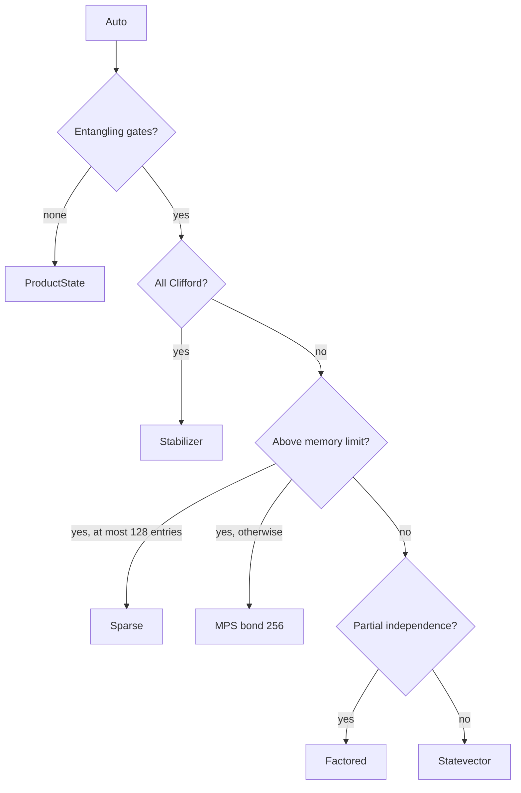

# PRISM-Q: quantum circuit simulator for Rust and Python

PRISM-Q reads the structure of each circuit and picks how to store its state: a
stabilizer tableau for Clifford circuits, a dense statevector for general ones, and a
sparse map, matrix product state, product state or factored form where the circuit
allows. One `simulate` call covers all of them, and the result says which one ran.

[](https://crates.io/crates/prism-q)
[](https://pypi.org/project/prism-q/)
[](https://docs.rs/prism-q)
[](https://github.com/AbeCoull/prism-q/actions/workflows/ci.yml)


```bash
pip install prism-q    # Python 3.11+, wheels for Linux, macOS arm64 and Windows
cargo add prism-q      # Rust 1.89+
```

## Quick start

```python
import prism_q

bell = prism_q.CircuitBuilder(2).h(0).cx(0, 1).build()
print(prism_q.simulate(bell).seed(42).run().probabilities)  # [0.5 0.  0.  0.5]

measured = prism_q.CircuitBuilder(2, 2).h(0).cx(0, 1).measure_all().build()
print(prism_q.simulate(measured).seed(42).shots(1000).counts())
# {'00': 507, '11': 493}: sampled, so the split moves with the seed
```

The same circuit in Rust:

```rust
use prism_q::{simulate, CircuitBuilder};

let bell = CircuitBuilder::new(2).h(0).cx(0, 1).build();
let result = simulate(&bell).seed(42).run().unwrap();
println!("{:?}", result.probabilities.unwrap().to_vec()); // [0.5, 0.0, 0.0, 0.5]
```

The Python package wraps the same engine, noise models, QEC programs and CUDA backends
included, and returns NumPy arrays.

## One API, several representations

```python
from prism_q import CircuitBuilder, circuits, simulate

def backend(circuit):
    return simulate(circuit).seed(42).run().metadata.backend

print(backend(circuits.qft(16)))    # Statevector
print(backend(circuits.ghz(1000)))  # Stabilizer

ghz_t = CircuitBuilder(60).h(0)
for q in range(59):
    ghz_t.cx(q, q + 1)
print(backend(ghz_t.t(0).build()))  # Sparse
```

The 16-qubit QFT runs on a dense statevector. The 1,000-qubit GHZ circuit is all
Clifford gates, so a stabilizer tableau of 2n × 2n bits holds it where 2^1000
amplitudes never could. Add one T gate to a 60-qubit GHZ circuit and the tableau no
longer applies, but only two of its 2^60 basis states are ever nonzero, so it runs on a
sparse map.

`BackendKind::Auto` walks this tree:



A few routes sit outside the tree. Circuits that split into independent blocks run per
block, shots on Clifford circuits go through compiled samplers, Clifford+T circuits with
few T gates can sample by stabilizer rank, and some expectation and marginal queries go
to Pauli propagation or tensor contraction. [Choosing a backend](https://abecoull.github.io/prism-q/getting-started/choosing-a-backend.html)
lists them with their thresholds. The rules read circuit structure and the memory
limit; they do not time the alternatives, so naming a backend can beat `Auto` on a
circuit the rules misjudge. The density matrix and distributed backends are never
picked automatically, and the GPU is used only when a device context is passed in.

## Performance

Before a circuit runs, a multi-pass fusion pipeline merges adjacent gates into larger
kernels. The statevector kernels use AVX2, FMA and BMI2 on x86-64 and NEON on ARM64,
picked at run time, and split across Rayon threads from 15 qubits. Optional features add
CUDA execution for the statevector, density-matrix and (experimental) stabilizer
backends, and an
MPI-distributed statevector for registers larger than one machine's memory.

Timings and the method behind them are on the
[Benchmarks](https://abecoull.github.io/prism-q/benchmarks.html) and
[Benchmark Methodology](https://abecoull.github.io/prism-q/guides/benchmarking.html)
pages. [Comparative Measurements](https://abecoull.github.io/prism-q/comparison.html)
runs the same circuits through other simulators with a committed harness in
[`comparison/`](comparison/README.md), so every number there can be reproduced.

## Documentation

| Task | Page |
| --- | --- |
| Install the crate or the wheel | [Installation](https://abecoull.github.io/prism-q/getting-started/install.html) |
| Work through a task end to end | [Tutorials](https://abecoull.github.io/prism-q/tutorials/index.html) |
| Use the simulator from Python | [Python Bindings](https://abecoull.github.io/prism-q/guides/python.html) |
| Look up the Rust API | [docs.rs/prism-q](https://docs.rs/prism-q) |
| Let the dispatcher pick a backend, or override it | [Choosing a Backend](https://abecoull.github.io/prism-q/getting-started/choosing-a-backend.html) |
| Compare the backends' memory and scaling | [Backends Deep Dive](https://abecoull.github.io/prism-q/guides/backends.html) |
| Check what runs where, and what is experimental | [Capability Matrix](https://abecoull.github.io/prism-q/guides/capabilities.html) |
| Check which OpenQASM constructs parse | [OpenQASM Support](https://abecoull.github.io/prism-q/guides/openqasm.html) |
| Add noise, detectors and decoding | [Noise and QEC](https://abecoull.github.io/prism-q/guides/qec.html) |
| Simulate Clifford+T circuits past the dense limit | [Clifford+T Simulation](https://abecoull.github.io/prism-q/guides/clifford-t.html) |
| Tune threads, tiles and memory caps | [Performance and SIMD](https://abecoull.github.io/prism-q/guides/performance.html) |
| Run on a CUDA device | [GPU Backend](https://abecoull.github.io/prism-q/guides/gpu.html) |
| Run across MPI ranks | [Distributed Statevector](https://abecoull.github.io/prism-q/guides/distributed.html) |
| Reproduce or extend the benchmarks | [Benchmark Methodology](https://abecoull.github.io/prism-q/guides/benchmarking.html) |
| Read how the layers fit together | [Architecture](https://abecoull.github.io/prism-q/architecture/overview.html) |
| Watch one gate go from matrix to SIMD lanes | [Interactive atlas](https://abecoull.github.io/prism-q/atlas/) ([source](docs/atlas/README.md)) |

Runnable scripts sit in [`bindings/python/examples`](bindings/python/examples) and
[`examples`](examples). Changes by release are in [`CHANGELOG.md`](CHANGELOG.md), and a
plain-text index of the docs for tools is at
[`llms.txt`](https://abecoull.github.io/prism-q/llms.txt).

If PRISM-Q is useful in your work, a star on GitHub helps other people find it.

## More examples

### Shots from OpenQASM

```rust
use prism_q::{bitstring, circuit::openqasm, simulate};

let qasm = r#"
    OPENQASM 3.0;
    include "stdgates.inc";
    qubit[2] q;
    bit[2] c;
    h q[0];
    cx q[0], q[1];
    c = measure q;
"#;

let circuit = openqasm::parse(qasm).unwrap();
let result = simulate(&circuit).seed(42).shots(1024).unwrap();
println!("{result}");
// 00: 517
// 11: 507

let counts = simulate(&circuit)
    .seed(42)
    .sample_counts(1024)
    .unwrap();
for (bits, count) in counts.into_counts() {
    println!("{}: {count}", bitstring(&bits, circuit.num_classical_bits));
}
```

Count keys and measurement bits are LSB-first: the leftmost character is classical bit
0, and `q[0]` is the least significant qubit of a statevector index. This is the reverse
of Qiskit's order. `run_qasm(source, seed)` parses and runs in one call.

### Expectation values and marginals

```rust
use prism_q::{simulate, CircuitBuilder, PauliTerm};

let bell = CircuitBuilder::new(2).h(0).cx(0, 1).build();

let observables = [
    vec![PauliTerm::z(0), PauliTerm::z(1)],
    vec![PauliTerm::x(0), PauliTerm::x(1)],
];
let values = simulate(&bell).seed(42).expectation_values(&observables).unwrap();
// [1.0, 1.0]: ⟨ZZ⟩ and ⟨XX⟩ on the Bell state.

let marginals = simulate(&bell).seed(42).marginals().unwrap();
// Per-qubit (P(0), P(1)) pairs: [(0.5, 0.5), (0.5, 0.5)].
```

An observable is a product of single-qubit Paulis with identity factors omitted.
Clifford circuits propagate it exactly, and past the statevector memory budget the
selected backend answers from its own representation. To start somewhere other than
|0...0⟩, pass `initial_state` a normalized amplitude vector of length 2^n, qubit 0 in
the least significant bit.

### Parameters and gradients

Mark angles as parameters while building, then rebind without rebuilding.
`PreparedCircuit` reuses one fusion plan across bindings and falls back to a full
fusion pass when a binding changes what fusion would emit.

```rust
use prism_q::{simulate, CircuitBuilder, PauliTerm, PreparedCircuit};

let (template, params) = CircuitBuilder::new(2)
    .ry(0.0, 0)
    .param(0)
    .cx(0, 1)
    .rz(0.0, 1)
    .param(1)
    .build_parametric();

let bound = params.bind(&template, &[0.3, 1.1]).unwrap();
let result = simulate(&bound).seed(42).run().unwrap();

let mut prepared = PreparedCircuit::new(template, params.clone()).unwrap();
let fused = prepared.bind_fused(&[0.4, 1.2]).unwrap();

let hamiltonian = vec![(1.0, vec![PauliTerm::z(0)])];
let g = simulate(&bound)
    .seed(42)
    .expectation_gradient(&hamiltonian, &params)
    .unwrap();
println!("<H> = {}, gradient = {:?}", g.value, g.gradient);
```

`expectation_gradient` uses the adjoint method on the statevector backend.
`expectation_gradient_shift` uses the parameter-shift rule and covers the backends and
circuit shapes the adjoint declines.

The [Tutorials](https://abecoull.github.io/prism-q/tutorials/index.html) cover sampling,
variational gradients, noise, a QEC memory experiment, dynamic circuits and wide
structured circuits, in Python with the Rust equivalents:

```bash
python bindings/python/examples/qec_memory.py
cargo run --release --example qec_memory
```

## Backends

| Backend | Best for | Scaling | Key property |
| --- | --- | --- | --- |
| Statevector | General circuits | O(2ⁿ) | SIMD, tiled L2/L3 kernels, optional CUDA path |
| Stabilizer | Clifford only | O(n²) | SIMD, thousands of qubits |
| Factored Stabilizer | Clifford with independent blocks | O(n²) per cluster | Per-cluster tableaux, dynamic merge and split |
| Sparse | Few live amplitudes | O(k) | HashMap with parallel measurement |
| MPS | Low entanglement or 1D | O(nχ²) | Hybrid faer / Jacobi SVD |
| Product State | No entanglement | O(n) | Per qubit |
| Tensor Network | Low treewidth | Depends on contraction order | Greedy min size heuristic |
| Factored | Partial entanglement | Dynamic | Tracks independent sub-states |
| Density Matrix | Exact noisy evolution | O(4ⁿ) | Explicit dispatch only, reuses statevector kernels |
| Distributed Statevector | Beyond single-host memory | O(2ⁿ) over MPI ranks | `distributed` feature, exact results |

Beside them sit Clifford+T engines (stabilizer rank and Pauli propagation) and a native
quantum error-correction program path with detector sampling and decoding.

The statevector memory budget is half the machine's physical memory, read once and
cached. `Limits` overrides it or any single cap, per request with `.limits(...)` or for
the process with `set_default_limits`, and the `PRISM_MAX_*` variables set the same caps
from the environment.

To choose a backend yourself, call `.backend(BackendKind::Stabilizer)` (or
`BackendKind::Mps { max_bond_dim: 64 }`, `BackendKind::Sparse`, and so on) on the
`simulate` builder. The [backends deep dive](https://abecoull.github.io/prism-q/guides/backends.html)
covers when each one wins.

## OpenQASM

The parser reads OpenQASM 3.0 and the compatible subset of 2.0. It accepts the
`stdgates.inc` set, common controlled and multi-controlled variants, Qiskit exporter
gates, IonQ and Google/Cirq native gate names, decomposed multi-instruction gates, IBM
legacy u1/u2/u3, and user-defined `gate` declarations. The `inv @`, `ctrl @` and
`pow(k) @` modifiers chain on direct gates. `qasm_export::to_qasm3` writes a `Circuit`
back out as OpenQASM 3.0 that re-parses to the same instruction stream with inline
angles exact; fused payloads have no OpenQASM spelling and are rejected with an error
naming the instruction.

The [OpenQASM guide](https://abecoull.github.io/prism-q/guides/openqasm.html) lists the
accepted subset and what each unsupported construct returns. The parser itself,
[`src/circuit/openqasm.rs`](src/circuit/openqasm.rs) (`resolve_gate()` and
`resolve_decomposed_gate()`), is the authoritative gate list.

## GPU

The `gpu` feature builds without a CUDA toolkit and loads the NVIDIA driver and NVRTC
at run time, compiling PTX for the device's compute capability. Running it needs a CUDA
device, a CUDA 12 driver, and NVRTC from a CUDA 12 toolkit or the `cuda12` Python extra.
Build with `cargo build --release --features "parallel gpu"`, then opt in through the
simulation builder:

```rust,ignore
use prism_q::{gpu::GpuContext, simulate};

let ctx = GpuContext::new(0)?;
let result = simulate(&circuit).gpu(ctx).seed(42).run()?;
```

The circuit still goes through fusion and subsystem decomposition, and a size crossover
keeps small sub-circuits on the CPU. `simulate(&circuit).gpu_auto(ctx)` runs automatic
dispatch with the device opted in, `BackendKind::StabilizerGpu` runs Clifford circuits
on the device, and `CompiledSampler::with_gpu(ctx)` moves large compiled BTS shot
counts onto it. The [GPU guide](https://abecoull.github.io/prism-q/guides/gpu.html)
covers the kernels, the crossover thresholds and their environment overrides.

## Distributed execution (MPI)

The `distributed` feature shards one exact statevector across `2^p` ranks: the top `p`
qubits select the rank and the rest index a local slice that runs on the same SIMD
kernels and fusion pipeline as the single-host backend. `distributed-mpi` adds the MPI
transport over `rsmpi` and needs a system MPI installation.

```rust,ignore
use prism_q::{distributed::DistributedContext, simulate};

let context = DistributedContext::world()?;   // MPI_Init at MPI_THREAD_FUNNELED
let result = simulate(&circuit).distributed(context).seed(42).run()?;
```

Results do not depend on the rank count. The
[distributed guide](https://abecoull.github.io/prism-q/guides/distributed.html) covers
the layout, the qubit relabeling that keeps busy qubits local, the launch scripts, and
the limits (power-of-two ranks, no noise models, CPU only).

## Benchmarks

```bash
cargo bench --bench circuits     --features parallel         # circuit macrobenchmarks
cargo bench --bench bench_driver --features parallel         # gate microbenchmarks
cargo bench --bench bench_gpu    --features "parallel gpu"   # GPU dispatch benchmarks
```

Baselines were taken with `parallel` enabled, so keep it on. Run one `cargo bench` at a
time: concurrent Rayon pools contend for cores and skew results. `RAYON_NUM_THREADS`
caps the thread count. The circuit definitions, the warmup and timing rules, and how to
run a like-for-like comparison against another simulator are in
[Benchmark Methodology](https://abecoull.github.io/prism-q/guides/benchmarking.html).
The A/B and regression workflow used for PRs is in [`CONTRIBUTING.md`](CONTRIBUTING.md)
and [`benches/README.md`](benches/README.md).

## Roadmap

- Multi-GPU and distributed GPU execution. A GPU context binds one device and the
  distributed backend is CPU only; sharding one statevector across devices also needs
  peer access, since a host-staged exchange costs far more than the gate it serves.
- ROCm ports of the CUDA statevector and stabilizer kernels.
- Noisy shots on the distributed backend, which rejects noise models today. The
  [distributed guide](https://abecoull.github.io/prism-q/guides/distributed.html#what-runs-distributed)
  describes the planned lockstep route.

## Contributing

[`CONTRIBUTING.md`](CONTRIBUTING.md) has the build, test, coverage, profiling and
benchmark workflow. The [architecture reference](docs/architecture/overview.md) covers
the layered design, backend trait, SIMD strategy, fusion pipeline and compiled samplers.
Bug reports and questions go to [issues](https://github.com/AbeCoull/prism-q/issues)
and [discussions](https://github.com/AbeCoull/prism-q/discussions).

## Citing

[`CITATION.cff`](CITATION.cff) carries the citation metadata; GitHub renders it under
"Cite this repository". Name the release version used, since timings and dispatch
rules change between releases.

## License

Dual-licensed under MIT or Apache-2.0, at your option.
