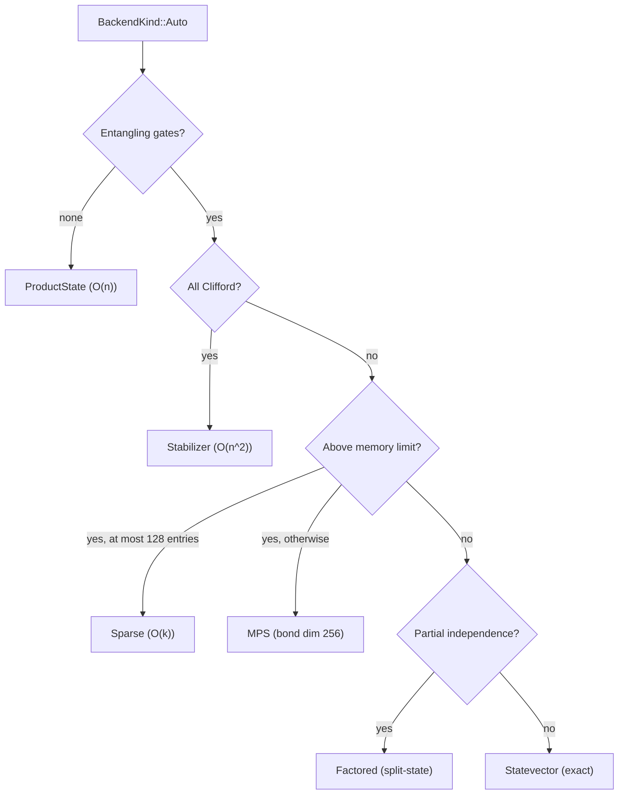

# Simulation Engine and Dispatch

## Backend trait

```rust
pub trait Backend {
    fn name(&self) -> &'static str;
    fn init(&mut self, num_qubits: usize, num_classical_bits: usize) -> Result<()>;
    fn apply(&mut self, instruction: &Instruction) -> Result<()>;
    fn classical_results(&self) -> &[bool];
    fn probabilities(&self) -> Result<Vec<f64>>;
    fn num_qubits(&self) -> usize;

    // Optional overrides:
    fn apply_instructions(&mut self, instructions: &[Instruction]) -> Result<()>;  // batch apply
    fn supports_fused_gates(&self) -> bool;   // false for symbolic backends (stabilizer)
    fn export_statevector(&self) -> Result<Vec<Complex64>>;  // for backend transitions
}
```

Contract: `init` before `apply`. Instructions arrive in circuit order. Measurement is destructive. Deterministic given same RNG seed.

## Entry points

Orchestration layer in `src/sim/mod.rs`.

| Function | Description |
|----------|-------------|
| `simulate(circuit).seed(seed).run()` | Auto-dispatch, full output |
| `simulate(circuit).backend(kind).seed(seed).run()` | Explicit backend selection |
| `simulate(circuit).seed(seed).shots(shots)` | Multi-shot sampling |
| `simulate(circuit).backend(kind).seed(seed).shots(shots)` | Multi-shot with backend selection |
| `simulate(circuit).backend(kind).noise(noise).seed(seed).shots(shots)` | Noisy multi-shot |
| `simulate(circuit).backend(density_matrix).noise(noise).seed(seed).run()` | Exact noisy distribution |
| `simulate(circuit).backend(density_matrix).noise(noise).seed(seed).marginals()` | Exact noisy marginals |
| `simulate(circuit).backend(density_matrix).noise(noise).seed(seed).expectation_values(obs)` | Exact `Tr(rho P_k)` |
| `simulate(circuit).seed(seed).sample_counts(shots)` | Auto-dispatched frequency histogram |
| `simulate(circuit).backend(kind).seed(seed).sample_counts(shots)` | Frequency histogram with backend selection |
| `simulate(circuit).seed(seed).marginals()` | Auto-dispatched per-qubit marginal probabilities |
| `simulate(circuit).backend(kind).seed(seed).marginals()` | Per-qubit marginal probabilities with backend selection |
| `simulate(circuit).seed(seed).expectation_values(observables)` | `⟨P_k⟩` per Pauli string |
| `simulate(circuit).seed(seed).expectation_gradient(hamiltonian, params)` | `⟨H⟩` and adjoint gradient |
| `simulate(circuit).backend(kind).seed(seed).expectation_gradient_shift(hamiltonian, params)` | `⟨H⟩` and parameter-shift gradient |
| `run_on(backend, circuit)` | Pre-constructed backend |
| `run_qasm(qasm, seed)` | Parse + simulate |

`RunOutcome::probabilities` is `None` only when the backend has no dense probability
terminal for the circuit: sparse, MPS, stabilizer, factored or product above
`PRISM_MAX_PROB_QUBITS`, or a register too wide to index. A statevector or tensor-network
run above that cap is an error naming it, since the register already fits the state.
Other extraction failures propagate as errors too.

`marginals()` needs a direct Pauli marginal route or backend probabilities, and returns
`BackendUnsupported` when it has neither rather than fabricating uniform marginals. The
stochastic and deterministic Pauli backends accept only unitary circuits of Clifford gates
and Pauli rotations, with no measurement, reset or conditional. `T`, `Tdg`, `Rz`, `P` and
`Rzz` branch natively. `Rx`, `Ry` and multi-qubit `PauliRot` lower to Clifford conjugation
around one `Rz`; `Fused` matrices lower to the named gate they equal up to phase, or to an
Euler triple; a `Cu` with a diagonal or Pauli target lowers to Z rotations and Cliffords.
Automatic dispatch sends only Clifford+T circuits to SPD (rotations at multiples of pi/4
count as Clifford or T), so arbitrary angles reach the Pauli engines only by explicit
selection.

## Noise across the terminals

The selected backend, not the terminal, fixes how a noise model is applied.

Backends holding a pure state per shot average trajectories: each shot re-evolves the
circuit with sampled channels, and a distribution converges as `1/sqrt(shots)`. Only
`shots` and `sample_counts` take that route, since one trajectory is not an answer to
`run`, `marginals` or `expectation_values`.

The density matrix holds the mixture, so `shots` means one exact evolution followed by a
draw per shot. Every terminal reads that evolution: `run` and `marginals` return the exact
noisy distribution, `expectation_values` the exact `Tr(rho P)`, and `shots` and
`sample_counts` carry sampling noise but no trajectory variance. Readout error applies to
drawn outcomes on its own RNG stream, so `run` and `marginals` reject a model carrying it
rather than return a distribution the sampled terminals would contradict.

The mixture holds every measurement branch and never chooses one, so a circuit with
mid-circuit measurement or classical conditioning is rejected on this route, with or
without noise: the outcome a later gate depends on was never fixed. The check sits on the
evolution, so `density_matrix_expectation_values` refuses the same circuits as the
`Simulate` terminals, and they stay on trajectory averaging. The density matrix is also
left out of the branching families of `tests/integration/conformance_matrix.rs`, where it
serves as the mixture oracle.

`expectation_gradient` rejects a noise model on every backend, because the adjoint method
backpropagates through a pure state. `expectation_gradient_shift` accepts one on the
density-matrix kinds: the channels do not depend on the shifted angle, so the shift rule
holds and each of the `1 + 2 * links` evaluations reads the exact mixture. Other backends
reject the pair, naming the density matrix.

## Result provenance

Every terminal's result carries a `RunMetadata`: the resolved engine, whether it is
exact, where the state lived, and the shot count for a sampled result. An approximate
backend chosen by `Auto` is reported as such and refused only through `require_exact()`,
because refusing by default would remove the only route an oversize non-sparse circuit
has.

An MPS run also carries `bond`, a `BondReport` of the peak bond dimension any cut kept
against the configured cap; `saturated()` says the cap bound the run.
`Exactness::Approximate` marks the route whether or not the cap was reached. Other
backends leave `bond` as `None`.

`require_exact()` resolves the route from the circuit and errors before allocating.
Exactness depends on route and circuit together: an oversize circuit of diagonal and
permutation gates holds one basis state, so its MPS never leaves bond 1 and is accepted.
Sparse Pauli dynamics truncates on coefficient magnitudes it learns only while
propagating, so that route is caught by a second check on the finished result. Both
checks run in every terminal.

## Auto-dispatch decision tree



The memory limit comes from detected physical memory: half of it is the budget,
and the cap is the widest register whose `2^n` `Complex64` amplitudes fit, so 29
qubits on a 16 GiB host and 30 on 32 GiB. `PRISM_MAX_SV_QUBITS` overrides it with
a qubit count, and an unparseable value warns and leaves detection in charge
rather than disabling the cap. When detection itself fails the cap is disabled,
with a warning on stderr: a register too wide for the machine then aborts on
allocation rather than routing to another backend, since there is no figure left
to route against. `src/backend/memory.rs` holds the derivation and the other
dense caps that share it.

Past the limit, dispatch runs the gates on a sparse map and takes it when the map never
holds more than 128 entries, as a W state does. A sparse gate costs about 8 ns per
entry and an MPS gate about 2 us even at bond 2, so the MPS wins past that on a
circuit that barely entangles. A circuit whose gates only permute or phase basis
states stays on one entry and skips the run.

For a user-facing version of this decision, see [Choosing a Backend](../getting-started/choosing-a-backend.md).

### Routes the tree does not show

The tree is the family choice for a state terminal. Five more routes are reachable under
`Auto`, each tested before the tree and each with its own constants, in
`src/sim/dispatch.rs` and `src/sim/mod.rs`:

| Route | Taken when |
| --- | --- |
| Factored stabilizer | Clifford only, the circuit splits into independent components, at least 16 qubits, and the largest component is at least 2 |
| Stabilizer rank, sampled | Shots with terminal measurements only, above 25 qubits, T count at most 40 and at most `n - 2⌈log2 n⌉`; also per-shot runs with mid-circuit measurement inside the same T bound |
| Deterministic Pauli marginals | A marginals terminal on a unitary Clifford+T circuit of at least 12 qubits. The propagation is exact, and at or below the statevector cap it hands over to the tree once its summed term count passes the dense run's amplitude updates divided by 64 |
| Scalar tensor contraction | An expectation or marginals terminal whose planned contraction stays inside the peak bound |
| Temporal Clifford split | A circuit at or below the statevector cap that is not Clifford only and opens with a Clifford prefix long enough to pay for the handover |

Each answers where the tree would have said statevector or stabilizer, so the backend a
result reports is the only reliable record of what ran. See
[what a backend reports](backends.md#what-a-backend-reports-about-its-own-result).

## Start states other than |0...0>

`Simulate::initial_state` bypasses the tree. Every branch of it reads circuit structure
and is sound only from the all-zero start: a Clifford circuit yields a stabilizer state
only from a stabilizer input, the product state and subsystem split assume an unentangled
input, and the Pauli engines propagate observables back to |0...0>. Any of them on an
arbitrary start returns a wrong answer, not an error, so `initial_state_plan` in
`src/sim/dispatch.rs` constrains the route instead:

- `Auto` resolves to the statevector, with no memory check, since a caller holding `2^n`
  amplitudes can already afford the dense state.
- `StatevectorDistributed` starts the sharded statevector from it; every rank receives
  the full vector and keeps the slice its rank bits select.
- `DensityMatrix` takes it as the pure mixture `|psi><psi|`.
- Every other kind returns `IncompatibleBackend`.

The vector is validated first: `2^n` entries for the circuit's `n` qubits, all finite,
unit norm to 1e-9. An unnormalized vector is rejected, not rescaled, because the load
resets the statevector's deferred-normalization factor to 1 and a silent rescale would
hide the error inside it.

`Simulate::initial_density_matrix` is the mixed-state counterpart. It takes the `4^n`
buffer `DensityMatrixBackend::density_matrix` exports, row-major `2^n x 2^n` with qubit 0
the least significant bit of both indices, so a mixture can be stored between runs or
composed from two evolutions. Only `DensityMatrix` and `DensityMatrixGpu` accept one;
`initial_state_plan` declines every other kind by name, `Auto` included, since automatic
dispatch never selects the density matrix. `Backend::init_from_density_matrix` validates
before sizing the register: `4^n` entries, all finite, each entry pair Hermitian to 1e-12
(scaled by the larger magnitude once that exceeds 1), and unit trace to 1e-9, with
`InvalidParameter` naming the failed check. Positive semidefiniteness is not checked,
because that needs an eigendecomposition the backend does not carry, so a mixture with a
negative eigenvalue evolves without complaint. The host backend takes ownership of the
buffer; the device uploads it in one transfer instead of forming the pure-state outer
product.

## Subsystem decomposition

Union-find finds independent qubit groups in O(n·α(n)), and each block runs separately.
Under `Auto` each block picks its own backend; under an explicit kind every block runs
that kind. The merged result reports `Decomposed` and lists each block's engine in
`RunMetadata::blocks`. Clifford-only circuits skip the split on an explicit
`FactoredStabilizer`, and under `Auto` from 16 qubits once a block holds two or more,
because that backend already keeps one tableau per cluster and merges and splits them as
the circuit runs. Results merge lazily through `Probabilities::Factored`, a Kronecker
product evaluated per element in O(K); the O(2^N) dense vector is built only on request.

Blocks run in parallel under Rayon only when every block is below 15 qubits
(`src/sim/decomposed.rs`), so block threads do not oversubscribe the kernels' own
parallelism.

## Temporal Clifford decomposition

Under `Auto`, a circuit that is not Clifford only and opens with a Clifford prefix of at least `max(2n, 16)` gates (`min_clifford_prefix_gates` in `src/sim/dispatch.rs`) runs that prefix on the stabilizer backend and exports the state to the statevector for the tail. The saving is the dense cost of the prefix, not memory: the route requires the register to fit the statevector cap.

## Expectation-value gradients

The caller picks the method: the adjoint is the default and the reference, parameter
shift covers what it declines. The two differ by a factor of `2 * links` in evaluation
count, so the engine does not choose silently.

### Adjoint method

`sim::gradient::run_expectation_gradient(circuit, hamiltonian, params, seed)` and
`simulate(circuit).seed(seed).expectation_gradient(hamiltonian, params)` compute `⟨H⟩`
and the exact gradient `d⟨H⟩/dθ` for a weighted Pauli sum `H = Σ c_k P_k`, given as a
`PauliObservable`, at a cost independent of the parameter count. Implementation in
`src/sim/gradient.rs`. `PreparedCircuit::expectation_gradient` runs the same pass on a
held template, applying its replayed fusion plan as the forward pass.

Two statevectors are propagated backwards. With `U = U_L…U_1` and `|φ⟩ = U|0⟩`:

1. Forward pass (fused) keeps `|φ⟩`. Build `|λ⟩ = H|φ⟩`; the value is
   `Re⟨φ|λ⟩`.
2. Sweep `i = L…1`. For a trainable gate with generator `G_i`, accumulate
   `Im⟨λ|G_i|φ⟩` (projector form for `P`), then step both states back through
   `U_i†` (`Gate::inverse()`).

The sweep is not gate by gate. A gate can be inverted once every gate above it that it
does not commute with has been, and a trainable gate's sandwich can be read once every
gate still above it commutes with its generator. A planner assigns each gate its earliest
such step, so one sandwich pass serves every gate ready at the same time (an Rz layer,
then an Ry layer of a hardware-efficient ansatz, instead of one pass per qubit). Gates
inverted between two steps go through the fusion pipeline at the state width and apply to
both states as one stretch. Commutation is structural: exact between two Pauli rotations,
and per qubit otherwise, with each gate acting on a qubit as Z, X, Y, or anything.

The sandwich `⟨λ|G|φ⟩` is the forward `pauli_expectation_from_masks` kernel generalized
to two vectors (`pauli_sandwich`, Rayon-parallel at 16+ qubits).

Differentiable gates are `Rx`, `Ry`, `Rz`, `Rzz`, `P` and `PauliRot`, identified by the
method `Gate::pauli_generator` so `Gate` stays 16 bytes. A multi-qubit Pauli rotation is
`exp(-iθP/2)`, so its generator is the string itself: `GeneratorKind::RotPauli` borrows
the letters off the gate and the sandwich takes the masks they imply. Trainable links on
other gates, non-unitary instructions and `QftBlock` are rejected. Parameters are an
index-based side table (`Parameters`, instruction to slot links recorded by
`CircuitBuilder::param`); many gates may share a slot.

The planner reads the unfused instruction stream so each gate keeps its 1:1 link to its
generator, which fusion would erase along with the stored angle. Only the forward pass and
the inverted stretches are fused. Three prunings cut work without changing results: the
sweep stops at the earliest trainable gate in the cone, so a non-trainable prefix costs
no inverse applications; a gate no trainable gate below it waits on is never inverted;
and a trainable gate outside the Hamiltonian's inverse light cone has a zero gradient, so
its sandwich is skipped.

Memory is two statevectors, so the qubit ceiling is about one below a single run. Only
the statevector backend is supported.

### Parameter shift (fallback)

`sim::gradient::run_expectation_gradient_shift(circuit, hamiltonian, params, seed)` and
`simulate(circuit).backend(kind).seed(seed).expectation_gradient_shift(hamiltonian,
params)` evaluate `d⟨H⟩/dθ = (f(θ+π/2) - f(θ-π/2)) / 2` per trainable gate, exactly, from
forward `expectation_values` calls. It inherits whatever the selected backend can
represent: Sparse, MPS, Factored, ProductState, DensityMatrix and Distributed, widths past
the statevector cap, and circuits containing `QftBlock`. A backend with no native
observable path reports `BackendUnsupported` naming itself.

The rule is exact because each differentiable gate is `exp(-iθG/2)` with `G` of
eigenvalues `±1`, so `⟨H⟩` is a degree-1 trigonometric polynomial in that angle. `P(θ)`
has the projector `|1⟩⟨1|` as generator, eigenvalues `{0, 1}`, but `P(θ) = e^{iθ/2}
Rz(θ)` and the scalar cancels against its conjugate in `⟨ψ|H|ψ⟩` wherever the gate sits,
so the same shift applies.

The gate set is the adjoint's: `Rx`, `Ry`, `Rz`, `Rzz`, `P` and `PauliRot` are the `Gate`
variants carrying an angle, so parameter shift reaches no gate the adjoint rejects. It
extends the backends and circuit shapes, not the gates. A `PauliRot` on a backend without
the native kernel is shifted in place, because the ladder expansion happens below the
forward evaluation.

Gates sharing a slot are shifted one at a time and their contributions summed. Shifting
them together gives a different quantity: two `Rx(θ)` on one qubit under `⟨Z⟩` give
`cos 2θ`, whose joint ±π/2 shift is zero rather than `-2 sin 2θ`.

Cost is `1 + 2 * links` evaluations against the adjoint's one, with no light-cone pruning:
a trainable gate with a zero gradient is still evaluated twice. Evaluations run in
sequence, because each already drives a Rayon-parallel backend run and several in flight
would multiply peak state memory by the parameter count, the resource this path exists to
stay under.

## Backend dispatch variants

The `BackendKind` variants outside feature gates. `AutoGpu`, `StatevectorGpu`,
`DensityMatrixGpu` and `StabilizerGpu` sit behind `gpu` (see the
[GPU guide](../guides/gpu.md)), and `StatevectorDistributed` behind `distributed`.

| Variant | Backend | Selection |
|---------|---------|-----------|
| `Auto` | Decision tree (see above) | Default |
| `Statevector` | Full state-vector | Explicit |
| `Stabilizer` | Aaronson-Gottesman tableau | Explicit or auto (all Clifford) |
| `FactoredStabilizer` | Per-cluster tableaux | Explicit or auto (large independent Clifford blocks) |
| `Sparse` | HashMap state | Explicit or auto (above memory limit, at most 128 entries) |
| `Mps { max_bond_dim }` | Matrix Product State | Explicit or auto (above memory limit) |
| `ProductState` | Per-qubit product | Explicit or auto (no entangling) |
| `TensorNetwork` | Deferred contraction | Explicit, or auto for an expectation or marginals terminal on a unitary circuit when a bounded greedy plan for every observable stays under `2^12` elements: from 18 qubits under the statevector cap, and above it when `Auto` would take MPS and the plan costs less than an estimate of the MPS run |
| `TensorNetworkBounded { tolerance }` | Deferred contraction with truncation past the peak cap | Explicit |
| `Factored` | Dynamic split-state | Explicit or auto (partial independence) |
| `DensityMatrix` | Exact mixed state | Explicit |
| `StabilizerRank` | Weighted stabilizer sum, or a Clifford tableau over a dense T register for terminal shots | Explicit, or auto for shots (Clifford+T from 16 qubits with fewer T gates than qubits and at most 20, or past the statevector cap inside the size-derived T budget); never auto for probabilities |
| `StochasticPauli { num_samples }` | SPP | Explicit |
| `DeterministicPauli { truncation }` | SPD | Explicit, or auto for marginals on a unitary Clifford+T circuit of at least 12 qubits and for expectation values on a Clifford circuit |
| `PauliPath { epsilon, max_terms }` | Noisy Heisenberg Pauli sum | Explicit |


## Query route inspection

`Simulate::plan(Query)` and terminal execution share the shot, noisy-trajectory,
marginal, expectation and diagnostic decisions in `sim::route`. A decision holds backend
plans and bounded tensor contraction plans, which execution consumes. Backend sampling
capabilities are readable before a backend is constructed.

The report separates the selected route from runtime alternatives: bounded SPD work can
decline at execution, and soft GPU initialization can lose device residency.
`Plan::fallbacks` declares those possibilities and `RunMetadata::reason` records one
actually taken. `would_fail` reports predictable failures; malformed query inputs return
an error. Query-specific exactness checks admit exact marginal and expectation routes
even where the full-state tree would choose MPS.

Gradient queries carry their Hamiltonian and parameter links. Parameter-shift plans reuse
the prepared-family decision when execution does, and report each evaluation in baseline,
plus, minus order. Deterministic differences between shifted evaluations are not reported
as runtime fallbacks.
