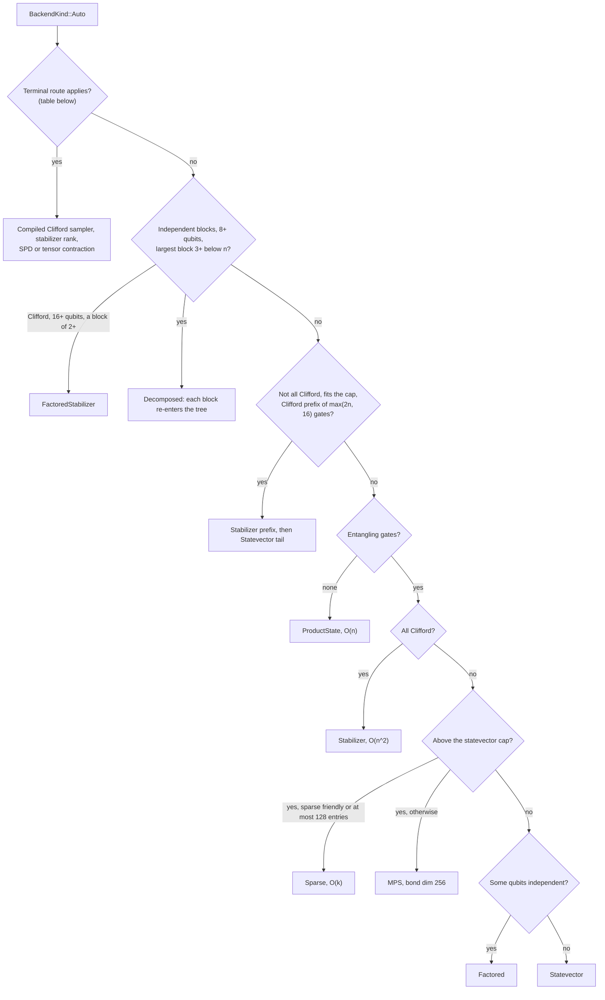

# Simulation Engine and Dispatch

## Backend trait

`Backend` in `src/backend/mod.rs` is sealed: only the crate's own backends implement it,
so a method can be added without a breaking release. Six methods are required and about
35 more have defaults. The sketch shows the required set, and the
[rustdoc page](https://docs.rs/prism-q/latest/prism_q/backend/trait.Backend.html) lists
every method.

```rust
pub trait Backend: sealed::Sealed {
    fn name(&self) -> &'static str;
    fn init(&mut self, num_qubits: usize, num_classical_bits: usize) -> Result<()>;
    fn apply(&mut self, instruction: &Instruction) -> Result<()>;
    fn classical_results(&self) -> &[bool];
    fn probabilities(&self) -> Result<Vec<f64>>;
    fn num_qubits(&self) -> usize;

    // Defaulted: provenance (resolved, exactness, placement, bond_report), start
    // states, batch and region apply, fusion profile, native sampling, Pauli
    // expectations, reduced density matrices, entropy, overlap, reset.
}
```

Contract: `init` before `apply`. Instructions arrive in circuit order. Measurement is
destructive. Results are deterministic for a given RNG seed.

## Entry points

The orchestration layer is `src/sim/mod.rs`. `simulate(&circuit)` returns a `Simulate`
builder; `.backend(kind)`, `.noise(&model)`, `.limits(limits)`, `.initial_state(..)` and
`.require_exact()` configure it, `.seed(seed)` arms it, and one terminal runs it.

| Terminal or function | Returns |
|----------------------|---------|
| `run()` | `RunOutcome`: probabilities, classical bits, save records, metadata |
| `shots(n)`, `sample_counts(n)` | Per-shot records, or a histogram |
| `marginals()` | P(1) per qubit |
| `expectation_values(obs)` | `⟨P_k⟩` per Pauli string |
| `observable_expectation(h)`, `observable_variance(h)` | Weighted Pauli sum, see [weighted observables](#weighted-observables) |
| `expectation_gradient(h, params)` | `⟨H⟩` and the adjoint gradient |
| `expectation_gradient_shift(h, params)` | `⟨H⟩` and the parameter shift gradient |
| `reduced_density_matrix(qubits)`, `entanglement_entropy(qubits)`, `overlap(other)` | State diagnostics, see [Backends](./backends.md#state-diagnostics) |
| `state_vector()`, `probabilities_of(qubits)` | Dense amplitudes, or a marginal distribution |
| `plan(query)` | The route a terminal would take, without running it; see [query route inspection](#query-route-inspection) |
| `run_on(backend, circuit)`, `run_on_state(backend, circuit, amps)` | A run on a backend the caller built, from `|0...0>` or from given amplitudes |
| `sim::run_batch(circuits, kind, seed)` | One result per circuit, holding one backend where widths match |
| `run_qasm(qasm, seed)` | Parse and run |
| `simulate_program(&program)` | The builder for a `DynamicProgram`; see [Dynamic Programs](./dynamic-programs.md) |

`RunOutcome::probabilities` is `None` only when the backend has no dense probability
terminal for the circuit: sparse, MPS, stabilizer, factored or product above
`PRISM_MAX_PROB_QUBITS`, or a register too wide to index. A statevector or tensor network
run above that cap is an error naming it, since the register already fits the state.
Other extraction failures propagate as errors too.

`marginals()` needs a direct Pauli marginal route or backend probabilities, and returns
`BackendUnsupported` when it has neither rather than fabricating uniform marginals. The
stochastic and deterministic Pauli backends accept only unitary circuits of Clifford gates
and Pauli rotations, with no measurement, reset or conditional. `T`, `Tdg`, `Rz`, `P` and
`Rzz` branch natively, and the deterministic engine also branches on `Rx` and `Ry`. The
stochastic engine lowers `Rx` and `Ry`, and both lower multi-qubit `PauliRot`, to Clifford
conjugation around one `Rz`. `Fused` matrices lower to the named gate they equal up to
phase, or to an Euler triple, and a `Cu` with a diagonal or Pauli target lowers to Z
rotations and Cliffords.
Automatic dispatch sends only Clifford+T circuits to SPD (rotations at multiples of pi/4
count as Clifford or T), so arbitrary angles reach the Pauli engines only by explicit
selection.

## Noise across the terminals

The selected backend, not the terminal, fixes how a noise model is applied. How a model
compiles into events is on [Noise Compilation](./noise.md).

Backends holding a pure state per shot average trajectories: each shot evolves the
circuit again with sampled channels, and a distribution converges as `1/sqrt(shots)`.
Only `shots` and `sample_counts` take that route, since one trajectory is not an answer
to `run`, `marginals` or `expectation_values`.

The density matrix holds the mixture, so `shots` means one exact evolution followed by a
draw per shot. Every terminal reads that evolution: `run` and `marginals` return the exact
noisy distribution, `expectation_values` the exact `Tr(rho P)`, and `shots` and
`sample_counts` carry sampling noise but no trajectory variance. Readout error applies to
drawn outcomes on its own RNG stream, so `run` and `marginals` reject a model carrying it
rather than return a distribution the sampled terminals would contradict.

The mixture holds every measurement branch and never chooses one, so a circuit with
mid-circuit measurement or classical conditioning is rejected on this route, with or
without noise: the outcome a later gate depends on was never fixed. The check sits on the
evolution, so `density_matrix_expectation_values` refuses the same circuits as the
`Simulate` terminals, and they stay on trajectory averaging. The density matrix is also
left out of the branching families of `tests/integration/conformance_matrix.rs`, where it
serves as the mixture oracle.

`expectation_gradient` rejects a noise model on every backend, because the adjoint method
backpropagates through a pure state. `expectation_gradient_shift` accepts one on the
density matrix kinds: the channels do not depend on the shifted angle, so the shift rule
holds and each of the `1 + 2 * links` evaluations reads the exact mixture. Other backends
reject the pair, naming the density matrix.

## Result provenance

Every terminal's result carries a `RunMetadata`. The
[Capability and Support Matrix](../guides/capabilities.md#what-kind-of-answer-a-result-is)
lists its fields and what `Approximate` means, and
[Backends](./backends.md#what-a-backend-reports-about-its-own-result) how a backend fills
them.

`require_exact()` resolves the route from the circuit and errors before allocating.
Exactness depends on route and circuit together: an oversize circuit of diagonal and
permutation gates holds one basis state, so its MPS never leaves bond 1 and is accepted.
Sparse Pauli dynamics truncates on coefficient magnitudes it learns only while
propagating, so that route is caught by a second check on the finished result. Both
checks run in every terminal.

## Auto-dispatch decision tree

`BackendKind::Auto` resolves in `src/sim/route.rs` and `src/sim/dispatch.rs`
(`plan_probability_route`, then `select_auto_backend_choice`). Terminal routes come
first; the rest of the tree is the state route every terminal falls back to.



The statevector cap is half of physical memory, about 29 qubits on a 16 GiB host, and
`PRISM_MAX_SV_QUBITS` overrides it. [Backends](./backends.md#memory-budget) holds the
derivation and the other caps.

A circuit with no entangling gate at 8 qubits or more meets the block split first and
runs as one product state block per qubit. Shots skip the split and sample the product
state directly ([Compiled Samplers](./samplers.md)).

Past the cap, dispatch runs the gates on a sparse map and takes it when the map never
holds more than 128 entries, as a W state does. A sparse gate costs about 8 ns per entry
and an MPS gate about 2 us even at bond 2, so the MPS wins past that on a circuit that
barely entangles. A circuit whose gates only permute or phase basis states stays on one
entry and skips the probe.

[Choosing a Backend](../getting-started/choosing-a-backend.md) is the user-facing version.

### Routes the tree does not show

Each of these is tested before the state route, with its own constants in
`src/sim/dispatch.rs`, `src/sim/route.rs` and `src/sim/mod.rs`:

| Route | Taken when |
| --- | --- |
| Compiled Clifford sampler | Shots on a Clifford circuit whose measurements are terminal or rewrite to terminal; see [Compiled Samplers](./samplers.md) |
| Clifford register (stabilizer rank) | Shots on a Clifford+T circuit with terminal measurements only and no reset, at least 16 qubits, when the register fits 20 qubits and its priced work is below the dense run's. A register pass over `2^k` amplitudes costs 25 statevector instruction-amplitudes per amplitude, against the instruction count times `2^n`, summed over independent blocks. When a block passes the statevector cap, a register that fits is taken whatever the cap. A bound from the T count decides most circuits; the rest take a tableau dry run capped at the widest register that could still win |
| Stabilizer rank, sampled | Shots with terminal measurements only and a reset, above 25 qubits, T count at most 20 and at most `n - 2⌈log2 n⌉`; also runs per shot with mid-circuit measurement inside a T bound of at most 40 and at most `n - 2⌈log2 n⌉` |
| Deterministic Pauli marginals | A marginals terminal on a unitary Clifford+T circuit of at least 12 qubits. The propagation is exact, and at or below the statevector cap it hands over to the tree once its summed term count passes the dense run's amplitude updates divided by 64 |
| Deterministic Pauli expectations | An expectation terminal on a Clifford circuit |
| Scalar tensor contraction | An expectation or marginals terminal on a unitary circuit whose bounded greedy plan for every observable stays under `2^12` elements: from 18 qubits under the statevector cap, and above it when the plan costs less than an estimate of the MPS run `Auto` would take |

Each answers where the tree would have said statevector or stabilizer, so the backend a
result reports
([what a backend reports](./backends.md#what-a-backend-reports-about-its-own-result)) is
the only reliable record of what ran.

`marginals()` on a route that goes straight to the resolved backend's observable path is
not held to the dense output cap: a Clifford circuit with measurements reads its
marginals off the tableau at any width, and the dense statevector reads them off its
amplitudes without building the `2^n` distribution. It falls back to the dense
distribution on a circuit that splits into independent blocks, unless those blocks run
as product states, and under a noise model, where the mixture is read densely and the
density-matrix cap applies.

### Auto dispatch policy

Routing constants are static values in `src/sim/dispatch.rs`, except the dense memory
caps, which `src/backend/memory.rs` derives from detected physical memory.

Capability limits are detected: a wrong one means a failed allocation or a swapping
host, and physical memory is cheap to read and hard to misread. `PRISM_MAX_SV_QUBITS`
and its siblings override the derivation.

Performance thresholds stay static, with an environment override where the value is
worth sweeping. The device crossover is the worked case: a default of 14 qubits with
`PRISM_GPU_MIN_QUBITS` beside it, not a figure read off the installed card. Detecting
cache geometry or device throughput wrongly is a silent slowdown no test catches, while
a wrong static default is the same slowdown on every host and shows in one measurement.
Runtime detection waits for a host that can validate it.

Changing a threshold takes a measurement. The `auto/crossover` group in
`benches/circuits.rs` holds both arms either side of the factored-stabilizer floor, the
exact stabilizer-rank budget and the Pauli marginals floor. The fusion floors and the
parallel threshold have no such pair, since nothing selects between them at run time:
moving one means building both values and comparing the binaries.

## Start states other than |0...0>

`Simulate::initial_state` bypasses the tree. Every branch of it reads circuit structure
and is sound only from the all-zero start: a Clifford circuit yields a stabilizer state
only from a stabilizer input, the product state and subsystem split assume an unentangled
input, and the Pauli engines propagate observables back to |0...0>. Any of them on an
arbitrary start returns a wrong answer, not an error, so `initial_state_plan` in
`src/sim/dispatch.rs` constrains the route instead:

- `Auto` resolves to the statevector, with no memory check, since a caller holding `2^n`
  amplitudes can already afford the dense state.
- `StatevectorDistributed` starts the sharded statevector from it; every rank receives
  the full vector and keeps the slice its rank bits select.
- `DensityMatrix` takes it as the pure mixture `|psi><psi|`.
- Every other kind returns `IncompatibleBackend`.

The vector is validated first: `2^n` entries for the circuit's `n` qubits, all finite,
unit norm to 1e-9. An unnormalized vector is rejected, not rescaled, because the load
resets the statevector's deferred normalization factor to 1 and a silent rescale would
hide the error inside it.

`Simulate::initial_density_matrix` is the mixed-state counterpart. It takes the `4^n`
buffer `DensityMatrixBackend::density_matrix` exports, row-major `2^n x 2^n` with qubit 0
the least significant bit of both indices, so a mixture can be stored between runs or
composed from two evolutions. Only `DensityMatrix` and `DensityMatrixGpu` accept one.
`initial_state_plan` declines every other kind by name, `Auto` included, since automatic
dispatch never selects the density matrix. `Backend::init_from_density_matrix` validates
before sizing the register: `4^n` entries, all finite, each entry pair Hermitian to 1e-12
(scaled by the larger magnitude once that exceeds 1), and unit trace to 1e-9, with
`InvalidParameter` naming the failed check. Positive semidefiniteness is not checked,
because that needs an eigendecomposition the backend does not carry, so a mixture with a
negative eigenvalue evolves without complaint. The host backend takes ownership of the
buffer, and the device uploads it in one transfer instead of forming the outer product of
a pure state.

## Subsystem decomposition

Union-find finds independent qubit groups in O(n·α(n)), and each block runs separately.
Under `Auto` each block picks its own backend; under an explicit kind every block runs
that kind. The merged result reports `Decomposed` and lists each block's engine in
`RunMetadata::blocks`. Clifford-only circuits skip the split on an explicit
`FactoredStabilizer`, and under `Auto` from 16 qubits once a block holds two or more,
because that backend already keeps one tableau per cluster and merges and splits them as
the circuit runs. Results merge lazily through `Probabilities::Factored`, a Kronecker
product evaluated per element in O(K). The O(2^N) dense vector is built only on request.

Blocks run in parallel under Rayon only when every block is below 15 qubits
(`src/sim/decomposed.rs`), so block threads do not oversubscribe the kernels' own
parallelism.

## Temporal Clifford decomposition

Under `Auto`, a circuit that is not Clifford only and opens with a Clifford prefix of at
least `max(2n, 16)` gates (`min_clifford_prefix_gates` in `src/sim/dispatch.rs`) runs
that prefix on the stabilizer backend and exports the state to the statevector for the
tail. The saving is the dense cost of the prefix, not memory: the route requires the
register to fit the statevector cap.

## Weighted observables

`PauliObservable` (`src/sim/observable.rs`) carries a weighted Pauli sum
`H = Σ c_k P_k` in the `(f64, Vec<PauliTerm>)` term shape the gradient surface takes.
Terms are canonical: factors sorted by qubit, identical strings merged. Qubit-wise
commuting (QWC) groups come from greedy first-fit-decreasing coloring, cached in the
observable and invalidated on mutation. Two strings qubit-wise commute when every shared
qubit carries the same axis, so a group has one axis per qubit it touches.

`observable_expectation` computes `Var(H_g) = ⟨H_g²⟩ - ⟨H_g⟩²` per group on the
statevector family. Small groups share one batched traversal
(`pauli_expectations_from_masks`). Two strings in a QWC group multiply without a phase,
so each `P_i P_j` is another Pauli string, and a small group's `⟨H_g²⟩` expands into
pairwise product masks appended to the traversal that serves the term means.

A group past the pair budget (`MAX_PAIR_MASKS_PER_GROUP`, set where the quadratic
expansion would cost more than a state sweep) takes one moment pass of its own: on the
state as run when the group is Z only, otherwise on a copy rotated by H on qubits
assigned X and by Sdg then H on qubits assigned Y, after which members are Z strings
with a plus sign. Both moments come from that pass. `h(j)` is built 64 indices at a
time: with the high index bits fixed, each member reduces to a signed coefficient on its
low bit pattern, and a Walsh-Hadamard transform over those patterns gives `h` across the
block, at one scalar step per member per block and six butterflies per index.

The pass is a fallback because it loses on molecular shapes: a 2000-string
Jordan-Wigner Hamiltonian groups into about 850 groups of mean size 2.3, and a copy,
rotation and sweep per group costs more than the single ungrouped traversal that
already yields the mean. Grouping buys the variance.

The reported variance is `Σ_g Var(H_g)`: the variance of a grouped estimate drawing one
shot per group, and the input to shot allocation through the vector per group. It
excludes covariances across groups, so it equals `Var(H)` only when one group covers
every term. Routes without the grouped evaluator (Clifford and SPD, the native paths of
other backends, a run with a noise model or start state) report the weighted mean with
no variance.

## Expectation-value gradients

`expectation_gradient` runs the adjoint method on the statevector at a cost independent
of the parameter count. `expectation_gradient_shift` runs `1 + 2 * links` forward
evaluations on any backend with an observable path, the density matrix and noise models
included. Both read the links a `Parameters` table records. The algorithms, the gate set
and the binding they share are on [Parameters, Binding and Gradients](./parameters.md).

## Backend dispatch variants

The `BackendKind` variants outside feature gates. `AutoGpu`, `StatevectorGpu`,
`DensityMatrixGpu` and `StabilizerGpu` sit behind `gpu` (see the
[GPU guide](../guides/gpu.md)), and `StatevectorDistributed` behind `distributed`.

| Variant | Backend | Selection |
|---------|---------|-----------|
| `Auto` | Decision tree (see above) | Default |
| `Statevector` | Full state vector | Explicit |
| `Stabilizer` | Aaronson-Gottesman tableau | Explicit or auto (all Clifford) |
| `FactoredStabilizer` | One tableau per cluster | Explicit or auto (large independent Clifford blocks) |
| `Sparse` | Hash map state | Explicit or auto (above the cap, sparse friendly or at most 128 entries) |
| `Mps { max_bond_dim }` | Matrix product state | Explicit or auto (above the cap) |
| `ProductState` | Product of qubit states | Explicit or auto (no entangling gates) |
| `TensorNetwork` | Deferred contraction | Explicit, or auto for an expectation or marginals terminal (see the routes table) |
| `TensorNetworkBounded { tolerance }` | Deferred contraction with truncation past the peak cap | Explicit |
| `Factored` | Dynamic split state | Explicit or auto (partial independence) |
| `DensityMatrix` | Exact mixed state | Explicit |
| `StabilizerRank` | Weighted stabilizer sum, or a Clifford tableau over a dense T register for terminal shots | Explicit, or auto for shots (see the routes table); never auto for probabilities |
| `StochasticPauli { num_samples }` | SPP | Explicit |
| `DeterministicPauli { truncation }` | SPD | Explicit, or auto for marginals and expectations (see the routes table) |
| `PauliPath { epsilon, max_terms }` | Noisy Heisenberg Pauli sum | Explicit |

## Query route inspection

`Simulate::plan(Query)` and terminal execution share the shot, noisy trajectory,
marginal, expectation and diagnostic decisions in `sim::route`. A decision holds backend
plans and bounded tensor contraction plans, which execution consumes. Backend sampling
capabilities are readable before a backend is constructed.

The report separates the selected route from runtime alternatives: bounded SPD work can
decline at execution, and soft GPU initialization can lose device residency.
`Plan::fallbacks` declares those possibilities and `RunMetadata::reason` records one
actually taken. `would_fail` reports predictable failures, and malformed query inputs
return an error. Exactness checks per query admit exact marginal and expectation routes
even where the full-state tree would choose MPS.

Gradient queries carry their Hamiltonian and parameter links. Parameter shift plans reuse
the prepared family decision when execution does, and report each evaluation in baseline,
plus, minus order. Deterministic differences between shifted evaluations are not reported
as runtime fallbacks.
