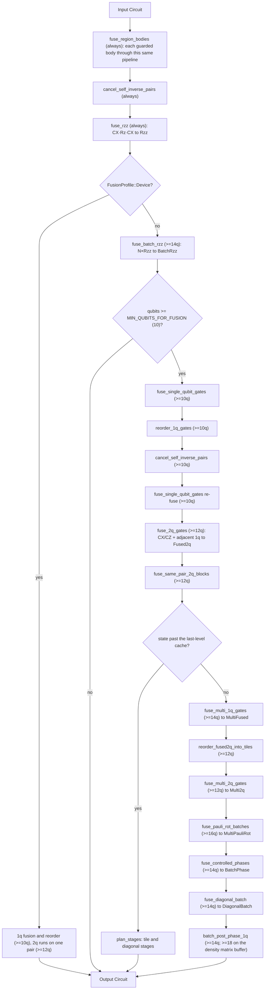

# Fusion Pipeline

Rewrites of the gate stream before execution, each pass gated on a qubit count. The count
is the width of the buffer the backend sweeps: the density matrix holds `n` qubits as a
`2n`-qubit statevector, so it reaches each floor at half the circuit width
(`fuse_circuit_for_width` in `src/circuit/fusion.rs`). Every pass returns `Cow<Circuit>`
and stays `Borrowed` when it changes nothing, so an untouched circuit is never cloned.

## Threshold constants

| Constant | Value | Rationale |
|----------|-------|-----------|
| `MIN_QUBITS_FOR_FUSION` | 10 | Below this, clone cost exceeds simulation savings |
| `MIN_QUBITS_FOR_MULTI_FUSION` | 14 | MultiFused tiling overhead vs benefit |
| `MIN_QUBITS_FOR_DIAG_BATCH` | 14 | Diagonal batch, cphase, and Rzz batching, and the 1q rebatch after phase fusion on a buffer as wide as the circuit (the statevector) |
| `MIN_QUBITS_FOR_POST_PHASE_BATCH` | 18 | The 1q rebatch after phase fusion on a wider buffer (the density matrix's `2n`) |
| `MIN_QUBITS_FOR_2Q_FUSION` | 12 | QV and random sweeps make fewer memory passes from 12q |
| `MIN_QUBITS_FOR_MULTI_2Q_FUSION` | 12 | Same as 2q fusion |
| `MIN_QUBITS_FOR_PAULI_ROT_BATCH` | 16 | At 15q a parallel subcube pass has tiles for half of an eight-thread pool |
| Stage floor | derived, 20 on an 8 MB L3 | First width whose statevector outgrows the last-level cache; 20 when the OS reports none, never below 16 |

## Stage planner

Once the statevector outgrows the last-level cache every pass is a sweep of main memory,
so `plan_stages` (`src/circuit/fusion_stage.rs`) replaces the batching passes from
`fuse_multi_1q_gates` on. It splits the stream at measurements, resets, conditionals,
regions, barriers, saves and gates no batch carries, then schedules each segment as
stages over the dependency frontier. A stage is one gathered tile: the low
`multi_2q_low_bits` qubits plus up to the `Multi2q` high budget of others. High qubits
grow greedily from the frontier, each step adding the qubits that take the most moving
gates per qubit added, ties going to the gate with the longest dependency chain behind
it. Gates commute when both act diagonally on every qubit they share, so diagonal gates
never block each other.

Each stage leaves as one existing batch: a `Multi2q` with every 1q gate folded into a
2q entry on its qubit, a `MultiFused` when it holds no 2q gate, or a `MultiPauliRot`,
whose Z letters cost no tile slot. Diagonal gates ride in a tile when a later gate needs
them. The rest wait for a diagonal stage (`BatchRzz` or `DiagonalBatch`), taken when no
tile moves anything or when clearing them first doubles what the next tile moves. The
schedule reads only the stream and the tile geometry, which comes from the hardware, not
the Rayon pool, so results are bitwise equal across thread counts. The planner records
provenance like the passes it replaces, so a `PreparedCircuit` replays its stages. The
density matrix keeps the batching passes.

## Device profile

`Backend::fusion_profile` picks the pipeline. The statevector picks
`FusionProfile::Device` when a GPU is attached and the state reaches
`gpu::tiles::MIN_QUBITS` (18). Every other backend, and the device below that width,
keeps the host pipeline above. The device profile stops after the 1q passes and fuses
2q gates only in runs of at least two on one pair with a moving gate among them (quantum
volume blocks), where the run's leading 1q gates fold in as well. A lone CX keeps its
neighbours as 1q gates. Neither the batching passes nor the stage planner run.

The device lowers each run of gates between measurements, resets, conditionals, regions
and saves itself (`src/gpu/tiles.rs`). 1q matrices, diagonals and antidiagonals, CX,
swap and two-qubit diagonals become ops of `apply_mixed_tile`, and a planner built like
the stage planner schedules them into shared-memory tiles of 11 qubits, one pass each. A
dense 4x4 and every other gate launch on their own kernels. The stage planner's tiles
would not serve the device: its `Multi2q` folds every 1q gate into a dense 4x4 entry,
which the device launches one entry at a time. A dense 4x4 stays out of the mixed tile
as well: on a card with a low FP64 rate it is compute bound and runs faster on its own
kernel.

The lowering runs after binding and reads only the bound stream, so a `PreparedCircuit`
captures and replays its plan under the profile of the backend it holds.

## Mixed CPU tiles

The stage planner runs at fusion time and emits ordinary batch gates into the circuit.
Mixed tiles run at apply time, inside the backend, over whatever stream fusion handed
over: they regroup operations the batches left apart, without adding a gate variant.

Past the last-level cache floor, the CPU statevector lowers the fused instruction slice
into a schedule of its own. A stage admits operations whose moving qubits fit one cache
tile and whose dependencies are met. Diagonal qubits and Pauli Z letters outside the tile
are constant within a subcube and take no tile slot. The planner examines at most four
times the state width in skipped operations per scan, and in candidate seeds per growth
step.

Homogeneous stages use the existing 1q, 2q, Pauli or diagonal batch kernels. Mixed
stages gather once, execute their operations in order, and scatter once. Controlled X
and swap keep their permutation operations. Measurements, resets, conditionals,
regions, barriers and QFT blocks end a stage. No schedule enters the gate enum.

A statevector slice whose operations all lower to one batch kind (dense 1q, dense 2q or
Pauli rotations) skips the schedule and applies its staged instructions directly, since
the stage planner already batched that stream for the same kernel. The density matrix
keeps its doubled schedule for every slice.

Across applications the backend keeps only stage indices and operation shapes, and
reloads numerical payloads from the current slice each time. A changed state width, gate
family or dependency mask rebuilds the schedule. Scheduling reads state width and cache
geometry, not the Rayon pool width.

The density matrix schedules a doubled stream over its `2n`-qubit buffer: ket gates on
`q+n`, conjugated bra gates on `q`. Each register keeps circuit order internally, while
commuting work from the other register can share a tile. An unsupported operation ends
the segment and runs through the density matrix backend. The device path keeps its own
fusion profile and kernels. The static density-matrix census accepts only supported gate
streams. Unsupported kernels have their own ket, bra and conjugation passes and are
excluded from that count.

## QFT recognition

Before this pipeline runs, a backend with a native `QftBlock` kernel (the statevector,
host or device) has `recognize_qft_blocks` (`src/circuit/qft_recognition.rs`) fold each
expanded QFT back into one block, so a QFT parsed from OpenQASM runs as the FFT rather
than as `n^2 / 2` controlled phases. It matches every sequence `qft_textbook_steps`
emits: forward or inverse, with or without the bit-reversal swaps, in either label order.
The phases of one column may come in any order with either qubit as control, and the
swaps in any order, which covers the gate order Qiskit's QFT decomposes to. Each phase
must equal `e^{±iπ/2^d}` to within `1e-12`, so an approximate QFT stays as gates.

Only ranges the FFT runs natively fold: blocks starting at `q[0]` that span the register
or cover at least 10 qubits (`MIN_SUBRANGE_QFT_QUBITS`). A narrower QFT stays as gates,
which the tiled passes run in a sweep or two. The gates must be consecutive top-level
instructions, so a QFT with another gate inside it, or on non-contiguous qubits, is left
alone. The scan allocates nothing until it finds a match and returns the circuit borrowed
when there is none. `PRISM_NO_QFT_BLOCK` turns off kernel and recognition together.

The kernel runs the DIF network over each `2^num` amplitude chunk, with conjugate
twiddles for the inverse, and reaches every form by adding a bit reversal of the chunk
index before the network, after it, or both.

## Payload capacities

The batched gates carry a lookup table sized at compile time, and the pass that emits
them keeps the payload inside it. Both caps are declared on the payload
(`BatchRzzData::MAX_EDGES`, `BatchPhaseData::MAX_PHASES`) and pinned to the kernel table
shape by a compile-time assertion. The kernels also assert on entry in release builds, so
a producer that outgrows a table fails loudly instead of dropping work.

| Payload         | Cap                   | Producer behavior past the cap                                     |
|-----------------|-----------------------|--------------------------------------------------------------------|
| `BatchRzz`      | 32 edges              | `fuse_batch_rzz` splits the run into consecutive batches           |
| `BatchPhase`    | 40 entries            | `fuse_controlled_phases` splits the chain into consecutive batches |
| `DiagonalBatch` | 4 tables of 10 qubits | `fuse_diagonal_batch` closes the run and opens a new one           |

Splitting the first two is sound because both hold mutually commuting diagonal terms. A
repeated `(control, target)` pair folds into the existing entry. That keeps the BMI2 and
fallback paths in agreement (the BMI2 kernel indexes one bit per distinct qubit, and a
repeated target has no bit of its own) and bounds a chain by the qubit count.

A `DiagonalBatch` table covers the qubits its two-qubit entries join, so the cap is on
those components, not the entry count: they must pack into
`DiagonalBatchData::MAX_GROUPS` tables of `MAX_QUBITS_PER_GROUP` qubits. The producer runs
the kernel's first-fit packing on every gate it admits and closes the run before a gate
breaks it. A hand-built batch that does not fit still runs, element by element.

## Diagonal batching

`fuse_diagonal_batch` takes every diagonal form the earlier passes leave behind: the named
diagonal gates, a `Cu` with a diagonal matrix (`crz` as well as controlled phases), a
diagonal `Fused2q`, an all-diagonal `MultiFused` or `Multi2q`, and every `BatchPhase` and
`BatchRzz`. A diagonal two-qubit block enters as a phase on each qubit and one on `|11>`.
A gate on no qubit of the open run is emitted ahead of it, so a layer of 1q gates elsewhere
does not split the run, and a gate on one of its qubits closes it.

`fuse_controlled_phases` roots each chain on its control. A chain holding one phase whose
target is also the target of another one-phase chain flushes with it as one `BatchPhase`
rooted on that target, since a controlled phase is symmetric in its qubits. The controlled
powers of phase estimation all share the eigenstate qubit and run as one batch.

## Plan capture and replay

`PreparedCircuit` records the block structure these passes choose and rebuilds only the
matrices a new binding changes, under guards that fall back to the full pipeline when a
binding flips a decision read from a matrix. The recipes and guards are on
[Parameters, Binding and Gradients](./parameters.md#plan-capture-and-replay).

## Fusion cost against apply cost

Fusion cost tracks instruction count and is nearly flat in qubit count, while gate
application is `2^n`. For `hardware_efficient_ansatz(n, 5, seed)` on this project's
reference host, fusion is about 22% of a run at 12 qubits and about 0.3% at 20.

From 16 qubits fusion is off the hot path, and these passes are written for
correctness and clarity rather than their own runtime. Below that, plan capture
amortizes it.
