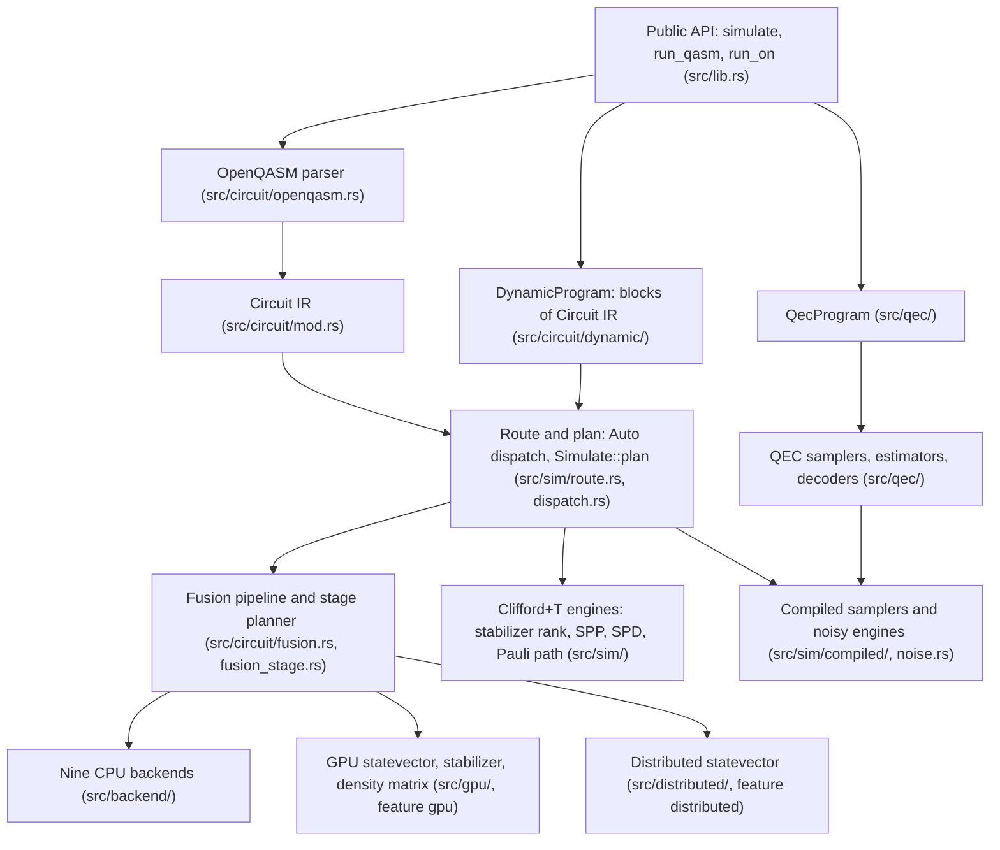

# Architecture: Overview and Layered Design

How PRISM-Q is built. Terms are defined in the [Glossary](../glossary.md).

## Goals

- The fastest practical quantum circuit simulation in Rust. When goals conflict,
  performance is weighed first, then correctness, then maintainability.
- Correct simulation of the supported gate sets on every backend.
- A backend trait that a new simulation strategy implements without changes to the core.

## Non-goals

- Full OpenQASM 3.0 compliance; a practical subset is supported.
- GUI or notebook integration (library-first).
- Connections to hardware or a QPU.

## Layered design

A circuit flows top to bottom: OpenQASM text or a builder produces a backend-agnostic
IR, the route layer picks an engine for the terminal asked, the fusion pipeline rewrites
the gate stream for that engine, and the engine runs it. Programs with runtime control
flow and native QEC programs enter beside the circuit path and reuse its parts.

The pages in this section follow that flow: the [parser and circuit IR](./ir.md),
[dynamic programs](./dynamic-programs.md), the [fusion pipeline](./fusion.md), the
[simulation engine and dispatch](./engine.md), the individual [backends](./backends.md),
[parameters, binding and gradients](./parameters.md), the
[compiled samplers](./samplers.md), [noise compilation](./noise.md), the
[QEC programs](./qec-programs.md) and their
[decoders](./qec-decoding.md), [threading, SIMD and memory layout](./threading-simd.md),
and the [error model and public API surface](./api-surface.md).
