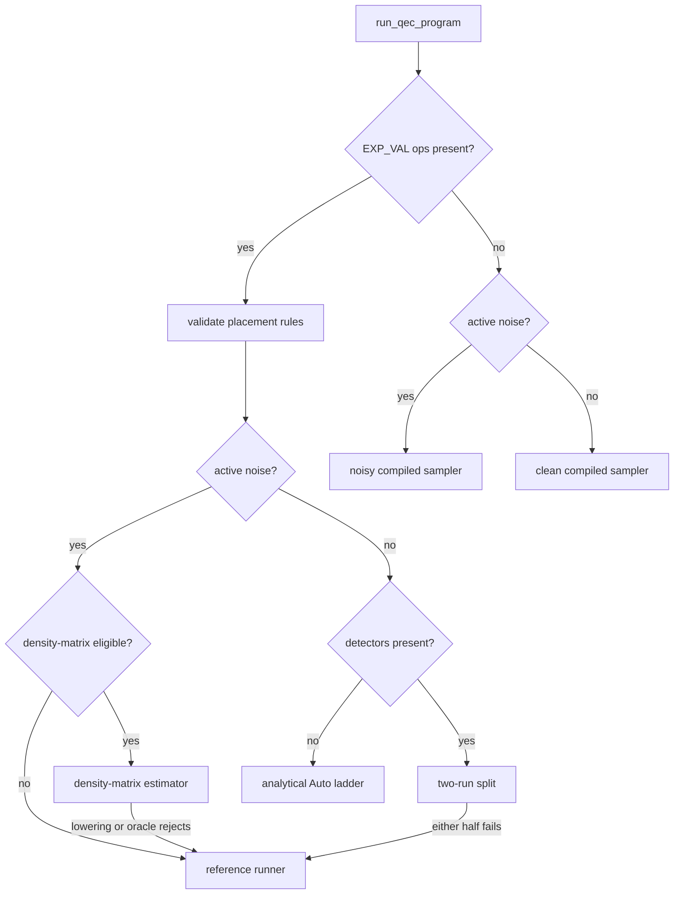

# QEC Programs

`QecProgram` in `src/qec/mod.rs` is a measurement-record IR for QEC workloads:
detectors, logical observables, postselection, expectation metadata and noise
annotations, held before sampler lowering. It is separate from `Circuit` so these
programs do not have to fit final-measurement OpenQASM semantics. Workflow examples are
in the [QEC guide](../guides/qec.md). Public entry points: `run_qec_program`,
`run_qec_program_reference`, `run_qec_program_with_strategy`,
`run_qec_program_spd_rerouted`, and `compile_qec_program_rows`.

## Program, ops, and options

`QecProgram` holds a qubit count, an ordered op list, and a `QecOptions` value. The
typed builders (`push_gate`, `measure`, `measure_pauli_product`, `reset`, `detector`,
`observable_include`, `expectation_value`, `postselect`, `noise`) validate each op as
it is appended. `measure` and `measure_pauli_product` return the new record index, and
`detector` the detector index. Validation covers gate arity, qubit bounds, finite
coordinates, coefficients and probabilities, record-reference scope, duplicate qubits
in a Pauli product, branch probabilities summing to at most 1, and target pairing for
`DEPOLARIZE2` and `PAULI_CHANNEL_2`.

| `QecOp` variant | Payload | Semantics |
| --- | --- | --- |
| `Gate` | `gate`, `targets` | Standard gate. The compiled runner requires Clifford gates; the reference runner accepts any gate the statevector backend supports. |
| `Measure` | `basis`, `qubit` | Single-qubit measurement in the requested basis. One record. The qubit is left in the Z frame: the basis rotation is not undone. Reusing a measured qubit before a `Reset` is rejected (see the reset requirement below); after a non-Z basis the reference runner rejects it too, so the frame it is left in is never observable. |
| `MeasurePauliProduct` | `terms` | One record equal to the parity of the listed Pauli terms. Unlike `Measure`, the per-term basis rotations are undone before the record is taken. |
| `Reset` | `basis`, `qubit` | Reset to the `+1` eigenstate of the requested basis. |
| `Detector` | `records`, `coords` | Parity over the listed records. `coords` is passthrough metadata with no effect on sampling. |
| `ObservableInclude` | `observable`, `records` | Includes for the same observable index XOR into a single row. |
| `ExpectationValue` | `terms`, `coefficient` | `coefficient * <P>` in the final state. Terminal placement, live qubits only. |
| `Postselect` | `records`, `expected` | The shot is accepted only when the parity over `records` matches `expected`. |
| `Feedforward` | `records`, `expected`, `body` | The body runs only when the parity over `records` matches `expected`. See [Feed-forward](#feed-forward) for what a body admits. |
| `Noise` | `channel`, `targets` | Pauli-noise annotation. Zero probability is inactive. |
| `CorrelatedError` | `branches` | Mutually exclusive Pauli products: branch `i` fires with its probability only when no earlier branch fired. The text chain `E` / `ELSE_CORRELATED_ERROR` is one op. |
| `HeraldedErase` | `probability`, `qubit` | One record: 1 with the given probability, in which case a uniformly random Pauli (identity included) hits the qubit; 0 otherwise. |
| `Pad` | `value` | One constant record. |
| `Tick` | | Scheduling separator with no semantic effect. |

Record references are `QecRecordRef::Absolute` indices or `QecRecordRef::Lookback`
distances (1 is the most recent record, 0 is rejected), resolved against the records
that exist when the referencing op is appended. Detector, observable and postselection
rows therefore hold absolute measurement indices by the time a sampler compiles them.

| `QecOptions` field | Default | Effect |
| --- | --- | --- |
| `shots` | `1024` | Number of shots requested by the runner APIs. |
| `seed` | `42` | RNG seed for stochastic samplers and Pauli-noise dispatch. |
| `chunk_size` | `None` | Per-batch shot bound for the compiled runner. `None` is equivalent to `Some(shots)`; `Some(0)` is rejected. No effect on the reference runner or on seeded noise. |
| `keep_measurements` | `true` | When `false`, `QecSampleResult::measurements` is returned with zero shots (column count preserved). Detector and observable records are always populated. |
| `detector_reference` | `Noiseless` | `Noiseless` XORs each detector and observable with its value in the noiseless reference run; `Raw` reports the plain record parity. See [Result shape](#result-shape). |

## Feed-forward

`QecOp::Feedforward` conditions a body on the parity of a record list against an
expected value, the shape a detector already has. It reuses the guarded-region
contract. The QEC record space and the classical bit vector are one address space (the
reference runner writes record `i` to classical bit `i`), so a resolved record index is
the bit a `ClassicalCondition::Parity` reads. The op executes as the guarded instruction
`circuit::guarded` picks for its body: a `Region` through `Backend::apply_region`, or a
`Conditional` when the body is one gate.

The body admits gates and resets only. Detectors and observables index the record space
absolutely, so a measurement whose execution depended on a record would make every
later index depend on the shot.

The compiled QEC sampler evaluates a static affine map from random bits to outcomes,
and a record-conditioned branch breaks that. A Pauli product body is the exception. A
Pauli at a fixed point flips the same later records in whichever shot it fires, like a
noise fault there, and reaches only records produced after it. `run_qec_program`
therefore samples the program without its feed-forwards and applies noise. It then
walks the feed-forwards in op order, XORing each one's precomputed flip set into the
shots where its predicate holds, so a predicate reads records that earlier corrections
already flipped. The flip sets come from the forward Pauli frame walk the record noise
uses, up to 64 corrections as lanes of one walk. A Pauli on a qubit measured since its
last reset flips nothing and is dropped, as noise there is.

Two cases are rejected by name, with a pointer to `run_qec_program_reference`: a body
holding any other gate or a reset, and a feed-forward in a program with leakage
annotations. A feed-forward program also skips the parity route that reads no records,
since its predicates read records. The deferred lowering's other consumers and the
density matrix estimator reject the op outright, and detector error model derivation
inherits the deferred lowering's rejection. Build the op with
`QecProgram::feedforward`; the native text format does not spell it.

## Parsing

`parse_qec_program` and `QecProgram::from_text` parse the native QEC text subset:
`I`, `X`, `Y`, `Z`, `H`, `S`, `S_DAG`, `T`, `T_DAG`, `CX`, `CZ`, `R`/`RX`/`RY`,
`M`/`MX`/`MY`, `MR` variants, `MPP`, `DETECTOR`, `OBSERVABLE_INCLUDE`, `POSTSELECT`,
`EXP_VAL`, the Pauli noise instructions (`X_ERROR`, `Y_ERROR`, `Z_ERROR`,
`DEPOLARIZE1`, `DEPOLARIZE2`, `PAULI_CHANNEL_1`, `PAULI_CHANNEL_2`), the leakage
annotations (`LEAK(p)`, `SEEP(p)`, and `LEAK_TRANSPORT(p)` on pairs), `TICK`,
`QUBIT_COORDS`, `SHIFT_COORDS` (ignored), flattened `REPEAT` blocks, and the
instructions below, which lower onto the same ops. `rec[-k]` resolves to an absolute
index while parsing. A numeric argument on a basis measurement, such as `M(0.001)`,
lowers to a Pauli flip on that record just before the measurement. Inverted (`!`)
targets are rejected; instruction tags such as `X_ERROR[tag](p)` are ignored.

| Instruction | Lowering |
| --- | --- |
| `SQRT_X` / `SQRT_X_DAG` | `Gate::SX` / `Gate::SXdg`, the `+pi/2` and `-pi/2` X rotations. |
| `SQRT_Y` / `SQRT_Y_DAG` | `S_DAG`, `SQRT_X` (or `SQRT_X_DAG`), `S` on the qubit. |
| `SQRT_Z` / `SQRT_Z_DAG` | `S` / `S_DAG`. |
| `C_XYZ` | `S_DAG`, `H`: the X -> Y -> Z -> X axis cycle. |
| `C_ZYX` | `H`, `S`: the inverse cycle, X -> Z -> Y -> X. |
| `CY a b` | `S_DAG b`, `CX a b`, `S b`. |
| `SWAP a b` | `CX a b`, `CX b a`, `CX a b`. |
| `ISWAP a b` / `ISWAP_DAG a b` | `S a`, `S b` (`S_DAG` for the dagger), `CZ a b`, then the three `CX` of a swap. |
| `CXSWAP a b` | `CX b a`, `CX a b` (a `CX a b` followed by a swap). |
| `SWAPCX a b` | `CX a b`, `CX b a` (a swap followed by `CX a b`). |
| `MXX` / `MYY` / `MZZ a b ...` | A `MeasurePauliProduct` over each pair, one record per pair; no measurement-error argument. |
| `MPAD v ...` | A `Pad` op per value, each one constant record. |
| `E(p)` / `CORRELATED_ERROR(p) P ...` | A `CorrelatedError` with one branch: the Pauli product fires with probability `p`. |
| `ELSE_CORRELATED_ERROR(p) P ...` | Appends a branch to the chain it directly follows, fired only when no earlier branch fired. |
| `HERALDED_ERASE(p) q ...` | A `HeraldedErase` op per target: one record, 1 when the qubit is erased, with a uniformly random Pauli applied on erasure. |
| `LEAK(p)` / `SEEP(p)` / `LEAK_TRANSPORT(p)` | `QecNoise::Leak`, `Seep` and `LeakTransport` annotations; see [leakage on the compiled QEC path](./noise.md#leakage-on-the-compiled-qec-path). |

`QecProgram::to_text` writes the same subset back, and parsing its output reproduces
the op list. Consecutive gates, measurements, resets and `MPP` products of one kind
share a line, so `MR` comes back as `M` then `R`, `MZZ` as `MPP`, `SWAP` as three
`CX`, and `SQRT_Y` as `S_DAG`, `SQRT_X`, `S`. Record references print as `rec[-k]` and
parse back to absolute indices. A leading `QUBIT_COORDS` line keeps the register width
when the highest qubit is idle. `QecOptions` are not written, and zero-probability
noise reads back as nothing. A gate outside the parser's set or a `FEEDFORWARD` op is an
error rather than a lossy write.

## Memory-experiment generators

`src/qec/generators.rs` builds the standard memory experiments as ordinary programs, so
sampling, model derivation, decoding and text export treat them like any other. Each
generator assembles the op list and validates it once through `QecProgram::from_ops`.
The incremental builders recount records on every append, which would make a
distance-13, 1000-round program quadratic to build.

| Generator | Qubits | Round | Memory basis | Observable 0 |
| --- | --- | --- | --- | --- |
| `repetition_memory(d, r, noise)` | `d` data on even indices, `d - 1` ZZ ancillas between them | two `CX` layers, then measure and reset the ancillas | Z | data qubit 0 |
| `surface_memory(d, r, basis, noise)` | `d * d` data, then one ancilla per stabilizer | `H` on X ancillas, four `CX` layers, `H`, measure and reset | X or Z | left data column (Z), top row (X) |
| `color_memory(d, r, basis, noise)` | `(3 d^2 + 1) / 4` data, then one ancilla per face | X stabilizers in six `CX` layers, measure and reset, then the Z stabilizers likewise | X or Z | every data qubit |

`QecCircuitNoise` has four rates, each emitted only when nonzero:

| Rate | Emits |
| --- | --- |
| `after_clifford_depolarization` | `DEPOLARIZE1` after each `H` layer, `DEPOLARIZE2` after each `CX` layer |
| `before_measure_flip_probability` | the flip the basis is sensitive to: `X_ERROR` before Z measurements, `Z_ERROR` before X ones |
| `after_reset_flip_probability` | the same, after resets |
| `before_round_data_depolarization` | `DEPOLARIZE1` on the data at the start of every round |

`TICK` separates the layers.

Detectors compare each stabilizer with its previous round. In the first round only
stabilizers of the memory basis have detectors. After the final data readout in the
memory basis, each such stabilizer gets one more detector: the product of its data
readouts against its last ancilla record, at `t = rounds`. Coordinates:

- repetition: `(x, t)`, `x` the ancilla's qubit index;
- surface: `(x, y, t)`, data qubit `(r, c)` at `(2c + 1, 2r + 1)`, each ancilla at its
  plaquette centre;
- color: `(x, y, t, c)`, `c` the face color, plus 3 for Z stabilizers.

The surface schedule visits X plaquettes NW, SW, NE, SE and Z plaquettes NW, NE, SW,
SE. On every data pair an X and a Z ancilla share, the Z ancilla acts first on both or
on neither, so interleaved ancillas measure the stabilizers correctly. The order also
lays each hook error perpendicular to the logical operator it could extend. A hook
error is the two-qubit error an ancilla fault halfway through a plaquette leaves on the
data. The graphlike distance of the decomposed model (the fewest mechanisms that flip
the observable with no detector) equals `d` for both bases at `d` = 3 and 5, as it does
for the repetition code.

The color code is the triangular 6.6.6 code. Data qubits are the honeycomb vertices
inside a triangle with one boundary of each color, giving hexagons in the bulk and
weight-4 half hexagons on the boundary. A face visits its vertices in angular order, and
a vertex sits at a different angular position in each of its three faces, so six layers
measure every face without two ancillas meeting one data qubit. X and Z stabilizers use
the same ancilla in separate halves of the round, so no interleaving argument is needed.

There are no flag qubits. An ancilla fault midway through a hexagon can leave weight-3
damage, and the circuit distance can fall below `d`. The code distance is `d`: under
data noise alone, the fewest undetected observable-flipping mechanisms is exactly `d`
at `d` = 3 and 5 in both bases. A bulk data error flips three faces. From distance 5
some of those hyperedges have no graphlike cover, so `decompose_graphlike` rejects the
model and union-find does not apply; a hypergraph decoder consumes the model as
derived.

With the union-find decoder at 100k shots, seed 42, `d` rounds and uniform noise:

| Code | `p` | Failures |
| --- | --- | --- |
| repetition | 0.01 | 691, 152, 21 at `d` = 3, 5, 7 |
| surface, Z memory | 0.002 | 309, 112 at `d` = 3, 5 |
| surface, X memory | 0.002 | 339, 144 at `d` = 3, 5 |

The MPP-based repetition and surface memories in the benchmark and test helpers are a
different program. They measure stabilizers directly under phenomenological noise, and
seeded-record digests and benchmark history pin them, so they stay as they are.

## Runner routing

`run_qec_program` picks one of six paths:



Programs without `EXP_VAL` take the packed compiled path:
`QecProgram::compile_sampler`, then one `QecCompiledSampler::sample` call at the
program's shot count and seed. Validation rejects non-Clifford gates and reports
whether active noise is present. A program with no measurements returns an empty record
buffer without compiling a sampler. Noisy Clifford programs compile a noise-aware
sampler; clean ones lower to a circuit and compile a detector sampler. Both honor
`QecOptions::chunk_size`: sampling runs in batches of at most `chunk_size` shots, with
detector, observable, postselection and logical-error accounting per chunk. Peak memory
is then one chunk of records when raw measurements are not kept.

The two-run split serves noiseless `EXP_VAL` programs with detectors. Detectors are
record metadata with no effect on the state, so the halves compose. The packed sampler
runs the program without its `EXP_VAL` ops (real measurement, detector and observable
records), and the analytical ladder runs it without its detectors (exact estimates
attached to the sampled result). When either half cannot run, for example non-Clifford
gates on the packed half, the whole program falls back to the reference runner.

The density-matrix estimator serves noisy `EXP_VAL` programs whose ensemble the mixed
state can carry in full. There `Tr(rho P)` is the exact value the reference runner
approximates by averaging per-shot statevector expectations. Eligibility:

- No measurement records. `M` and `MPP` collapse the state per shot and feed the
  measurement, detector and observable rows; the mixed state holds no record stream.
- No postselection, which would condition the estimate on an accepted subensemble
  `Tr(rho P)` does not express.
- Width within the density-matrix cap (`PRISM_MAX_DM_QUBITS`, default half the
  statevector cap), since the backend stores `4^n` amplitudes.

`R` is eligible. Both paths implement the reset channel `rho -> |0><0| (x) tr_q rho`
from the [backends](./backends.md) reset contract. The density matrix applies it
directly, and the reference runner samples one trajectory per shot, so the shot mean
still converges to `Tr(rho P)`.

A gate or channel the density-matrix path rejects surfaces as an error from the
lowering or the oracle, which also falls back to the reference runner. The lowering
maps gates one to one and expands a basis reset into `Reset` plus its Z-to-basis
rotation. Each Pauli-noise annotation becomes `NoiseModel` events on the instruction it
follows, applied through the backend's exact one-qubit Kraus and two-qubit depolarizing
channels.

`run_qec_program_reference` is the correctness oracle: one statevector simulation per
shot, `O(shots * 2^n)`. It executes ops in order, samples Pauli noise from a dedicated
RNG stream derived from the seed, lowers `MPP` onto one scratch qubit at index
`num_qubits`, and evaluates postselection parities per shot.

## Compiled rows

`compile_qec_program_rows` is the public sampler-row primitive. It lowers basis
measurements and `MPP` ops into `QecCompiledRows`: one packed X/Z Pauli row per
measurement record (bitmask words over the qubits), plus detector, observable and
postselection rows as absolute record indices with their expected values. Parity
projection delegates to `PackedShots::parity_rows`. It is a lowering artifact, not an
execution path, and rejects programs containing gates, resets, active noise, or
`EXP_VAL`.

The clean compiled path builds its sampler from the lowered Clifford circuit instead.
It backward-propagates each measurement observable into a Pauli sensitivity row. Gaussian
elimination reduces the rows to independent flip rows plus a deterministic reference
outcome, and each shot XORs a random subset of flip rows into the reference bits.
Detector and observable rows are then applied as parities over the sampled records. See
[compiled samplers](./samplers.md) for the machinery.

## Lowering

Two lowerings turn a QEC program into a circuit the samplers accept. They share the
basis-rotation helpers (`append_basis_to_z_rotation` and its inverse) and `MPP` parity
accumulation in `append_mpp_parity_rotations`. That helper rotates each term into Z,
accumulates parity on a scratch qubit via `CX`, undoes the rotations and measures the
scratch. Both lowerings finish by checking that exactly `num_measurements` records were
emitted.

The clean Clifford lowering measures in place: rotate the qubit into Z and measure into
the next record, leaving the rotation in place, so the qubit stays in the Z frame.
`MPP` uses one scratch qubit at index `num_qubits`, reset between uses. A reset emits a
reset followed by the basis rotation.

The deferred lowering backs the noisy path and the analytical estimator prelude. A
reset gives the program qubit a fresh circuit alias, so every measurement can be
deferred to a terminal record; reusing a measured qubit without a reset is rejected.
Each program qubit's final alias is recorded so terminal `EXP_VAL` terms translate onto
the lowered circuit. Noise ops are not applied to the circuit but recorded as
positioned events for sensitivity compilation.

```admonish note title="V1 reset requirement"
A measured qubit must be reset before any later gate reuses it, because the
compiled lowering defers measurements to terminal records.
```

## Noisy data flow

Noise never executes during compiled sampling; it compiles into record flips.

At compile time the deferred lowering produces the noiseless circuit plus positioned
noise events. Backward Pauli propagation walks the circuit in reverse, carrying each
measurement's observable to each event position. Every event becomes sensitivity rows:
for each noise branch, the records whose propagated Pauli anticommutes with the
injected error, packed as flip masks. The noiseless sampler is compiled on the deferred
circuit.

When records are neither kept nor postselected, the walk holds rows only for the
aliases live at each position and projects each event onto detector and observable bits
as it reaches it. Compile memory then follows the live qubit count rather than records
times aliases. The same walk reads the noiseless detector and observable values from
the propagated signs; if any is random, compilation falls back to the record path. A
noiseless program takes the same walk with no events, at cost live qubits times
records. Compiling the deferred circuit forward grew with the square of the record
count.

At sample time the noiseless records are sampled first, then each noise event XORs its
branch flip masks into the shot-major record buffer. Small-probability events skip
between firing shots by geometric sampling. Dense events (probability at or above `0.5`,
or a unit of fewer than 32 shots) iterate every shot. `DEPOLARIZE2` precomputes the flip
masks of all 15 non-identity two-qubit Pauli branches and picks one uniformly per
firing. `PAULI_CHANNEL_2` precomputes the same masks and picks a branch from a second
uniform draw against its cumulative branch rates, kept in one table per op rather than
in every event.

Noise draws in fixed units of 8192 shots. Unit `k` covers shots
`[8192 k, 8192 (k + 1))` and draws every event in program order from ChaCha stream `k`
of the noise seed, so a unit's faults depend only on the seed and `k`. A chunk boundary
inside a unit continues that unit's draws. Seeded noise is therefore independent of
`QecOptions::chunk_size`, and units run in parallel under the `parallel` feature without
changing any bit. When records are neither kept nor postselected and every detector and
observable is fixed in the noiseless circuit, the draws land directly on detector and
observable rows, bit for bit what the record path produces. The unit size is part of
the seeded output: changing it changes noisy results at a given seed. Noiseless records
that are random in the circuit still draw from the compiled sampler per chunk.

Supported Pauli channels are `X_ERROR`, `Y_ERROR`, `Z_ERROR`, `DEPOLARIZE1`,
`PAULI_CHANNEL_1(px, py, pz)`, `DEPOLARIZE2`, and `PAULI_CHANNEL_2` with its 15
probabilities in the order `IX, IY, IZ, XI, XX, XY, XZ, YI, YX, YY, YZ, ZI, ZX, ZY,
ZZ`, the first letter on the first target of each pair. Every one-qubit channel is one
draw with three branch rates, so `Y_ERROR(p)` is `(0, p, 0)`. Noise on an
already-measured target is dropped, since it can no longer affect a record. A two-qubit
channel with one measured target degrades to its marginal on the survivor:
`DEPOLARIZE1` at `p * 0.8` for `DEPOLARIZE2`, and for `PAULI_CHANNEL_2` the
`PAULI_CHANNEL_1` that sums branch rates by the survivor's letter.

The leakage annotations `LEAK(p)`, `SEEP(p)` and `LEAK_TRANSPORT(p)` (on pairs) carry a
leak flag per qubit through the shot, which no fixed flip map holds. `run_qec_program`
samples them with a forward frame walk next to the leak rows, and each `LEAK` target
adds a herald column to `QecSampleResult::heralds`. The walk is described under
[leakage on the compiled QEC path](./noise.md#leakage-on-the-compiled-qec-path). The
reference runner, the record noise sampler and the error model derivation reject them
by name, and so does a program pairing them with a feed-forward.

The reference runner applies the Pauli channels stochastically to each shot's state.
The density-matrix estimator applies them exactly: the one-qubit channels as Pauli
channels, `DEPOLARIZE1` as a symmetric one-qubit depolarizing channel, `DEPOLARIZE2`
as a two-qubit depolarizing channel on each target pair, and `PAULI_CHANNEL_2` as a
two-qubit Kraus channel of `sqrt(p) P` terms. How this path relates to the
noisy engines for circuits is on [Noise Compilation](./noise.md).

## Detector error models and decoding

`QecProgram::detector_error_model` derives the independent error mechanisms behind a
program's detectors, and three in-crate decoders consume the result. Both are on
[QEC Decoding](./qec-decoding.md).

## Expectation values

`EXP_VAL(c) P1*...*Pk` estimates `c * <P>` for the Pauli product `P` in the program's
final state and returns one `QecObservableEstimate` per op, in op order, in
`QecSampleResult::expectation_values`. Two placement rules make "final state" well
defined on every path:

- Terminal placement: no gate, measurement, reset, or active noise may follow an
  `EXP_VAL` op. Detector, observable, postselection and tick metadata may.
- Live qubits only: a term may not reference a qubit that a single-qubit measurement
  read after its last reset. The Pauli then commutes with every prior measurement
  projector, so the sampled post-measurement average equals the measurement-stripped
  pure-state expectation the analytical strategies compute. `MPP` does not affect
  liveness: the deferred lowering measures a scratch alias, and the projected cross
  terms cancel exactly.

| Path | Selection | `mean` | `variance` |
| --- | --- | --- | --- |
| Density-matrix estimator | `run_qec_program` with active noise on an eligible program | exact `c * Tr(rho P)` | `0.0` |
| Reference runner | `run_qec_program` with active noise on an ineligible program, or as the detector-split fallback; `run_qec_program_reference` directly | per-shot exact `c * <P>` averaged over accepted shots | unbiased sample variance |
| Analytical ladder (SPD, CAMPS, tensor network) | `run_qec_program` noiseless; `run_qec_program_with_strategy` | exact `c * <P>` on the lowered unitary | `c^2 *` squared SPD truncation weight; `0.0` for CAMPS and tensor network |

The reference runner precomputes Pauli masks per observable and evaluates `c * <P>` on
the final statevector of every accepted shot. It reports the sample mean and unbiased
sample variance with `num_shots` equal to the accepted count. Programs wider than 64
qubits (the `MPP` scratch qubit included) are rejected, since the mask reduction packs
X and Z masks into 64-bit words. With noise annotations the per-shot trajectories
average to `Tr(rho P)`.

The analytical strategies evaluate `<0|U^dag P U|0>` on the deferred lowering with the
trailing measurements stripped. Record observables become Z strings, and `EXP_VAL`
terms translate through the final qubit aliases. The strategies reject detectors and
active noise; `run_qec_program` handles those through the split and reference routes.
`QecTStrategy` selects the path:

- `Auto`, the production ladder. Light-cone SPD runs first (truncation tolerance
  `1e-10`, term cap `16384`) and is accepted when every estimate reports no truncation.
  SPD encodes truncation as `variance = total_discarded^2`, and variance at or below
  `1e-12` counts as exact. Otherwise CAMPS runs (bond dimension cap `256`) and
  hard-errors when SVD truncation discards weight above `1e-12`, so the ladder falls
  through to the exact tensor-network scalar fallback. When all three fail, the error
  reports each stage's reason.
- `Reference`, the per-shot oracle.
- `Spd` and `Camps` run their stage directly.

CAMPS evaluates arbitrary X/Y/Z strings by conjugating each letter through the signed
Clifford prefix (`Y = i * X * Z` composes the two inverse-tableau rows). Postselection
composes on both paths. The reference runner averages over accepted shots, and the
analytical combiner conditions via `<O * Pi> / <Pi>` over the projector subsets,
capped at 12 postselection predicates. The projector Z strings live on measured aliases
and never overlap `EXP_VAL` terms.

`run_qec_program_spd_rerouted` takes caller-supplied Z stabilizers per observable. It
evaluates each rerouted observable on the XOR-equivalent support with the smallest
inverse light cone, after verifying via SPD that the substituted stabilizer product
holds `<S> = +1` in the lowered state. Observables without a reroute use their original
support. It rejects `EXP_VAL` ops, postselection, and resets (resets relabel qubits,
making stabilizer indices ambiguous).

`tests/integration/qec_exp_val.rs` pins routing and placement;
`tests/integration/qec_e2e_d3.rs` checks distance-3 repetition-code fixtures against
closed-form expectations on the compiled, analytical and reference paths.

## Result shape

Every runner returns a `QecSampleResult`. The type is `#[non_exhaustive]`: construct
through `new`, `new_with_total_shots`, or `empty`, and match fields with a trailing
`..`.

| Field | Meaning |
| --- | --- |
| `total_shots` | Shots requested. `accepted_shots + discarded_shots == total_shots`. |
| `measurements` | Raw measurement records, or a zero-shot buffer when `keep_measurements` is `false` (column count preserved). |
| `detectors` | One bit per detector per shot. |
| `observables` | One bit per observable per shot. Synthesized on the analytical path (below). |
| `accepted_shots` | Shots accepted after postselection (`total_shots` without a predicate). |
| `discarded_shots` | Shots rejected by postselection. |
| `logical_errors` | Per observable, the count of accepted shots whose parity is 1. |
| `observable_expectations` | Optional weighted-estimator expectation per observable; `None` when the strategy emits raw bit counts only. |
| `expectation_values` | Estimates for the program's `EXP_VAL` ops, one per op in op order, coefficient-scaled; `None` when the program has none. |

`QecObservableEstimate` carries `mean`, `variance`, and `num_shots` (shots that
contributed, postselection rejections excluded). Zero accepted shots yield
`{mean: 0.0, variance: 0.0, num_shots: 0}`.

Analytical strategies have no per-shot stream, so they synthesize the packed
`observables` records to match the `logical_errors` counts. The one-bits occupy
positions `[0, accepted_shots)` and the rest is inert padding. Derive rates with
`logical_error_rates` (denominator `accepted_shots`), and do not align these rows shot
for shot with detector rows on the analytical path.

The compiled runner delivers shot-major `PackedShots` record buffers: one row of packed
record bits per shot, record `j` at bit `j % 64` of word `j / 64`. The Clifford+T
sampler emits measurement-major records instead, so consumers branch on `layout()` or
read through `get_bit`. Detector, observable and postselection parities are XORs of the
referenced records.

Under `QecDetectorReference::Noiseless`, detector and observable parities are then
XORed with their values in the noiseless reference run. That run is computed once at
compile time with every random outcome taken as 0, the hidden collapse of a reset
included. The compiled sampler is rebased onto that run's records, so samples depend
only on the seed. A reset on a qubit entangled since its last measurement falls back to
a forced-outcome stabilizer run for the reference. Postselection and heralds read raw
records, and non-Clifford programs report raw parities under either setting. Summary
statistics: `survivor_rate`, `logical_error_rates`, and their Wilson-interval variants.
