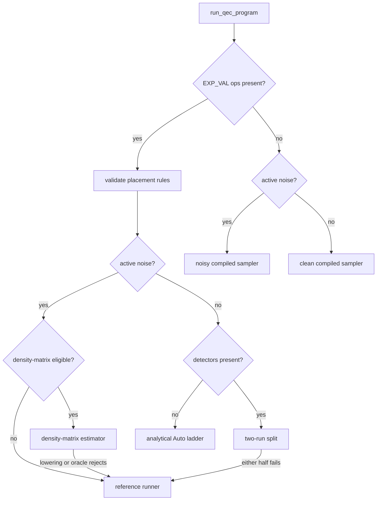

# QEC Program Execution

How native QEC programs execute. The data model and text format are on the
[native QEC program IR](./qec-ir.md) page, and workflow examples in the
[noise and QEC guide](../guides/qec.md). Public entry points: `run_qec_program`,
`run_qec_program_reference`, `run_qec_program_with_strategy`,
`run_qec_program_spd_rerouted`, and `compile_qec_program_rows`.

## Program, ops, and options

`QecProgram` holds a qubit count, an ordered op list, and a `QecOptions` value. The
typed builders (`push_gate`, `measure`, `measure_pauli_product`, `reset`, `detector`,
`observable_include`, `expectation_value`, `postselect`, `noise`) validate each op as
it is appended; `measure` and `measure_pauli_product` return the new record index, and
`detector` the detector index. Validation covers gate arity, qubit bounds, finite
coordinates, coefficients and probabilities, record-reference scope, duplicate qubits
in a Pauli product, branch probabilities summing to at most 1, and target pairing for
`DEPOLARIZE2` and `PAULI_CHANNEL_2`.

| `QecOp` variant | Payload | Semantics |
| --- | --- | --- |
| `Gate` | `gate`, `targets` | Standard gate. The compiled runner requires Clifford gates; the reference runner accepts any gate the statevector backend supports. |
| `Measure` | `basis`, `qubit` | Single-qubit measurement in the requested basis. One record. The qubit is left in the Z frame: the basis rotation is not undone. Reusing a measured qubit before a `Reset` is rejected (see the reset requirement below); after a non-Z basis the reference runner rejects it too, so the frame it is left in is never observable. |
| `MeasurePauliProduct` | `terms` | One record equal to the parity of the listed Pauli terms. Unlike `Measure`, the per-term basis rotations are undone before the record is taken. |
| `Reset` | `basis`, `qubit` | Reset to the `+1` eigenstate of the requested basis. |
| `Detector` | `records`, `coords` | Parity over the listed records. `coords` is passthrough metadata with no effect on sampling. |
| `ObservableInclude` | `observable`, `records` | Includes for the same observable index XOR into a single row. |
| `ExpectationValue` | `terms`, `coefficient` | `coefficient * <P>` in the final state. Terminal placement, live qubits only. |
| `Postselect` | `records`, `expected` | The shot is accepted only when the parity over `records` matches `expected`. |
| `Feedforward` | `records`, `expected`, `body` | The body runs only when the parity over `records` matches `expected`. See the [QEC IR reference](./qec-ir.md) for what a body admits. |
| `Noise` | `channel`, `targets` | Pauli-noise annotation. Zero probability is inactive. |
| `CorrelatedError` | `branches` | Mutually exclusive Pauli products: branch `i` fires with its probability only when no earlier branch fired. The text chain `E` / `ELSE_CORRELATED_ERROR` is one op. |
| `HeraldedErase` | `probability`, `qubit` | One record: 1 with the given probability, in which case a uniformly random Pauli (identity included) hits the qubit; 0 otherwise. |
| `Pad` | `value` | One constant record. |
| `Tick` | | Scheduling separator with no semantic effect. |

Record references are `QecRecordRef::Absolute` indices or `QecRecordRef::Lookback`
distances (1 is the most recent record, 0 is rejected), resolved against the records
that exist when the referencing op is appended. The text parser resolves `rec[-k]` to
absolute indices while parsing.

| `QecOptions` field | Default | Effect |
| --- | --- | --- |
| `shots` | `1024` | Number of shots requested by the runner APIs. |
| `seed` | `42` | RNG seed for stochastic samplers and Pauli-noise dispatch. |
| `chunk_size` | `None` | Per-batch shot bound for the compiled runner. `None` is equivalent to `Some(shots)`; `Some(0)` is rejected. No effect on the reference runner or on seeded noise. |
| `keep_measurements` | `true` | When `false`, `QecSampleResult::measurements` is returned with zero shots (column count preserved). Detector and observable records are always populated. |
| `detector_reference` | `Noiseless` | `Noiseless` XORs each detector and observable with its value in the noiseless reference run; `Raw` reports the plain record parity. See [Result shape](#result-shape). |

## Runner routing

`run_qec_program` picks one of six paths:



Programs without `EXP_VAL` take the packed compiled path:
`QecProgram::compile_sampler`, then one `QecCompiledSampler::sample` call at the
program's shot count and seed. Validation rejects non-Clifford gates and reports
whether active noise is present. A program with no measurements returns an empty record
buffer without compiling a sampler. Noisy Clifford programs compile a noise-aware
sampler; clean ones lower to a circuit and compile a detector sampler. Both honor
`QecOptions::chunk_size`: sampling runs in batches of at most `chunk_size` shots, with
detector, observable, postselection and logical-error accounting per chunk, so peak
memory is one chunk of records when raw measurements are not kept.

The two-run split serves noiseless `EXP_VAL` programs with detectors. Detectors are
record metadata with no effect on the state, so the halves compose: the packed sampler
runs the program without its `EXP_VAL` ops (real measurement, detector and observable
records), and the analytical ladder runs it without its detectors (exact estimates
attached to the sampled result). When either half cannot run, for example non-Clifford
gates on the packed half, the whole program falls back to the reference runner.

The density-matrix estimator serves noisy `EXP_VAL` programs whose ensemble the mixed
state can carry in full; there `Tr(rho P)` is the exact value the reference runner
approximates by averaging per-shot statevector expectations. Eligibility:

- No measurement records. `M` and `MPP` collapse the state per shot and feed the
  measurement, detector and observable rows; the mixed state holds no record stream.
- No postselection, which would condition the estimate on an accepted subensemble
  `Tr(rho P)` does not express.
- Width within the density-matrix cap (`PRISM_MAX_DM_QUBITS`, default half the
  statevector cap), since the backend stores `4^n` amplitudes.

`R` is eligible. Both paths implement the reset channel `rho -> |0><0| (x) tr_q rho`
from the [backends](./backends.md) reset contract: the density matrix applies it
directly, and the reference runner samples one trajectory per shot, so the shot mean
still converges to `Tr(rho P)`.

A gate or channel the density-matrix path rejects surfaces as an error from the
lowering or the oracle, which also falls back to the reference runner. The lowering
maps gates one to one, expands a basis reset into `Reset` plus its Z-to-basis
rotation, and turns each Pauli-noise annotation into `NoiseModel` events on the
instruction it follows, applied through the backend's exact one-qubit Kraus and
two-qubit depolarizing channels.

`run_qec_program_reference` is the correctness oracle: one statevector simulation per
shot, `O(shots * 2^n)`. It executes ops in order, samples Pauli noise from a dedicated
RNG stream derived from the seed, lowers `MPP` onto one scratch qubit at index
`num_qubits`, and evaluates postselection parities per shot.

## Compiled rows

`compile_qec_program_rows` is the public sampler-row primitive. It lowers basis
measurements and `MPP` ops into `QecCompiledRows`: one packed X/Z Pauli row per
measurement record (bitmask words over the qubits), plus detector, observable and
postselection rows as absolute record indices with their expected values. Parity
projection delegates to `PackedShots::parity_rows`. It is a lowering artifact, not an
execution path, and rejects programs containing gates, resets, active noise, or
`EXP_VAL`.

The clean compiled path builds its sampler from the lowered Clifford circuit instead.
It backward-propagates each measurement observable into a Pauli sensitivity row,
reduces the rows by Gaussian elimination to independent flip rows plus a deterministic
reference outcome, and samples shots by XORing a random subset of flip rows into the
reference bits. Detector and observable rows are then applied as parities over the
sampled records. See [compiled samplers](./samplers.md) for the machinery.

## Lowering

Two lowerings turn a QEC program into a circuit the samplers accept. They share the
basis-rotation helpers (`append_basis_to_z_rotation` and its inverse), `MPP` parity
accumulation (`append_mpp_parity_rotations`: rotate each term into Z, accumulate parity
on a scratch qubit via `CX`, undo the rotations, measure the scratch), and a final
check that exactly `num_measurements` records were emitted.

The clean Clifford lowering measures in place: rotate the qubit into Z and measure into
the next record, leaving the rotation in place, so the qubit stays in the Z frame.
`MPP` uses one scratch qubit at index `num_qubits`, reset between uses. A reset emits a
reset followed by the basis rotation.

The deferred lowering backs the noisy path and the analytical estimator prelude. A
reset gives the program qubit a fresh circuit alias, so every measurement can be
deferred to a terminal record; reusing a measured qubit without a reset is rejected.
Each program qubit's final alias is recorded so terminal `EXP_VAL` terms translate onto
the lowered circuit. Noise ops are not applied to the circuit but recorded as
positioned events for sensitivity compilation.

```admonish note title="V1 reset requirement"
A measured qubit must be reset before any later gate reuses it, because the
compiled lowering defers measurements to terminal records.
```

## Noisy data flow

Noise never executes during compiled sampling; it compiles into record flips.

At compile time the deferred lowering produces the noiseless circuit plus positioned
noise events. Backward Pauli propagation walks the circuit in reverse, carrying each
measurement's observable to each event position, and turns every event into
sensitivity rows: for each noise branch, the records whose propagated Pauli
anticommutes with the injected error, packed as flip masks. The noiseless sampler is
compiled on the deferred circuit.

When records are neither kept nor postselected, the walk holds rows only for the
aliases live at each position and projects each event onto detector and observable
bits as it reaches it, so compile memory follows the live qubit count rather than
records times aliases. The same walk reads the noiseless detector and observable
values from the propagated signs; if any is random, compilation falls back to the
record path. A noiseless program takes the same walk with no events, at cost live
qubits times records, where compiling the deferred circuit forward grew with the square
of the record count.

At sample time the noiseless records are sampled first, then each noise event XORs its
branch flip masks into the shot-major record buffer. Small-probability events skip
between firing shots by geometric sampling; dense events (probability at or above
`0.5`, or a unit of fewer than 32 shots) iterate every shot. `DEPOLARIZE2` precomputes
the flip masks of all 15 non-identity two-qubit Pauli branches and picks one uniformly
per firing. `PAULI_CHANNEL_2` precomputes the same masks and picks a branch from a
second uniform draw against its cumulative branch rates, kept in one table per op
rather than in every event.

Noise draws in fixed units of 8192 shots. Unit `k` covers shots `[8192 k, 8192 (k +
1))` and draws every event in program order from ChaCha stream `k` of the noise seed,
so a unit's faults depend only on the seed and `k`. A chunk boundary inside a unit
continues that unit's draws, which makes seeded noise independent of
`QecOptions::chunk_size`, and units run in parallel under the `parallel` feature
without changing any bit. When records are neither kept nor postselected and every
detector and observable is fixed in the noiseless circuit, the draws land directly on
detector and observable rows, bit for bit what the record path produces. The unit size
is part of the seeded output: changing it changes noisy results at a given seed.
Noiseless records that are random in the circuit still draw from the compiled sampler
per chunk.

Supported channels are `X_ERROR`, `Y_ERROR`, `Z_ERROR`, `DEPOLARIZE1`,
`PAULI_CHANNEL_1(px, py, pz)`, `DEPOLARIZE2`, and `PAULI_CHANNEL_2` with its 15
probabilities in the order `IX, IY, IZ, XI, XX, XY, XZ, YI, YX, YY, YZ, ZI, ZX, ZY,
ZZ`, the first letter on the first target of each pair. Every one-qubit channel is one
draw with three branch rates, so `Y_ERROR(p)` is `(0, p, 0)`. Noise on an
already-measured target is dropped, since it can no longer affect a record. A two-qubit
channel with one measured target degrades to its marginal on the survivor:
`DEPOLARIZE1` at `p * 0.8` for `DEPOLARIZE2`, and for `PAULI_CHANNEL_2` the
`PAULI_CHANNEL_1` that sums branch rates by the survivor's letter.

The reference runner applies the same channels stochastically to the per-shot state.
The density-matrix estimator applies them exactly: the one-qubit channels as Pauli
channels, `DEPOLARIZE1` as a symmetric one-qubit depolarizing channel, `DEPOLARIZE2`
as a two-qubit depolarizing channel on each target pair, and `PAULI_CHANNEL_2` as a
two-qubit Kraus channel of `sqrt(p) P` terms. How this path relates to the
circuit-level noisy engines is in the noisy engine routing section of
[compiled samplers](./samplers.md).

## Detector error model export

`QecProgram::detector_error_model` derives a `DetectorErrorModel`: the independent
error mechanisms implied by the program's noise annotations, detectors and
observables. Matching and belief-propagation decoders consume this model rather than
raw detector samples.

The derivation reuses the noisy data flow: the deferred lowering gives the circuit and
positioned events, and backward propagation gives, at every event position, the records
each single-Pauli fault flips. Every annotation expands into its fault branches (three
per target for one-qubit channels, fifteen per pair for two-qubit ones; zero-probability
branches do not fire), and each branch's record mask projects through the detector and
observable rows to its symptom, the detectors and observables it flips.

Branches merge into mechanisms at fault-site granularity (one target of a one-qubit
annotation, or one target pair of a two-qubit one):

- Branches at one site are mutually exclusive, so same-symptom branches sum. A
  `DEPOLARIZE1` site whose X and Y branches flip the same records yields one mechanism
  at exactly `2p/3`.
- Distinct sites are independent, distinct targets of one annotation included, so
  same-symptom mechanisms compose as `p = p1(1-p2) + p2(1-p1)`.

Faults that flip no detector and no observable are omitted. Mechanisms keep program
order (the position of the annotation that first produced each symptom). They are
independent in the model even where the branches were exclusive, so model statistics
agree with the sampler to second order in the branch probabilities; validation compares
at tolerances, never exactly.

Sampler semantics carry over: a measurement error argument (`M(p)`) is a
pre-measurement Pauli fault and appears as an ordinary mechanism on that record's
detectors, noise on an already-measured qubit contributes nothing, and a two-qubit
channel with one measured target enters as its exact one-qubit marginal. Non-Clifford
gates and reuse of a measured qubit without reset are rejected, as on the compiled
sampling path.

Hypergraph mechanisms (more than two detectors, as `DEPOLARIZE2` produces) stay intact
in the derived model, and check-matrix decoders consume them directly. A matching
decoder needs the graphlike form, which is opt-in: `decompose_graphlike` returns a new
model in which each hypergraph mechanism is replaced by two or more existing graphlike
mechanisms whose non-empty detector sets partition its detectors and whose observable
XOR matches it, with the mechanism's probability composed into every component. A
`DEPOLARIZE2` `Y`-`Y` branch, for example, splits into the same channel's single-qubit
branches. Cross-component correlations are lost; single-detector marginals are
unchanged, since each hyperedge composes into exactly one component containing any
given detector. A mechanism with no such cover is an error naming its symptom.
Decomposition is never applied silently, and the writer serializes whichever model it
is given.

### Text format

`DetectorErrorModel::to_text` renders the model in the common detector error model text
format that external matching and belief-propagation decoders read. The emitted
subset:

```text
error(<p>) D<i> ... L<j> ...
error(<p>) D<i> D<k> ^ D<m> L<j> ...
detector D<i>
detector(<c0>, <c1>, ...) D<i>
logical_observable L<j>
```

- One `error` line per mechanism in mechanism order, with its probability and its
  `D`-prefixed detector and `L`-prefixed observable indices, both ascending.
- A mechanism on more than two detectors is written as `^`-separated components, the
  decomposition suggestion a matching decoder reads: the suggestion it was imported
  with, otherwise the cover `decompose_graphlike` would pick, otherwise flat when no
  cover exists.
- One `detector` line per detector in index order, with the program's detector
  coordinates when present, and one `logical_observable` line per observable slot.

Indices are zero-based and dense; probabilities print with enough digits to round-trip
exactly. There are no `repeat` blocks and no `shift_detectors`: derivation merges
mechanisms across the whole program by symptom, so the per-round structure a `repeat`
block would compress is not in the model, and recovering it means searching the flat
list for a period. A distance-13 surface memory over 1000 rounds at uniform circuit
noise writes 3.4 million mechanisms, about 200 MB of text, which reads back in less
time than the derivation took. Compression stays out until a workload shows the size
matters.

`DetectorErrorModel::from_text` reads the format back: `error(p)` with `D`, `L` and `^`
targets, `detector` with optional coordinates, `logical_observable`,
`shift_detectors(<coordinate shift>) <detector shift>`, and nested `repeat N { ... }`
blocks, expanded as read. Detector targets add the accumulated detector shift, and
detector coordinates the accumulated coordinate shift, in program order through the
expansion. Instruction names are case-insensitive, `error[tag](p)` tags are ignored,
and `#` starts a comment. Each `error` line becomes one mechanism in line order, not
merged with others of the same symptom; a target named twice in one component cancels.
Its `^` components are kept as `ErrorMechanism::suggested_decomposition`, and
`decompose_graphlike` splits a hypergraph mechanism along them when every component
flips one or two detectors, adding any component no existing mechanism matches.
Detector and observable counts are one past the highest index named. A `repeat` whose
expansion would exceed 2^25 instructions is rejected before it runs. Export then import
reproduces every mechanism's probability, detectors and observables, the detector
coordinates, and the text itself.

Example, one syndrome round of the three-qubit repetition memory under `X_ERROR(0.05)`
on the data qubits:

```text
error(0.05) D0
error(0.05) D0 D1
error(0.05) D1
detector D0
detector D1
```

In Python, `QecProgram.detector_error_model()` returns the model with
`probabilities()` (float64), `detector_matrix()` and `observable_matrix()` (bool,
detectors or observables by mechanisms), `detector_coords()`,
`suggested_decompositions()`, and `to_text()`; `DetectorErrorModel.from_text` reads
one. The matrix triple feeds check-matrix decoder constructors directly, with no file
in between.

### Decoding

Three in-crate decoders cover sampling through logical error rate with no external
tool:

| Decoder | Model | Correction |
| --- | --- | --- |
| `UnionFindDecoder` | graphlike | union-find with peeling, almost-linear cost |
| `MatchingDecoder` | graphlike | exact minimum-weight perfect matching |
| `BpOsdDecoder` | any, hypergraph included | belief propagation, then ordered statistics |

All three compile from a `DetectorErrorModel` and share one batch driver.
`decode_packed` takes a `PackedShots` of detector samples in either layout and returns
shot-major predicted observable flips; `logical_error_rate` decodes and counts shots
whose prediction differs from the sampled observables in any observable. The driver
transposes measurement-major input once, decodes each shot into a zeroed output row
with scratch reused across shots, and under the `parallel` feature splits large batches
into Rayon chunks with one scratch per chunk. A shot the model cannot explain rejects
the batch with an error naming the first such shot.

#### Union-find

Weighted cluster growth with peeling (Delfosse and Nickerson, arXiv:1709.06218).

`UnionFindDecoder::from_model` compiles a graphlike model: detectors become vertices, a
two-detector mechanism an internal edge, a one-detector mechanism a boundary edge, each
weighted `ln((1-p)/p)` clamped at zero. A mechanism with more than two detectors is
rejected with a pointer to `decompose_graphlike`. Mechanisms flipping no detector cannot
enter the graph; their probability mass is a floor under any decoder's logical error
rate over the model. Mechanisms sharing one detector set collapse to the most probable,
and the enumeration tests in `tests/integration/qec_decoder.rs` measure the mass of
single faults this misroutes.

`decode_packed` returns one bit per observable per shot. Per shot, clusters grow from
the defects in the `ln((1-p)/p)` metric: each round adds the minimum slack over the
active clusters' unsaturated incident edges, so at least one edge saturates per round,
and a cluster goes inactive when its parity is even or it touches a boundary edge.
Peeling walks a spanning forest of each grown cluster, rooted at the boundary contact
when one exists, and XORs the observable mask of every selected edge into the
prediction. A component with odd parity and no boundary edge is impossible under the
model and rejects the batch, naming the shot.

Decoding is deterministic: no randomness, ties break by ascending edge index in
mechanism order, and serial and Rayon results are identical. Under the `parallel`
feature, batches of at least 1024 shots decode in parallel over 256-shot chunks with
per-chunk scratch and no per-shot allocation; a model with no observables decodes
serially at any batch size.

Validation ties the decoder to the exact ML rate. At distance 3 the full syndrome set
is enumerable, so the tests compute the exact union-find failure rate alongside the
exact ML rate and assert
`rate_ML <= rate_UF <= P(two or more faults) + measured single-fault misses`, pin the
analytic rate at 1e-12, and hold fixed-seed golden decode counts. On repetition memory
at p=0.02 (20k shots, seed 42, 3 rounds) the decoded rate falls from distance 3 to 5
and both sit below the physical rate.

#### Minimum-weight perfect matching

`MatchingDecoder::from_model` builds the union-find graph (same edge dedup, same
`ln((1-p)/p)` weights clamped at zero) and quantizes every weight to an even integer,
`2 * round(w / w_max * 2^23)`. Matching is exact for the quantized weights: each
shot's correction is a minimum-weight edge set whose boundary is the shot's defects,
with the open boundary absorbing any number of chain ends, which is a minimum-weight
perfect matching in which any defect may match the boundary. Construction also runs one
multi-source Dijkstra from every boundary edge, giving each detector its exact boundary
distance `b(v)` and the observable mask of one shortest path to the boundary.

Per shot the decoder runs Edmonds' primal-dual blossom algorithm in the cut
formulation, organized like sparse blossom (Higgott and Gidney, arXiv:2303.15933).
Every unmatched defect roots an alternating tree, and one global clock drives every
dual: S nodes grow at rate 1, T nodes shrink at rate 1, nodes outside a tree hold. A
defect's radius is the sum of the duals of every node containing it. Four events
advance the search:

- A pair between two S nodes becomes tight: a blossom forms when both sit in one tree,
  and an augmentation joins the two trees otherwise.
- A pair between an S node and an out-of-tree node becomes tight: the tree grows
  through that node and its mate, or augments when its mate is the boundary.
- An S defect's radius reaches `b(v)`: the tree augments to the boundary.
- A T blossom's dual reaches zero: the blossom expands, the even arc of its cycle
  staying in the tree and the rest leaving as matched pairs.

Sparse blossom discovers pairs through regions that own detector vertices. Here each
defect grows its own Dijkstra ball, settled out to its current radius: when a radius
reaches the next tentative distance in its heap, a frontier event settles every vertex
at or below it before any other event at that time. Balls may overlap, so a shrinking T
node needs no undo on the graph. When a ball settles a vertex it records a candidate
length for every other ball met at that vertex or one edge from it, keeping the
shortest. If `d(i, j)` is at most the sum of the two settled radii, the candidate
equals `d(i, j)`: the last vertex of a shortest path inside ball `i` and the next one,
strictly inside ball `j`, are joined by a path edge the later settle examined. A pair
turns tight only when the radii reach its length, and radii never exceed settled radii,
so every tight pair carries its exact distance and an undiscovered pair still has
positive slack.

The result is optimal by LP duality. At termination every defect is matched to a
defect or to the boundary along tight edges, and a blossom dual is positive only on a
blossom with exactly one matched edge leaving it, so the matching's cost equals the
dual objective. Every boundary-aware matching satisfies the odd-set constraints (an odd
set of defects has a member matched outside it), so the dual bounds every matching from
below.

Arithmetic is exact `i64`. With even weights, every defect in a tree has a radius of
the clock's parity at every event, so a pair between two growing nodes has even slack
and every event falls on an integer time. Tree and match edges are stored as pair ids
and resolved to top-level nodes on use, so forming or expanding a blossom rewires
nothing outside it, and the matching inside blossoms is resolved once at the end by
descending from each external match edge. A matched pair's observable mask is the XOR
of the edge masks along both ball predecessor chains and the meeting edge.

Per shot with `k` defects, Dijkstra work is `O(B log B)` over the `B` vertex entries
the balls settle, and the matcher performs at most `k` augmentations, each rescheduling
the discovered pairs of the nodes it touches: `O(k^2 P log P)` worst case over `P`
discovered pairs. At low defect density balls stop at the first collision or the
boundary, so work stays close to linear in `k`. Vertex slots are stamped rather than
cleared and every pool keeps its capacity, so decoding allocates nothing per shot after
warm-up.

Validation against brute force: on 400 random graphs of up to 8 detectors and 14 edges,
every syndrome decodes to the minimum over all edge subsets and to an observable mask
some minimum subset reaches; on 60 random graphs of 20 to 48 detectors, syndromes of up
to 12 defects decode to the metric-closure optimum. On the enumerable distance-3 models
the exact rates satisfy `rate_ML <= rate_MWPM <= rate_UF`. On shared fixed-seed samples
matching never fails more often than union-find (repetition memory at distances 3, 5,
7 and rotated surface memory at 3 and 5), and the repetition rate at p = 0.05 falls
from distance 3 through 7.

#### BP+OSD

`BpOsdDecoder` takes any model. Each mechanism flipping at least one detector is a
column of the check matrix (detectors are rows) with prior log-likelihood ratio
`ln((1-p)/p)`; mechanisms sharing one detector set collapse to the most probable, as in
the graph decoders. Belief propagation runs a flooding schedule on the Tanner graph
with the product-sum rule (leave-one-out `tanh` products built forward and backward) or
scaled min-sum (default scaling 0.625), for at most 30 iterations by default, and stops
once its hard decision reproduces the syndrome.

A converged decision can still carry a zero-syndrome cycle on top of a lighter
solution: on the color code below, the first min-sum iteration already satisfies the
syndrome of a single center-qubit fault with that fault plus a weight-3 logical. The
decoder therefore reruns the OSD search restricted to the decision's support and the
checks it touches, and keeps the lighter of the two, at `O(k * r)` for a decision of
`k` columns touching `r` checks.

When belief propagation does not converge, ordered-statistics decoding (Panteleev and
Kalachev, arXiv:1904.02703; Roffe et al., arXiv:2005.07016) sorts columns by posterior
log-likelihood, most likely first, and reduces the check matrix in that order to
reduced row-echelon form over GF(2), with the syndrome as right-hand side and the rank
precomputed so elimination stops once it is reached. A nonzero right-hand side below
the rank rejects the batch. Each candidate fixes the free (non-pivot) bits and reads the
pivot bits from the reduced rows; the candidate of least prior weight wins:

| `OsdMethod` | Candidates |
| --- | --- |
| `Zero` | the all-zero free pattern |
| `CombinationSweep { order }` | plus every single free bit and every pair among the first `order` free bits (default order 7) |
| `Exhaustive { order }` | all `2^order` patterns over the first `order` free bits in Gray-code order; exact maximum-likelihood error decoding once `order` covers every free column |

Belief propagation costs `O(iterations * nnz)` per shot. Elimination costs
`O(rank * rows * columns / 64)` word operations, and each candidate one packed XOR over
the pivot rows plus a weighted walk of its set bits. Buffers are sized once per scratch,
and batches of 64 shots or more decode in parallel over 16-shot chunks.

Validation:

- On the cyclic [15, 7, 5] BCH code, every error of weight at most two is recovered
  under both BP rules and every OSD method (OSD-0 relies on belief propagation for its
  order), and exhaustive OSD at order `n - rank` equals the brute-force ML error weight
  on every syndrome.
- On the graphlike distance-3 models the exact BP+OSD rate is at most the union-find
  rate, and on shared samples under single-qubit noise it never fails more often than
  union-find.
- On the distance-3 color code, whose X errors on the center qubit flip three
  plaquettes, every single fault decodes to its own class and the exact rate stays
  within 1.5 times the ML rate.
- Under two-qubit depolarizing noise `decompose_graphlike` drops the correlations of the
  hyperedges it splits. On the distance-3 surface memory at p = 0.02 (20k shots, seed
  42), union-find fails 603 times and exact matching 654 times over the decomposed
  model, BP+OSD 436 times over the full model.

Python exposes `UnionFindDecoder(model)`, `MatchingDecoder(model)` and
`BpOsdDecoder(model, ...)`, each with `decode(detectors) -> (shots, num_observables)`
over numpy bool arrays, `decode_packed(detectors)` over the packed `uint8` rows of
`packed_detectors()`, and `logical_error_rate(detectors, observables)` over either
form.

## Expectation values

`EXP_VAL(c) P1*...*Pk` estimates `c * <P>` for the Pauli product `P` in the program's
final state and returns one `QecObservableEstimate` per op, in op order, in
`QecSampleResult::expectation_values`. Two placement rules make "final state" well
defined on every path:

- Terminal placement: no gate, measurement, reset, or active noise may follow an
  `EXP_VAL` op. Detector, observable, postselection and tick metadata may.
- Live qubits only: a term may not reference a qubit single-qubit-measured after its
  last reset. The Pauli then commutes with every prior measurement projector, so the
  sampled post-measurement average equals the measurement-stripped pure-state
  expectation the analytical strategies compute. `MPP` does not affect liveness: the
  deferred lowering measures a scratch alias, and the projected cross terms cancel
  exactly.

| Path | Selection | `mean` | `variance` |
| --- | --- | --- | --- |
| Density-matrix estimator | `run_qec_program` with active noise on an eligible program | exact `c * Tr(rho P)` | `0.0` |
| Reference runner | `run_qec_program` with active noise on an ineligible program, or as the detector-split fallback; `run_qec_program_reference` directly | per-shot exact `c * <P>` averaged over accepted shots | unbiased sample variance |
| Analytical ladder (SPD, CAMPS, tensor network) | `run_qec_program` noiseless; `run_qec_program_with_strategy` | exact `c * <P>` on the lowered unitary | `c^2 *` squared SPD truncation weight; `0.0` for CAMPS and tensor network |

The reference runner precomputes Pauli masks per observable and evaluates `c * <P>` on
the final statevector of every accepted shot, reporting the sample mean and unbiased
sample variance with `num_shots` equal to the accepted count. Programs wider than 64
qubits (the `MPP` scratch qubit included) are rejected, since the mask reduction packs
X and Z masks into 64-bit words. With noise annotations the per-shot trajectories
average to `Tr(rho P)`.

The analytical strategies evaluate `<0|U^dag P U|0>` on the deferred lowering with the
trailing measurements stripped, translating record observables into Z strings and
`EXP_VAL` terms through the final qubit aliases. They reject detectors and active
noise; `run_qec_program` handles those through the split and reference routes.
`QecTStrategy` selects the path:

- `Auto`, the production ladder. Light-cone SPD runs first (truncation tolerance
  `1e-10`, term cap `16384`) and is accepted when every estimate reports no truncation;
  SPD encodes truncation as `variance = total_discarded^2`, and variance at or below
  `1e-12` counts as exact. Otherwise CAMPS runs (bond dimension cap `256`) and
  hard-errors when SVD truncation discards weight above `1e-12`, so the ladder falls
  through to the exact tensor-network scalar fallback. When all three fail, the error
  reports each stage's reason.
- `Reference`, the per-shot oracle.
- `Spd` and `Camps` run their stage directly.

CAMPS evaluates arbitrary X/Y/Z strings by conjugating each letter through the signed
Clifford prefix (`Y = i * X * Z` composes the two inverse-tableau rows). Postselection
composes on both paths: the reference runner averages over accepted shots, and the
analytical combiner conditions via `<O * Pi> / <Pi>` over the projector subsets,
capped at 12 postselection predicates. The projector Z strings live on measured aliases
and never overlap `EXP_VAL` terms.

`run_qec_program_spd_rerouted` takes caller-supplied Z stabilizers per observable and
evaluates each rerouted observable on the XOR-equivalent support with the smallest
inverse light cone, first verifying via SPD that the substituted stabilizer product
holds `<S> = +1` in the lowered state; observables without a reroute use their original
support. It rejects `EXP_VAL` ops, postselection, and resets (resets relabel qubits,
making stabilizer indices ambiguous).

`tests/integration/qec_exp_val.rs` pins routing and placement;
`tests/integration/qec_e2e_d3.rs` checks distance-3 repetition-code fixtures against
closed-form expectations on the compiled, analytical and reference paths.

## Result shape

Every runner returns a `QecSampleResult`. The type is `#[non_exhaustive]`: construct
through `new`, `new_with_total_shots`, or `empty`, and match fields with a trailing
`..`.

| Field | Meaning |
| --- | --- |
| `total_shots` | Shots requested. `accepted_shots + discarded_shots == total_shots`. |
| `measurements` | Raw measurement records, or a zero-shot buffer when `keep_measurements` is `false` (column count preserved). |
| `detectors` | One bit per detector per shot. |
| `observables` | One bit per observable per shot. Synthesized on the analytical path (below). |
| `accepted_shots` | Shots accepted after postselection (`total_shots` without a predicate). |
| `discarded_shots` | Shots rejected by postselection. |
| `logical_errors` | Per observable, the count of accepted shots whose parity is 1. |
| `observable_expectations` | Optional weighted-estimator expectation per observable; `None` when the strategy emits raw bit counts only. |
| `expectation_values` | Estimates for the program's `EXP_VAL` ops, one per op in op order, coefficient-scaled; `None` when the program has none. |

`QecObservableEstimate` carries `mean`, `variance`, and `num_shots` (shots that
contributed, postselection rejections excluded). Zero accepted shots yield
`{mean: 0.0, variance: 0.0, num_shots: 0}`.

Analytical strategies have no per-shot stream, so they synthesize the packed
`observables` records to match the `logical_errors` counts: the one-bits occupy
positions `[0, accepted_shots)` and the rest is inert padding. Derive rates with
`logical_error_rates` (denominator `accepted_shots`), and do not align these rows shot
for shot with detector rows on the analytical path.

The compiled runner delivers shot-major `PackedShots` record buffers: one row of packed
record bits per shot, record `j` at bit `j % 64` of word `j / 64`. The Clifford+T
sampler emits measurement-major records instead, so consumers branch on `layout()` or
read through `get_bit`. Detector, observable and postselection parities are XORs of the
referenced records. Under `QecDetectorReference::Noiseless`, detector and observable
parities are then XORed with their values in the noiseless reference run, computed once
at compile time with every random outcome, the hidden collapse of a reset included,
taken as 0. The compiled sampler is rebased onto that run's records, so samples depend
only on the seed. A reset on a qubit entangled since its last measurement falls back to
a forced-outcome stabilizer run for the reference. Postselection and heralds read raw
records, and non-Clifford programs report raw parities under either setting. Summary
statistics: `survivor_rate`, `logical_error_rates`, and their Wilson-interval variants.
