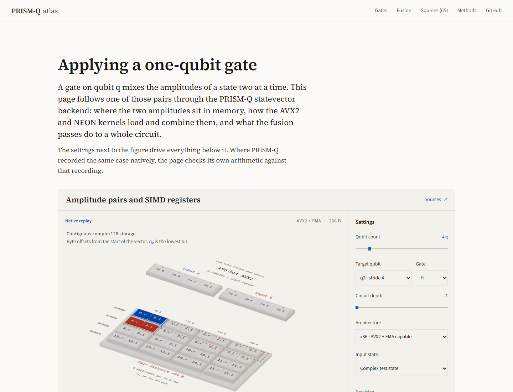
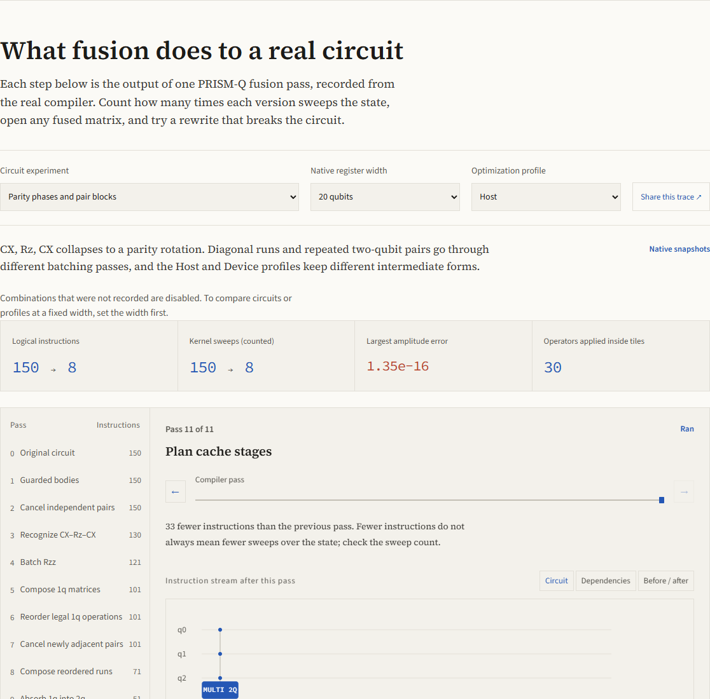

# PRISM-Q atlas

A browser companion to the simulator source. Two chapters are interactive: one
follows a single statevector gate from its matrix to memory and SIMD lanes, the
other replays native recordings of the fusion compiler. The other nine chapters
are source dossiers with cited evidence and no live experiment.



[Interactive atlas](https://abecoull.github.io/prism-q/atlas/) ·
[Five-stage video preview](public/preview/statevector.webm) ·
[Source-evidence matrix](research/source-evidence.md) ·
[Technical limitations](PROVENANCE.md)



[SIMD microscope](public/preview/execution-microscope.png) ·
[3D native matrix inspector](public/preview/operator-landscape.png) ·
[Rewrite counterexample on mobile](public/preview/rewrite-challenge-mobile.png)

## Run and validate

Requires Node 22.12 or newer. Dependencies and fonts are locked and bundled.

```sh
cd docs/atlas
npm ci
npm run dev
```

The gate laboratory takes 2 to 16 qubits, any target bit, seven unitary gates, a
rotation angle, up to four repeated applications, a CPU capability profile, a pair
selection, and five manual execution stages. The selected pair drives every panel:
the matrix, the indices, the memory view, the register lanes, and the validation
readout. The SVG view works without WebGL and supports keyboard selection. The
share button encodes the parameters in the URL.

The execution microscope steps through the load, lane swap, complex product, FMA
and store groups of one kernel iteration, with selectable matrix coefficients and
an Argand plot. The steps follow the source intrinsics; they are computed in
JavaScript, not captured from the CPU.

The compiler laboratory replays 31 native circuit records with 432 pass snapshots.
Pick a circuit family, a recorded width, the Host or Device profile, and a pass,
then inspect the IR, a conservative dependency graph, the native complex matrices,
or a 3D coefficient landscape. Kernel traversal counts, numerical checks and traffic
models are reported separately. The recording host has an 8 MiB last-level cache,
which puts the stage planner floor at 20 qubits. On that host the 20-qubit Host
record goes from 150 kernel traversals to 8 over the full pipeline, and the planner
accounts for the step from 41 to 8. A host with a larger cache records a higher floor
and keeps the batching passes at this width. These are counts, not timings. A rewrite
sandbox shows how deleting two X gates across a CX keeps the state normalized while
changing the answer.

```sh
npm run evidence
npm test
npm run build
npx playwright install chromium
npm run test:production
npm run test:visual
```

On Windows the browser tests use the installed Microsoft Edge, so no browser
download is needed. `npm run evidence` must run inside a full simulator checkout.
It verifies 65 evidence records, 40 source hashes, 140 native gate cases, 12 sampled
16-qubit native cases, and the compiler fixture's 31 records and 432 snapshots.
Source hashes normalize CRLF to LF. Each fixture is checked against the sources of
the commit that last wrote it, or the working tree while it is uncommitted, so the
check needs full Git history. Source changes made after a fixture was recorded do
not fail the check; the command lists them as files the fixtures predate.

Screenshot baselines depend on platform and browser. Only Windows Edge baselines
are committed. Set `ATLAS_VISUAL=1` to compare against them. For a new platform,
run `npm run test:visual:update`, inspect every image, then rerun the comparison.
CI runs the functional browser tests on Linux Chromium and skips screenshot
comparisons.

## Evidence and replay

The browser runs no native Rust, CUDA, MPI or SIMD code. The default small example
replays amplitudes recorded from PRISM-Q and compares them with the browser model.
Native cases cover every target at widths 2 through 6, all seven gates, and four
repeated steps at theta = pi/3. Sampled 16-qubit H, Z and Rz cases cover the
threaded tile, paired slice and diagonal scaling routes. The tests compare those
samples with the browser model, and the exporter checks every amplitude against a
scalar reference. Other parameter combinations run on the browser model alone and
are labeled as such. The CPU architecture selector changes the route explanation,
not the ISA the fixture was recorded on.

Regenerate native fixtures from the repository root:

```sh
node docs/atlas/scripts/generate-traces.mjs
node docs/atlas/scripts/generate-fusion-traces.mjs
cd docs/atlas
npm run evidence
```

This runs `cargo run --quiet --features parallel --example atlas_trace` with seed
42, records environment metadata, and saves amplitude snapshots. It runs no
benchmark. The gate exporter uses the public backend API. The compiler exporter is
an ignored unit test that calls the internal passes and reads the test-only kernel
counters; production kernels are unchanged. Compiler records execute on the CPU,
including those recorded with the Device profile. See
[trace schemas](TRACE-SCHEMA.md) and the
[compiler recording contract](research/fusion-traces.md).

Both generators check the audited implementation before running. A recording keeps
its own checkout revision and dirty-tree flag next to the audited revision. Source
fingerprints cover every file under `src` that Git tracks or would track (ignored
files are left out), the audited files, the Cargo manifests, build configuration and
the exporter scripts. For a clean recording, commit the producers, regenerate, then
commit the fixtures on their own. The audit comparison skips only the test-module
registration in `fusion.rs`; the full recording fingerprints include it. Changing
audited code requires a new source review before recording. A later commit with the
same audited code can record against the original audit revision.

Each claim is tagged as implementation, mathematical theory, analytical model,
empirical measurement, or proposal. The atlas contains no timing data, and no
proposed optimization is presented as implemented. The numerical reference builds a
full Kronecker operator instead of reusing the pair iterator.

## Structure and extension

| Directory         | Responsibility                                                        |
| ----------------- | --------------------------------------------------------------------- |
| `src/models/`     | Pure quantum algebra, address arithmetic, and hardware cost models    |
| `src/data/`       | Typed evidence, immutable source references, Anatomy geometry         |
| `src/renderers/`  | React Three Fiber and interactive SVG, independent of arithmetic      |
| `src/components/` | Reusable mathematical typesetting                                     |
| `src/chapters/`   | Native compiler replay and operator inspection                        |
| `src/store.ts`    | Synchronized experiment state and share URL validation                |
| `fixtures/`       | Versioned native amplitude snapshots and provenance                   |
| `tests/`          | Independent numerical references, hardware boundaries, browser checks |
| `research/`       | Audits, source matrix, design mapping, recording contract             |
| `scripts/`        | Trace export, source verification, geometry generation, capture       |

To add a chapter, audit its source first and add evidence records with a fixed
revision, an exact source range, a claim type and the limitations. Keep numerical
models pure and test them against an independent reference or native output. Pass
model state into renderers. Controls should change an algorithmic quantity, not
just the camera. Keep a keyboard path and a path that works without WebGL.

After a source audit, update the affected records and their revision, then run
`node scripts/update-evidence.mjs` to regenerate the Markdown matrix and the source
hash manifest. The command marks the current source as audited; it does not check
the implementation for you. Native fixtures and evidence keep their audited base
revision, and both recording families also record the checkout revision, current
producer hashes and export changes. The two fixture families have separate trace
schemas.

SVG paths are generated with the [Anatomy](https://github.com/wheresryan22/anatomy)
kit at a pinned revision. [Visual design](research/visual-design.md) covers the
geometric mapping, license and regeneration steps.

## Deployment and previews

`npm run build` writes a static `dist/` with relative asset paths, so it can be
served from a subdirectory. The documentation workflow builds and validates the
atlas, then copies it into `docs/book/atlas/` before the single GitHub Pages
deployment, so the book stays at the site root. The atlas goes live once these
changes are pushed and that workflow succeeds.

With a preview server running, capture screenshots and the five-stage video with
`node scripts/capture-preview.mjs http://127.0.0.1:4173`. Capture the execution
microscope, compiler and operator landscape with
`node scripts/capture-expansion.mjs http://127.0.0.1:4173`. Video recording needs
Playwright's matching ffmpeg helper. Capture pacing has nothing to do with
simulator execution time.
