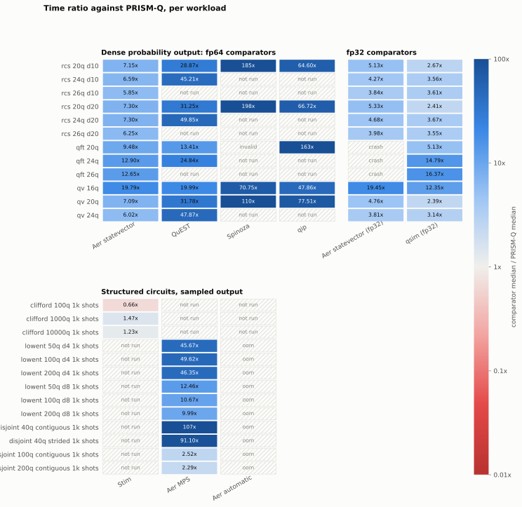

# Comparative Measurements

<!-- Generated by `python comparison/matrix.py report`. Do not edit by hand. -->

Comparative performance measurements against commonly used quantum simulators. These
results are intended to make performance characteristics reproducible and transparent
across representative workloads, not to rank projects: each simulator makes different
trade-offs, and a ratio here describes one workload on one host under the controls the
methodology page lists.

Measured on one Intel(R) Core(TM) i7-6700K CPU @ 4.00GHz (4 cores, 8 threads, 31.9 GB,
Windows 10) with PRISM-Q 0.37.0 at commit `fc7e0c9699`, run `20261103T090018-b6c9ed`, with
8 supplementary runs that re-measured individual rows. CPU only: no GPU or distributed
path of any simulator is measured.

- [Methodology](./comparison/methodology.md): workloads, timed regions, repetition and
  stopping rules, validation, and fairness controls.
- [Full results](./comparison/results.md): every table and figure, generated from the raw
  files.
- [Engineering report](./comparison/report.md): analysis of the gaps, their mechanisms,
  and their limits.
- [Earlier probability-vector run](./comparison/probability-vector.md): the 0.33.0
  comparison against six simulators at 16 to 24 qubits.



## Headline ratios

Comparator median time over PRISM-Q median time, over validated headline rows at the
headline thread count. Per-row values, spreads and intervals are on the full results page.

| Comparator | Rows | Families | Median ratio | Lowest | Highest |
| --- | --- | --- | --- | --- | --- |
| `aer-mps` | 10 | disjoint, lowent | 29.07x | 2.29x | 106.74x |
| `aer-statevector` | 12 | qft, qv, rcs | 7.22x | 5.85x | 19.79x |
| `aer-statevector-f32` | 9 | qv, rcs | 4.68x | 3.81x | 19.45x |
| `qip` | 5 | qft, qv, rcs | 66.72x | 47.86x | 163.45x |
| `qsim` | 12 | qft, qv, rcs | 3.58x | 2.39x | 16.37x |
| `quest` | 9 | qft, qv, rcs | 31.25x | 13.41x | 49.85x |
| `spinoza` | 4 | qv, rcs | 147.57x | 70.75x | 197.51x |
| `stim` | 3 | clifford | 1.23x | 0.66x | 1.47x |

Of 275 observations, 238 ran, 6 were not applicable, and 31 ended in a timeout,
out-of-memory refusal, crash or error; the full results page lists each with its reason.

## Reproducing

```bash
python -m venv comparison/.venv && comparison/.venv/Scripts/pip install -r comparison/requirements.txt
comparison/.venv/Scripts/python comparison/matrix.py run --profile smoke --out comparison/results/my-smoke
comparison/.venv/Scripts/python comparison/matrix.py run --profile reference --out comparison/results/my-run
comparison/.venv/Scripts/python comparison/matrix.py report comparison/results/my-run
```

Building the QuEST, Spinoza and qip comparators is described in `comparison/README.md`.
The smoke profile runs every family and adapter in about three minutes.
