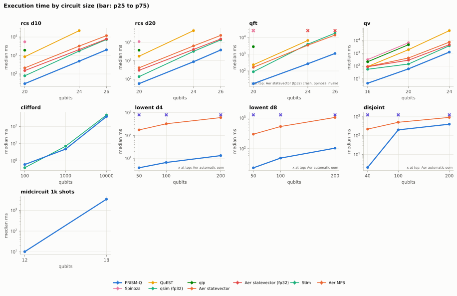
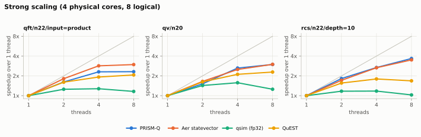
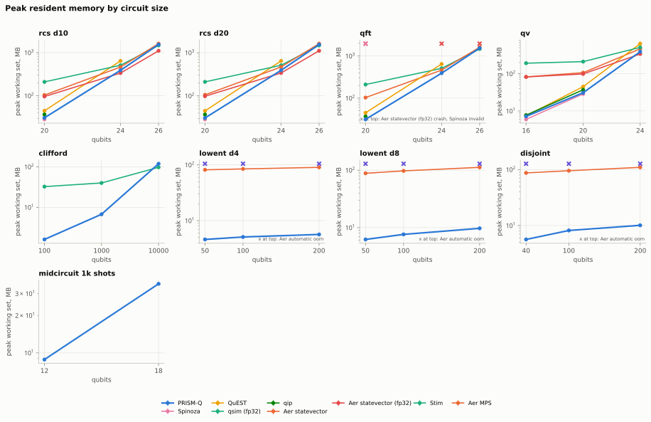
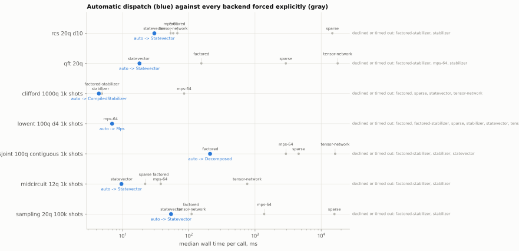
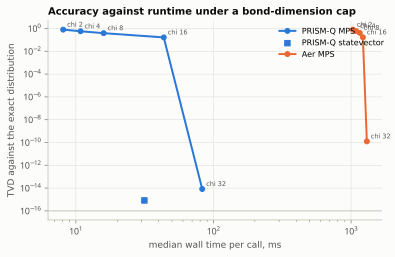
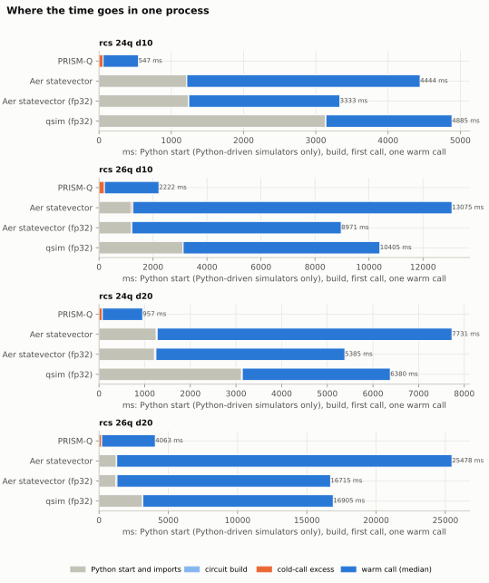
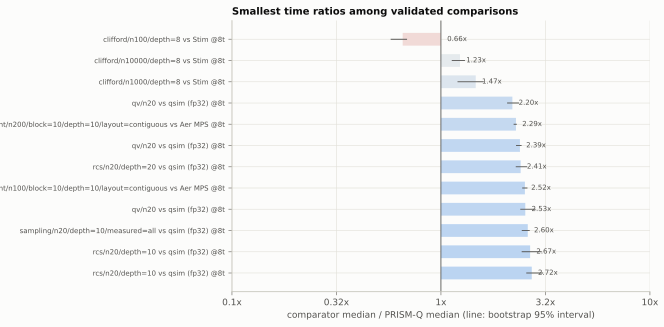

# Benchmark Matrix: Engineering Report

This report reads the reference run on the [full results page](./results.md): what was
measured, what each difference can be traced to, and how far the numbers carry. The
[methodology](./methodology.md) defines every term used here. The numbers quoted below
come from `derived.json`, `fusion.json` and `observations.jsonl` in
`comparison/results/matrix-reference-i7-6700k/`. All ratios are the comparator's median
call time over PRISM-Q's median call time on the same workload in the same pass, at 8
threads unless stated.

## Measurements in brief

| Area | Result on this host |
| --- | --- |
| Dense random brickwork, 20 to 26 qubits | Aer statevector 5.85x to 7.30x; qsim (fp32) 2.41x to 3.67x; Aer fp32 3.84x to 5.33x; QuEST 28.9x to 49.9x; qip 64.6x to 66.7x; Spinoza 185x to 198x |
| QFT on a random product state, 20 to 26 qubits | Aer statevector 9.48x to 12.9x; qsim 5.13x to 16.4x; QuEST 13.4x to 24.8x; qip 163x at 20 qubits |
| Quantum volume, 16 to 24 qubits | Aer statevector 6.02x to 19.8x; qsim 2.39x to 12.4x; QuEST 20.0x to 47.9x |
| Clifford brickwork against Stim | 0.66x at 100 qubits (0.40 ms against 0.62 ms), 1.47x at 1000, 1.23x at 10,000 |
| Shallow wide circuits against Aer MPS | 45.7x to 49.6x at depth 4, 9.99x to 12.5x at depth 8 |
| Disconnected 10-qubit components against Aer MPS | 107x and 91.1x at 40 qubits, 2.52x at 100, 2.29x at 200 |
| Sampling one million shots, 20 qubits | 144 ms PRISM-Q, 2.29 s Aer, 4.32 s qsim |
| Automatic dispatch | within 5% of the fastest forced backend on 6 of 7 rows; 1.05x on the 100-qubit shallow row |
| Peak memory at 26 qubits | 1.54 GB PRISM-Q, 1.62 GB Aer statevector, 1.11 GB Aer fp32, 1.47 GB qsim |
| Correctness | 79 of 81 checked dense outputs and 76 of 76 tested sampled outputs passed; the two failures are Spinoza's 20-qubit QFT and a forced 64-bond MPS on the same circuit; 64 validated headline comparisons |

## Experimental questions

The matrix was built to answer six questions, listed on the methodology page: dense
throughput at matched precision and threads, structured circuits beyond a dense state,
where the time goes in a process, thread and size scaling with memory, whether automatic
dispatch picks the fastest backend, and what accuracy a bond cap buys.

## Simulators and environment

PRISM-Q 0.37.0 (library source at commit `fc7e0c9`), Qiskit Aer 0.17.2, qsim 0.22.1
through qsimcirq, QuEST v4.3.0, Spinoza 0.5.1, RustQIP 1.5.0 and Stim 1.16.0, on one Intel
Core i7-6700K (4 cores, 8 threads, AVX2 and FMA, no AVX-512), 32 GB, Windows 10, rustc
1.99.0 (1.99.0-nightly for Spinoza and qip), Python 3.14.0. The QuEST compiler version was
not recorded. The results page carries the full host block, every package version, the run
identifiers and the load check taken before each run. The desktop ran an interactive
editor session beside the benchmark.

## Correctness

Of the 238 successful observations:

- 81 dense outputs were checked against their row's fp64 reference vector and 79 passed,
  within 1e-8 (fp64) or 1e-5 (fp32) total variation distance. The largest fp64 distance
  outside the accuracy study was 6.7e-15; fp32 distances ran from 3.1e-7 to 2.3e-6. 22
  more are the references themselves, and eight are the accuracy study's truncated MPS
  runs, whose distance is the measurement rather than a check.
- The two failures are on the 20-qubit QFT. Spinoza's vector is 0.86 from the reference.
  The same gate list matches on Spinoza with one thread at 15 and 16 qubits, and fails
  with eight threads from 15 qubits up (0.70 to 0.98), so the error sits in Spinoza's
  multithreaded path for these gates, which it enters at 15 qubits. The forced 64-bond MPS
  in the dispatch study is 1.3e-7 from the reference, a truncation error past the 1e-8
  tolerance.
- 76 sampled outputs passed every per-statistic test, up to 256 statistics per row,
  including the 10,000-qubit Clifford rows, whose deterministic bits matched exactly on
  PRISM-Q and Stim. Every statistic was tested against the exact light-cone reference
  except two on the 24-qubit sampling row, whose cones exceed 20 qubits and were tested
  against a second simulator. 12 more ran under 100 shots; only their deterministic bits
  were checked.
- 36 are thread-scaling samples below 8 threads; the output of each workload was checked
  once, at 8 threads.
- 170 of 170 reseeded observations (PRISM-Q, Aer, Stim) returned the same output hash on
  every call.

## Dense circuits



Random brickwork at 24 qubits and depth 10 takes 490 ms per call in PRISM-Q, 3.23 s in Aer
statevector, 2.09 s in Aer fp32, 1.75 s in qsim (fp32) and 22.2 s in QuEST. The ratio
against Aer stays between 5.85x and 7.30x from 20 to 26 qubits at both depths; against
qsim it moves from 2.4x to 2.7x at 20 qubits to 3.6x at 24 and 26. QuEST reads 28.9x at 20
qubits and 45.2x at 24, depth 10.

**Fusion counts.** A separate call to PRISM-Q's fusion pass on the same gate list
(`matrix.py fusion-counts`, not the timed run) turns the 835 gates of that circuit into 7
instructions, all `Multi2q`, the tiled pass that applies a run of one- and two-qubit gates
to each cache-sized tile of the state before moving on. Depth 20 becomes 11 instructions
and 24-qubit QV 23. On a 256 MB state each such instruction is roughly one pass over
memory, so the circuit costs about 7 passes rather than hundreds; that per-instruction
cost is inferred, not profiled. QuEST, Spinoza and qip apply every gate as its own pass,
which is consistent with both their gap and its growth with state size.

**Aer and qsim, hypothesis.** Both also fuse, into dense blocks of up to a few qubits
applied one at a time across the whole state. Neither exposes its fused gate count, so the
remaining 2.4x to 7.3x gap is attributed to the number of full-state sweeps per circuit by
analogy only, not by measurement. Aer's own timer accounts for over 99% of its wall time
at 24 qubits (3,186 of 3,205 ms on the depth-10 cold call), so the gap is not Python
overhead.

**QFT.** The QFT runs on a seeded random product state; on |0...0> its output is uniform
whatever the phase angles, so the input layer is what lets validation see the phases. The
26-qubit QFT runs in 1.11 s in PRISM-Q against 14.1 s in Aer and 18.2 s in qsim. The
fusion pass reduces its 416 gates to 15 instructions (4 `BatchPhase`, 4 `DiagonalBatch`, 6
`Multi2q` and 1 `MultiFused`), and PRISM-Q can also recognize a textbook QFT at dispatch
and run it on a block FFT. The run metadata does not record which path ran, so this report
does not split the QFT gap between them. Aer's fp32 method crashed on all three QFT rows
(see Limits).

**Precision groups.** fp32 runs halve the state's memory traffic. Aer fp32 takes 65% of
Aer fp64's time at 24 qubits depth 10 (2.09 s against 3.23 s) and 66% at 26 qubits.
PRISM-Q has no fp32 path, so the fp32 tables carry its fp64 time for scale only.

## Clifford circuits

| Qubits | PRISM-Q | Stim | Stim / PRISM-Q (95% CI) |
| --- | --- | --- | --- |
| 100 | 0.62 ms | 0.40 ms | 0.66x (0.58 to 0.69) |
| 1000 | 4.87 ms | 7.14 ms | 1.47x (1.21 to 1.60) |
| 10,000 | 376 ms | 464 ms | 1.23x (1.13 to 1.30) |

Each call compiles the depth-8 brickwork and draws 1000 shots. PRISM-Q routes these
circuits to its compiled Clifford sampler (`CompiledStabilizer` via
`CompiledCliffordSampler`). Stim's timed call is `compile_sampler` plus `sample`. At 100
qubits Stim's call is 0.22 ms shorter. Neither simulator's fixed per-call cost was
separated from its per-shot cost on these rows, so the 100-qubit difference is not
attributed to either. The two outputs also differ in kind: Stim returns per-shot bits and
PRISM-Q a histogram, and building the histogram of Stim's bits happens after its timer.
Stim runs single-threaded; PRISM-Q ran with 8 threads available, and no single-thread
PRISM-Q row was measured. At 10,000 qubits PRISM-Q's peak working set was 120 MB and
Stim's 98 MB.

## Structured circuits beyond a dense state

| Workload | PRISM-Q route | PRISM-Q | Aer MPS | Ratio |
| --- | --- | --- | --- | --- |
| shallow, 50 qubits, depth 4 | `Mps` via `NativeSampling` | 3.83 ms | 175 ms | 45.7x |
| shallow, 200 qubits, depth 4 | `Mps` | 13.1 ms | 607 ms | 46.4x |
| shallow, 200 qubits, depth 8 | `Mps` | 105 ms | 1.04 s | 9.99x |
| disconnected, 40 qubits | `Decomposed` via `IndependentBlocks` | 2.09 ms | 223 ms | 107x |
| disconnected, 40 qubits, strided | `Decomposed` via `IndependentBlocks` | 2.46 ms | 224 ms | 91.1x |
| disconnected, 100 qubits | `Decomposed` via `PerShot` | 203 ms | 512 ms | 2.52x |
| disconnected, 200 qubits | `Decomposed` via `PerShot` | 405 ms | 926 ms | 2.29x |

Both simulators run an MPS on the shallow rows; the ratio falls from about 46x at depth 4
to about 10x at depth 8, as the bond dimension grows and the per-gate contraction cost
starts to dominate a fixed per-call cost. On the disconnected rows the route changes with
width: at 40 qubits PRISM-Q samples the four independent blocks directly
(`IndependentBlocks`), and at 100 and 200 qubits it takes a per-shot decomposed route,
which costs about 20 ms per 10-qubit component per call and brings the ratio to 2.3x to
2.5x. Placing the components on interleaved qubits moved PRISM-Q from 2.09 to 2.46 ms and
Aer MPS from 223 to 224 ms at 40 qubits.

Aer's `automatic` method selected its statevector on all ten of these rows and stopped
with "Insufficient memory"; those cells are recorded as `oom`.

## Sampling

| Qubits | Simulator | 1 shot | 1M shots | Per 1M shots |
| --- | --- | --- | --- | --- |
| 20 | PRISM-Q | 33.5 ms | 144 ms | 111 ms |
| 20 | Aer statevector | 211 ms | 2.29 s | 2.08 s |
| 20 | qsim | 60.5 ms | 4.32 s | 4.26 s |
| 24 | PRISM-Q | 581 ms | 796 ms | 215 ms |
| 24 | Aer statevector | 3.17 s | 10.6 s | 7.44 s |
| 24 | qsim | 2.09 s | 6.93 s | 4.84 s |

The one-shot call is the simulation; the slope is the marginal cost of sampling and
returning the result. The one-shot outputs are too few shots to test statistically, so
their timings stand on the million-shot rows of the same circuit, which validated.
PRISM-Q's route for these rows is `TerminalStatevector`: simulate once, then draw from the
final state. Its marginal cost per million shots is 111 ms at 20 qubits against Aer's 2.08
s, which puts most of the million-shot gap in sampling and result construction rather than
simulation. Each simulator returns a different object (PRISM-Q a count map, Aer a `Result`
with a counts dictionary, qsim a per-shot array), so part of the slope is output format,
and the matrix does not separate the two. Measuring half the qubits at 20 qubits and one
million shots took PRISM-Q 80 ms, Aer 1.62 s and qsim 4.20 s.

## Mid-circuit measurement

PRISM-Q only: Aer simulates these circuits shot by shot and was left out of the reference
run for its run time, and qsim's adapter carries no reset or feed-forward. PRISM-Q took
10.2 ms for 1000 shots and 23.0 ms for 10,000 at 12 qubits, and 3.51 s for 1000 shots at
18 qubits, all on its `PerShot` statevector route. At 12 qubits the marginal cost between
the two shot counts is about 1.4 us per shot on a 64 KB state; at 18 qubits the call
averages 3.5 ms per shot on a 4 MB state. That step is far larger than the 64x growth in
state size; the 12-qubit state fits in L2 and the 18-qubit state does not fit in this
CPU's 8 MB L3 alongside the per-shot working copy, which is a plausible cause but was not
profiled. Every statistic of all three rows matched the exact reference.

## Thread scaling



| Workload, 8 threads over 1 | PRISM-Q | Aer statevector | qsim | QuEST |
| --- | --- | --- | --- | --- |
| rcs, 22 qubits | 3.67x | 3.50x | 1.03x | 1.68x |
| QFT, 22 qubits | 2.32x | 2.97x | 1.16x | 2.07x |
| QV, 20 qubits | 2.98x | 3.00x | 1.25x | 2.29x |

The host has 4 physical cores; past 4 threads no simulator gains much. qsim's time barely
moves with thread count on these rows (445 ms at 1 thread, 433 ms at 8 on the 22-qubit
brickwork). qsim ran with `QSimOptions` defaults, including its default fusion size; no
tuned qsim configuration was measured, so this run does not say what limits it.

## Memory



Peak working sets cover the whole measuring process, including the harness's conversion of
the output to fp64 after the timer. PRISM-Q peaks at 390 MB at 24 qubits (256 MB of fp64
amplitudes plus the 128 MB probability vector) and 1.54 GB at 26; Aer statevector at 464
MB and 1.62 GB; Aer fp32 at 337 MB and 1.11 GB; qsim at 511 MB and 1.47 GB; QuEST at 645
MB at 24. The Python-driven simulators carry about 80 MB of interpreter and library before
any state. On the structured rows PRISM-Q stayed between 5 and 10 MB through 200 qubits
and Aer MPS between 82 and 112 MB.

## Automatic dispatch



| Workload | Auto picked | Auto | Fastest forced | auto / fastest |
| --- | --- | --- | --- | --- |
| rcs 20 qubits | Statevector | 30.1 ms | statevector 30.0 ms | 1.00x |
| QFT 20 qubits | Statevector | 17.9 ms | statevector 17.5 ms | 1.03x |
| Clifford 1000 qubits | CompiledStabilizer | 4.37 ms | stabilizer 4.60 ms | 0.95x |
| shallow 100 qubits | Mps | 6.92 ms | mps-64 6.57 ms | 1.05x |
| disconnected 100 qubits | Decomposed | 209 ms | factored 211 ms | 0.99x |
| sampling 20 qubits, 100k shots | Statevector | 53.8 ms | statevector 54.4 ms | 0.99x |
| mid-circuit 12 qubits | Statevector | 9.58 ms | statevector 9.62 ms | 1.00x |

On every row the automatic choice is the forced backend it resolves to, or within 5% of
the fastest; the shallow row reads 1.05x. On the QFT the forced 64-bond MPS ran but its
output missed the tolerance (TVD 1.3e-7), so it is not a candidate for the fastest. The
plan itself (`Simulate::plan`, median of 21 calls) costs 28 us to 2.4 ms; the largest is
the 100-qubit disconnected circuit, where finding the components is part of the decision.
Forced backends that cannot take a circuit refuse it with a reason (stabilizer backends on
non-Clifford gates, sparse and factored past their size caps), and the tensor-network
backend ran past the 180 s timeout on two rows.

## Accuracy under a bond cap



On the 20-qubit, depth-10 brickwork, whose exact bond dimension is 32:

| Bond cap | PRISM-Q MPS | TVD | Aer MPS | TVD |
| --- | --- | --- | --- | --- |
| 2 | 8.1 ms | 0.79 | 1.03 s | 0.79 |
| 8 | 15.9 ms | 0.39 | 1.16 s | 0.41 |
| 16 | 43.5 ms | 0.17 | 1.22 s | 0.17 |
| 32 | 82.9 ms | 8.3e-15 | 1.30 s | 1.3e-10 |

Both MPS implementations reach the same accuracy at each cap; truncation error depends on
the circuit, not on the simulator. PRISM-Q's time grows from 8 ms to 83 ms with the cap
and Aer's from 1.03 s to 1.30 s, so on this row Aer's time is dominated by a cost that
does not depend on the bond dimension. Every call here returns the full 2^20 probability
vector, and the matrix does not separate that extraction from the MPS evolution, so the
fixed cost may be the extraction rather than the MPS. At cap 32 the exact statevector is
faster for PRISM-Q (31.5 ms) than the MPS (82.9 ms).

## Where the time goes in a process



A Python-driven simulator pays 0.18 to 5.2 s to start the interpreter and import its
library before the first gate (qsim's cirq import is the largest). Building the circuit
object from the gate list costs under 50 ms everywhere except Stim's 10,000-qubit circuit
(330 ms). The first call exceeds the warm median by under 10% on 73% of observations; the
largest excess is PRISM-Q's 24-qubit, one-million-shot sampling row, 901 ms over a 796 ms
warm median. None of these phases is inside the headline numbers, which are warm calls.

## Lowest ratios



The validated comparisons with the smallest ratios are the Clifford rows against Stim
(0.66x, 1.23x, 1.47x), then qsim on the 20-qubit circuits (2.20x to 2.89x across QV,
brickwork, the two extra seeds and 1000-shot sampling) and the 100- and 200-qubit
disconnected rows against Aer MPS (2.52x and 2.29x). In each case the comparator uses a
representation suited to the circuit (a tableau, an MPS, a fused fp32 statevector).

## Limits to generalization

- One host. Ratios on dense rows depend on memory bandwidth, cache size and core count; a
  server with eight memory channels changes the balance between sweep count and compute.
- Windows only. Aer's single-precision method crashed on this host on circuits of 14
  qubits or fewer (heap corruption, reproduced outside the harness) and on the QFT at 20
  to 26 qubits with fusion on (access violation; the same circuit completes with fusion
  off); those cells are recorded as crashes, and the behaviour may not occur on Linux.
- Up to five warm samples per cell, fewer where the row's budget ran out (21 of 238 cells
  have three or four): enough to bound noise at about 10% on this host, not to resolve
  smaller differences.
- Absolute times drift between passes more than ratios do. The dense rows were measured in
  two clean passes; between them the median absolute time moved by 2% (10th to 90th
  percentile 0.91x to 1.03x), and on the 24-qubit, depth-20 brickwork PRISM-Q moved 0.78x
  and Aer statevector 0.76x together. Every published ratio is between two simulators
  measured in the same pass, and the earlier passes are kept in `superseded.jsonl`.
- The structured families are built to have the structure their specialized method
  exploits. They show the cost when the structure is present, not how often it is.
- GPU, distributed, 16-thread and ISA-variant measurements were not taken; the methodology
  page lists why.

## Reproducing

```bash
comparison/.venv/Scripts/python comparison/matrix.py run --profile reference --out comparison/results/my-run
comparison/.venv/Scripts/python comparison/matrix.py fusion-counts comparison/results/my-run
comparison/.venv/Scripts/python comparison/matrix.py report comparison/results/my-run
```

The main reference run took 90.5 minutes. Eight supplementary runs followed, each recorded
in the manifest with its command and load check: the Clifford rows re-measured against
Stim, the mid-circuit rows re-measured without Aer, four passes over the 24-qubit depth-20
brickwork row, and two passes over every dense row after the QFT input and the qsim timed
region changed (72.5 minutes on a busy host, then 44.8 minutes on a quiet one). The last
pass is the published one for the dense rows; the manifest's code hashes identify the
runner and harness each pass used.

## Follow-up opportunities, ranked by evidence

1. **Per-call cost on small Clifford circuits.** Measured: 0.62 ms against Stim's 0.40 ms
   at 100 qubits, while the gap reverses at 1000 and 10,000. A split of fixed and per-shot
   cost on these rows (the sampling family's one-shot method) and a single-thread PRISM-Q
   row would locate the 0.22 ms.
2. **Per-shot cost on mid-circuit circuits past cache.** Measured: about 1.4 us per
   marginal shot at 12 qubits, 3.5 ms per shot at 18. Not yet profiled; a branch-merging
   or deferred-measurement route would avoid one state copy per shot where the circuit
   permits it.
3. **Decomposed per-shot route at 100 and more qubits.** Measured: 203 ms at 100 qubits
   against 2.09 ms at 40 for the same 10-qubit components, after the route changes from
   `IndependentBlocks` to `PerShot`. The independent-block sampler may extend to wider
   registers.
4. **QFT thread scaling.** Measured: 2.32x at 8 threads against Aer's 2.97x on the
   22-qubit QFT. Whether the FFT path or the fused pass limits it is not known.
