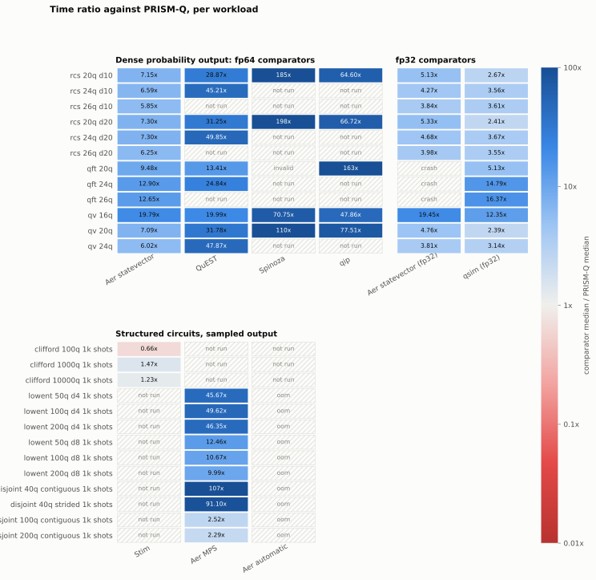
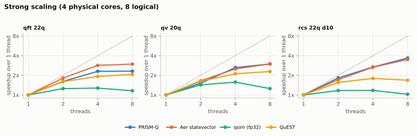
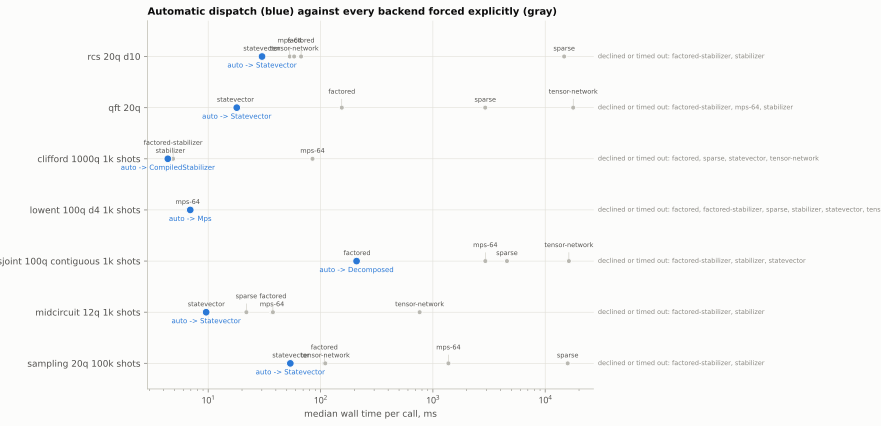

# Benchmark Matrix: Results

<!-- Generated by `python comparison/matrix.py report`. Do not edit by hand. -->

Time per call for the same circuits in PRISM-Q and other simulators, on one desktop. Ratio
= comparator median time / PRISM-Q median time. Cells: median time (ratio). Raw data and
spreads: `comparison/results/matrix-reference-i7-6700k/`.

## Dense circuits

| Workload | PRISM-Q | Aer | QuEST | Spinoza | qip | Aer fp32 | qsim fp32 |
| --- | --- | --- | --- | --- | --- | --- | --- |
| rcs 20q d10 | 29.6 ms | 212 ms (7.15x) | 855 ms (28.9x) | 5.48 s (185x) | 1.91 s (64.6x) | 152 ms (5.13x) | 79.2 ms (2.67x) |
| rcs 24q d10 | 490 ms | 3.23 s (6.59x) | 22.16 s (45.2x) | - | - | 2.09 s (4.27x) | 1.75 s (3.56x) |
| rcs 26q d10 | 2.02 s | 11.82 s (5.85x) | - | - | - | 7.76 s (3.84x) | 7.29 s (3.61x) |
| rcs 20q d20 | 56.4 ms | 412 ms (7.30x) | 1.76 s (31.3x) | 11.15 s (198x) | 3.77 s (66.7x) | 301 ms (5.33x) | 136 ms (2.41x) |
| rcs 24q d20 | 884 ms | 6.46 s (7.30x) | 44.08 s (49.8x) | - | - | 4.14 s (4.68x) | 3.24 s (3.67x) |
| rcs 26q d20 | 3.87 s | 24.20 s (6.25x) | - | - | - | 15.42 s (3.98x) | 13.75 s (3.55x) |
| qft 20q | 17.4 ms | 165 ms (9.48x) | 233 ms (13.4x) | invalid | 2.84 s (163x) | crash | 89.1 ms (5.13x) |
| qft 24q | 269 ms | 3.47 s (12.9x) | 6.68 s (24.8x) | - | - | crash | 3.97 s (14.8x) |
| qft 26q | 1.11 s | 14.08 s (12.6x) | - | - | - | crash | 18.22 s (16.4x) |
| qv 16q | 4.54 ms | 89.9 ms (19.8x) | 90.8 ms (20.0x) | 321 ms (70.8x) | 217 ms (47.9x) | 88.3 ms (19.4x) | 56.1 ms (12.3x) |
| qv 20q | 60.5 ms | 429 ms (7.09x) | 1.92 s (31.8x) | 6.67 s (110x) | 4.69 s (77.5x) | 288 ms (4.76x) | 144 ms (2.39x) |
| qv 24q | 1.23 s | 7.43 s (6.02x) | 59.08 s (47.9x) | - | - | 4.71 s (3.81x) | 3.88 s (3.14x) |

## Structured circuits

| Workload | PRISM-Q | Stim | Aer MPS | Aer auto |
| --- | --- | --- | --- | --- |
| clifford 100q 1k shots | 616 us | 404 us (0.66x) | - | - |
| clifford 1000q 1k shots | 4.87 ms | 7.14 ms (1.47x) | - | - |
| clifford 10000q 1k shots | 376 ms | 464 ms (1.23x) | - | - |
| lowent 50q d4 1k shots | 3.83 ms | - | 175 ms (45.7x) | out of memory |
| lowent 100q d4 1k shots | 6.55 ms | - | 325 ms (49.6x) | out of memory |
| lowent 200q d4 1k shots | 13.1 ms | - | 607 ms (46.4x) | out of memory |
| lowent 50q d8 1k shots | 23.9 ms | - | 298 ms (12.5x) | out of memory |
| lowent 100q d8 1k shots | 49.6 ms | - | 529 ms (10.7x) | out of memory |
| lowent 200q d8 1k shots | 105 ms | - | 1.04 s (9.99x) | out of memory |
| disjoint 40q contiguous 1k shots | 2.09 ms | - | 223 ms (107x) | out of memory |
| disjoint 40q strided 1k shots | 2.46 ms | - | 224 ms (91.1x) | out of memory |
| disjoint 100q contiguous 1k shots | 203 ms | - | 512 ms (2.52x) | out of memory |
| disjoint 200q contiguous 1k shots | 405 ms | - | 926 ms (2.29x) | out of memory |
| midcircuit 12q 1k shots | 10.1 ms | - | - | - |
| midcircuit 12q 10k shots | 23.0 ms | - | - | - |
| midcircuit 18q 1k shots | 3.51 s | - | - | - |

## Sampling

| Workload | PRISM-Q | Aer | Aer fp32 | qsim fp32 |
| --- | --- | --- | --- | --- |
| sampling 16q 1 shot | 4.06 ms | 49.1 ms (12.1x) | 52.0 ms (12.8x) | 32.8 ms (8.07x) |
| sampling 16q 1M shots | 50.3 ms | 1.70 s (33.8x) | 1.63 s (32.5x) | 3.63 s (72.2x) |
| sampling 20q 1 shot | 33.5 ms | 211 ms (6.30x) | 150 ms (4.49x) | 60.5 ms (1.81x) |
| sampling 20q 1k shots | 32.5 ms | 226 ms (6.93x) | 159 ms (4.89x) | 84.7 ms (2.60x) |
| sampling 20q 100k shots | 50.2 ms | 454 ms (9.04x) | 413 ms (8.22x) | 523 ms (10.4x) |
| sampling 20q 1M shots | 144 ms | 2.29 s (15.9x) | 2.29 s (15.9x) | 4.32 s (30.0x) |
| sampling 20q half measured 1M shots | 80.0 ms | 1.62 s (20.2x) | 1.59 s (19.9x) | 4.20 s (52.5x) |
| sampling 24q 1 shot | 581 ms | 3.17 s (5.45x) | 2.29 s (3.94x) | 2.09 s (3.60x) |
| sampling 24q 1M shots | 796 ms | 10.61 s (13.3x) | 8.00 s (10.0x) | 6.93 s (8.71x) |

## Thread scaling

| Speedup, 8 threads over 1 | PRISM-Q | Aer | qsim fp32 | QuEST |
| --- | --- | --- | --- | --- |
| qft 22q | 2.32x | 2.97x | 1.16x | 2.07x |
| qv 20q | 2.98x | 3.00x | 1.25x | 2.29x |
| rcs 22q d10 | 3.67x | 3.50x | 1.03x | 1.68x |

## Automatic dispatch

| Workload | Automatic choice | Fastest forced backend | Automatic / fastest |
| --- | --- | --- | --- |
| rcs 20q d10 | Statevector, 30.1 ms | statevector, 30.0 ms | 1.00x |
| qft 20q | Statevector, 17.9 ms | statevector, 17.5 ms | 1.03x |
| clifford 1000q 1k shots | CompiledStabilizer, 4.37 ms | stabilizer, 4.60 ms | 0.95x |
| lowent 100q d4 1k shots | Mps, 6.92 ms | mps-64, 6.57 ms | 1.05x |
| disjoint 100q contiguous 1k shots | Decomposed, 209 ms | factored, 211 ms | 0.99x |
| midcircuit 12q 1k shots | Statevector, 9.58 ms | statevector, 9.62 ms | 1.00x |
| sampling 20q 100k shots | Statevector, 53.8 ms | statevector, 54.4 ms | 0.99x |

Forced backends without a valid output: factored (2 refused); factored-stabilizer (6
refused); mps-64 (1 invalid); sparse (2 refused); stabilizer (6 refused); tensor-network
(2 timeout).

## Accuracy under a bond cap

rcs 20q d10; distance from the exact vector.

| Bond cap | PRISM-Q MPS | Distance | Aer MPS | Distance |
| --- | --- | --- | --- | --- |
| 2 | 8.10 ms | 0.79 | 1.03 s | 0.79 |
| 4 | 10.8 ms | 0.57 | 1.09 s | 0.6 |
| 8 | 15.9 ms | 0.39 | 1.16 s | 0.41 |
| 16 | 43.5 ms | 0.17 | 1.22 s | 0.17 |
| 32 | 82.9 ms | 8.3e-15 | 1.30 s | 1.3e-10 |

## Peak memory

| Peak working set | PRISM-Q | Aer | QuEST | Spinoza | qip | Aer fp32 | qsim fp32 |
| --- | --- | --- | --- | --- | --- | --- | --- |
| rcs 20q d10 | 31 MB | 104 MB | 45 MB | 28 MB | 37 MB | 96 MB | 210 MB |
| rcs 24q d10 | 390 MB | 464 MB | 645 MB | n/a | n/a | 337 MB | 511 MB |
| rcs 26q d10 | 1.51 GB | 1.58 GB | n/a | n/a | n/a | 1.08 GB | 1.44 GB |

## Correctness

- Dense: 79 of 81 within tolerance of the fp64 reference.
- Sampled: 76 of 76 passed; 12 under 100 shots checked on deterministic bits only.

Cells without a valid timing:

| Simulator | Outcome | Workloads | Detail |
| --- | --- | --- | --- |
| Aer automatic | out of memory | 6 shallow, 4 disconnected rows | Insufficient memory to run circuit circuit-46 using the statevector simulator |
| Aer statevector (fp32) | crash | qft 20q, qft 24q, qft 26q | exit 0xC0000005 |
| Spinoza | invalid | qft 20q | distance 0.86 from the reference |

## Setup

| Item | Value |
| --- | --- |
| Host | Intel Core i7-6700K, 4 cores, 8 threads, Windows 10 |
| PRISM-Q | 0.37.0, rustc 1.99.0, `parallel` |
| Python | 3.14.0 |
| Commit | `fc7e0c9699` |
| Runs | `20261103T090018-b6c9ed` and 8 supplementary runs |
| Aer statevector | 0.17.2, double |
| Aer statevector (fp32) | 0.17.2, single |
| Aer automatic | 0.17.2, double |
| Aer MPS | 0.17.2, double |
| qsim (fp32) | 0.22.1, single |
| QuEST | v4.3.0, double |
| Spinoza | 0.5.1 (git f900971), double |
| qip | 1.5.0, double |
| Stim | 1.16.0, exact (tableau) |
