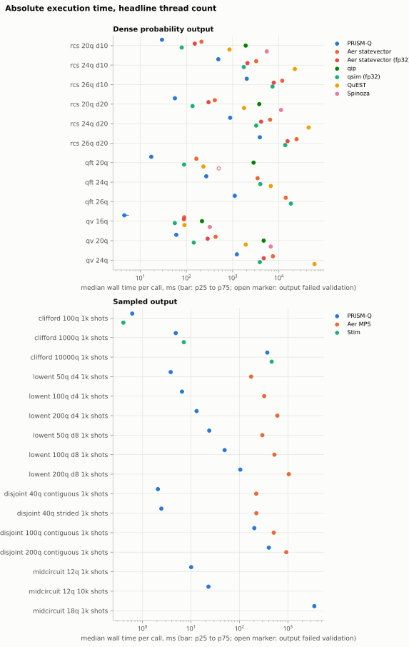

# Benchmark Matrix: Full Results

<!-- Generated by `python comparison/matrix.py report`. Do not edit by hand. -->

Comparative performance measurements against commonly used quantum simulators. These
results are intended to make performance characteristics reproducible and transparent
across representative workloads, not to rank projects: each simulator makes different
trade-offs, and a ratio here describes one workload on one host under the controls the
methodology page lists.

Raw data: `comparison/results/matrix-reference-i7-6700k/` in the repository
(`observations.jsonl`, `superseded.jsonl`, `manifest.json`, `samples.csv`, `summary.csv`,
`derived.json`, `fusion.json`, `circuits.jsonl.gz`).

## Host and software

| Field | Value |
| --- | --- |
| CPU | Intel(R) Core(TM) i7-6700K CPU @ 4.00GHz |
| Cores | 4 physical, 8 logical |
| CPU flags | AVX, AVX2, F16C, FMA3, SSE42 |
| RAM | 31.9 GB |
| GPU (not used) | NVIDIA GeForce GTX 1080 Ti, 11264 MiB, 581.42 |
| OS | Windows 10 |
| Power plan | 381b4222-f694-41f0-9685-ff5bb260df2e  (Balanced) |
| rustc (PRISM-Q) | 1.99.0, release profile, features `parallel`, RUSTFLAGS none |
| rustc (Spinoza, qip) | 1.99.0-nightly |
| C++ (QuEST) | not recorded |
| Python | 3.14.0, NumPy BLAS scipy-openblas 0.3.33.112.0 |
| Commit | `fc7e0c96996590ccc69c1cd0fea7322365b9b9b7` plus the uncommitted harness and runner changes that introduced this matrix; the library source is that commit's |
| Run | `20261103T090018-b6c9ed`, profile `reference`, 90.51 min |
| Supplementary run | `20261103T103224-246aba`, 2.29 min, re-measured 3 workloads (clifford), moving 9 earlier records to `superseded.jsonl` |
| Supplementary run | `20261103T103447-8e5ea0`, 0.41 min, re-measured 3 workloads (midcircuit), moving 12 earlier records to `superseded.jsonl` |
| Supplementary run | `20261103T103517-c715f0`, 0.45 min, re-measured 1 workloads (rcs), moving 1 earlier records to `superseded.jsonl` |
| Supplementary run | `20261103T104656-d00d02`, 1.27 min, re-measured 1 workloads (rcs), moving 2 earlier records to `superseded.jsonl` |
| Supplementary run | `20261103T104838-b5c4aa`, 1.41 min, re-measured 1 workloads (rcs), moving 3 earlier records to `superseded.jsonl` |
| Supplementary run | `20261103T105026-5ab2ce`, 6.03 min, re-measured 1 workloads (rcs), moving 5 earlier records to `superseded.jsonl` |
| Supplementary run | `20261103T185850-1959bb`, 72.5 min, re-measured 21 workloads (qft, qv, rcs), moving 143 earlier records to `superseded.jsonl` |
| Supplementary run | `20261103T202523-0a42e5`, 44.82 min, re-measured 21 workloads (qft, qv, rcs), moving 145 earlier records to `superseded.jsonl` |
| Peak memory | largest PeakWorkingSetSize over the child and its descendants, sampled every 20 ms and once more after exit; the counter only rises, so the last sample bounds the peak from below |

## Simulators

| Adapter | Simulator | Version | Precision | Representation | Output modes |
| --- | --- | --- | --- | --- | --- |
| `prismq` | PRISM-Q (auto dispatch) | 0.37.0 | double | dispatcher picks per circuit | counts, probs |
| `aer-statevector` | Qiskit Aer (statevector) | 0.17.2 | double | dense statevector | counts, probs |
| `aer-statevector-f32` | Qiskit Aer (statevector, single) | 0.17.2 | single | dense statevector | counts, probs |
| `aer-automatic` | Qiskit Aer (automatic) | 0.17.2 | double | Aer picks the method per circuit | counts, probs |
| `aer-mps` | Qiskit Aer (matrix_product_state) | 0.17.2 | double | matrix product state | counts, probs |
| `qsim` | qsim (qsimcirq) | 0.22.1 | single | dense statevector | counts, probs |
| `quest` | QuEST (OpenMP) | v4.3.0 | double | dense statevector | probs |
| `spinoza` | Spinoza | 0.5.1 (git f900971) | double | dense statevector | probs |
| `qip` | RustQIP (qip) | 1.5.0 | double | dense statevector | probs |
| `stim` | Stim | 1.16.0 | exact (tableau) | stabilizer tableau, compiled sampler | counts |

## Compatibility matrix

What each simulator, as configured here, can be asked to do. `adapter: no` means the
harness does not drive that feature for that simulator, not that the simulator lacks it.

| Capability | `prismq` | `aer-statevector` | `aer-statevector-f32` | `aer-automatic` | `aer-mps` | `qsim` | `quest` | `spinoza` | `qip` | `stim` |
| --- | --- | --- | --- | --- | --- | --- | --- | --- | --- | --- |
| Dense probabilities (rcs, qft, qv) | yes | yes | yes (fp32) | yes | yes | yes (fp32) | yes | yes | yes | no (measurements only) |
| Shot sampling | yes | yes | yes | yes | yes | yes | adapter: no | adapter: no | adapter: no | yes |
| Mid-circuit measure, reset, feed-forward | yes | yes | yes | yes | yes | adapter: no | adapter: no | adapter: no | adapter: no | Clifford only |
| Beyond 2^30 amplitudes | yes (stabilizer, MPS, factored) | no | no | picks a method | yes | no | no | no | no | Clifford only |
| Threads | Rayon | OpenMP | OpenMP | OpenMP | OpenMP | OpenMP | OpenMP | Rayon | Rayon | single-threaded |
| GPU path (not measured here) | CUDA feature | separate GPU build | separate GPU build | separate GPU build | separate GPU build | CUDA build | CUDA build | no | no | no |

## Workload families

| Family | Construction |
| --- | --- |
| `rcs` | dense random circuit: per layer an Rz Ry Rz rotation with uniform random angles on every qubit, then CX on alternating nearest-neighbour pairs (brickwork on a line) |
| `qft` | textbook quantum Fourier transform from prism_q::circuits::qft_circuit, expanded to H, CP, SWAP, applied to a seeded random product state (Ry then Rz on every qubit); on |0...0> every CP has its control in |0>, so the output would be uniform whatever the CP angles |
| `qv` | quantum volume from prism_q::circuits::quantum_volume_circuit: n layers, each a random pairing of the qubits with a random SU(4) per pair decomposed into CX, Ry and Rz |
| `clifford` | random Clifford brickwork: per layer one of H, S, Sdg, X, Z, HS uniformly on every qubit, then CX on alternating nearest-neighbour pairs; every qubit measured at the end |
| `lowent` | shallow dense brickwork on a wide register: the rcs layer at depth 4 or 8, so the bond dimension across any cut stays at most 2^ceil(d/2); every qubit measured at the end |
| `disjoint` | independent 10-qubit components, each an rcs brickwork of depth 10 inside the component; `contiguous` puts component k on qubits 10k..10k+9, `strided` on k, k+K, k+2K, ...; every qubit measured at the end |
| `sampling` | rcs brickwork of depth 10, then a terminal measurement of all qubits or of the lower half, sampled at several shot counts |
| `midcircuit` | repeated parity checks: per round random rotations and one CX brickwork layer on the data qubits, each ancilla collects the parity of a data pair, is measured, feeds a conditional X back onto the pair's first qubit, and is reset; data measured at the end |

Random families draw from NumPy PCG64 with seed `0xdeadbeef` unless the workload id names
another. Every gate list is stored with its SHA-256 in `circuits.jsonl.gz` in the results
directory, named by the first 16 hex digits of its SHA-256.

## Correctness

- 76 of 76 sampled outputs passing every per-statistic test; 12 had too few shots to test
  beyond their deterministic bits.
- 79 of 81 dense outputs within tolerance of their row's fp64 reference vector; 22 were
  the reference.
- 170 of 170 seeded observations returned identical output on every call (seed
  reproducibility).

## Headline workloads

### fp64 and exact comparators

Median per call with [p25, p75]; the ratio column is the comparator's median over
PRISM-Q's, with its bootstrap 95% interval.

| Workload | Gates | `prismq` | `aer-automatic` | `aer-mps` | `aer-statevector` | `qip` | `quest` | `spinoza` | `stim` | ratio `aer-automatic` | ratio `aer-mps` | ratio `aer-statevector` | ratio `qip` | ratio `quest` | ratio `spinoza` | ratio `stim` |
| --- | --- | --- | --- | --- | --- | --- | --- | --- | --- | --- | --- | --- | --- | --- | --- | --- |
| `rcs/n20/depth=10/seed=deadbeef/probs` | 695 | 29.6 ms [29.5 ms, 30.6 ms] | not run | not run | 211.8 ms [210.7 ms, 223.0 ms] (reference) | 1.91 s [1.91 s, 1.94 s] | 855.4 ms [852.2 ms, 855.5 ms] | 5.48 s [5.43 s, 5.56 s] | not run | n/a | n/a | 7.15x (6.54 to 7.66) | 64.60x (59.14 to 65.84) | 28.87x (26.43 to 29.43) | 184.75x (169.15 to 190.11) | n/a |
| `rcs/n24/depth=10/seed=deadbeef/probs` | 835 | 490.1 ms [487.6 ms, 490.9 ms] | not run | not run | 3.23 s [3.18 s, 3.26 s] (reference) | not run | 22.16 s [22.16 s, 22.17 s] | not run | not run | n/a | n/a | 6.59x (6.45 to 6.71) | n/a | 45.21x (44.96 to 45.57) | n/a | n/a |
| `rcs/n26/depth=10/seed=deadbeef/probs` | 905 | 2.02 s [2.02 s, 2.02 s] | not run | not run | 11.82 s [11.75 s, 11.82 s] (reference) | not run | not run | not run | not run | n/a | n/a | 5.85x (5.76 to 5.86) | n/a | n/a | n/a | n/a |
| `rcs/n20/depth=20/seed=deadbeef/probs` | 1390 | 56.4 ms [55.8 ms, 57.1 ms] | not run | not run | 411.9 ms [409.8 ms, 418.7 ms] (reference) | 3.77 s [3.76 s, 3.80 s] | 1.76 s [1.76 s, 1.77 s] | 11.15 s [11.10 s, 11.15 s] | not run | n/a | n/a | 7.30x (7.04 to 7.57) | 66.72x (64.37 to 69.21) | 31.25x (30.15 to 31.97) | 197.51x (190.54 to 201.56) | n/a |
| `rcs/n24/depth=20/seed=deadbeef/probs` | 1670 | 884.3 ms [883.8 ms, 884.7 ms] | not run | not run | 6.46 s [6.45 s, 6.50 s] (reference) | not run | 44.08 s [44.03 s, 44.13 s] | not run | not run | n/a | n/a | 7.30x (7.18 to 7.46) | n/a | 49.85x (49.01 to 50.00) | n/a | n/a |
| `rcs/n26/depth=20/seed=deadbeef/probs` | 1810 | 3.87 s [3.87 s, 3.90 s] | not run | not run | 24.20 s [24.18 s, 24.20 s] (reference) | not run | not run | not run | not run | n/a | n/a | 6.25x (6.18 to 6.28) | n/a | n/a | n/a | n/a |
| `qft/n20/input=product/seed=deadbeef/probs` | 260 | 17.4 ms [17.2 ms, 17.7 ms] | not run | not run | 164.6 ms [164.4 ms, 165.0 ms] (reference) | 2.84 s [2.82 s, 2.86 s] | 232.9 ms [230.8 ms, 234.7 ms] | 501.2 ms [490.2 ms, 504.5 ms] INVALID | not run | n/a | n/a | 9.48x (8.99 to 9.82) | 163.45x (157.30 to 169.40) | 13.41x (12.89 to 14.44) | n/a | n/a |
| `qft/n24/input=product/seed=deadbeef/probs` | 360 | 268.8 ms [264.3 ms, 269.5 ms] | not run | not run | 3.47 s [3.45 s, 3.54 s] (reference) | not run | 6.68 s [6.67 s, 6.70 s] | not run | not run | n/a | n/a | 12.90x (12.43 to 13.44) | n/a | 24.84x (23.92 to 25.52) | n/a | n/a |
| `qft/n26/input=product/seed=deadbeef/probs` | 416 | 1.11 s [1.11 s, 1.11 s] | not run | not run | 14.08 s [14.06 s, 14.17 s] (reference) | not run | not run | not run | not run | n/a | n/a | 12.65x (12.54 to 12.84) | n/a | n/a | n/a | n/a |
| `qv/n16/seed=deadbeef/probs` | 1024 | 4.5 ms [4.2 ms, 5.6 ms] | not run | not run | 89.9 ms [89.0 ms, 90.0 ms] (reference) | 217.4 ms [216.5 ms, 217.8 ms] | 90.8 ms [90.7 ms, 91.1 ms] | 321.4 ms [320.7 ms, 322.4 ms] | not run | n/a | n/a | 19.79x (15.96 to 22.12) | 47.86x (38.85 to 53.50) | 19.99x (16.26 to 22.42) | 70.75x (57.49 to 79.09) | n/a |
| `qv/n20/seed=deadbeef/probs` | 1600 | 60.5 ms [60.3 ms, 61.1 ms] | not run | not run | 428.5 ms [422.5 ms, 432.8 ms] (reference) | 4.69 s [4.68 s, 4.71 s] | 1.92 s [1.92 s, 1.92 s] | 6.67 s [6.63 s, 6.71 s] | not run | n/a | n/a | 7.09x (6.91 to 7.19) | 77.51x (76.25 to 78.40) | 31.78x (31.25 to 31.94) | 110.39x (108.16 to 111.43) | n/a |
| `qv/n24/seed=deadbeef/probs` | 2304 | 1.23 s [1.23 s, 1.24 s] | not run | not run | 7.43 s [7.43 s, 7.46 s] (reference) | not run | 59.08 s [59.02 s, 59.11 s] | not run | not run | n/a | n/a | 6.02x (5.97 to 6.07) | n/a | 47.87x (47.43 to 47.93) | n/a | n/a |
| `clifford/n100/depth=8/seed=deadbeef/counts1000` | 1435 | 616 us [608 us, 637 us] | not run | not run | not run | not run | not run | not run | 404 us [390 us, 415 us] | n/a | n/a | n/a | n/a | n/a | n/a | 0.66x (0.58 to 0.69) |
| `clifford/n1000/depth=8/seed=deadbeef/counts1000` | 14320 | 4.9 ms [4.7 ms, 5.0 ms] | not run | not run | not run | not run | not run | not run | 7.1 ms [7.1 ms, 7.2 ms] | n/a | n/a | n/a | n/a | n/a | n/a | 1.47x (1.21 to 1.60) |
| `clifford/n10000/depth=8/seed=deadbeef/counts1000` | 143414 | 376.2 ms [376.1 ms, 379.6 ms] | not run | not run | not run | not run | not run | not run | 464.2 ms [460.1 ms, 475.1 ms] | n/a | n/a | n/a | n/a | n/a | n/a | 1.23x (1.13 to 1.30) |
| `lowent/n50/depth=4/seed=deadbeef/counts1000` | 748 | 3.8 ms [3.8 ms, 3.9 ms] | oom | 174.7 ms [172.3 ms, 178.8 ms] | not run | not run | not run | not run | not run | n/a | 45.67x (42.25 to 50.86) | n/a | n/a | n/a | n/a | n/a |
| `lowent/n100/depth=4/seed=deadbeef/counts1000` | 1498 | 6.5 ms [6.5 ms, 7.1 ms] | oom | 324.9 ms [318.3 ms, 329.4 ms] | not run | not run | not run | not run | not run | n/a | 49.62x (44.59 to 55.11) | n/a | n/a | n/a | n/a | n/a |
| `lowent/n200/depth=4/seed=deadbeef/counts1000` | 2998 | 13.1 ms [12.5 ms, 13.1 ms] | oom | 606.7 ms [603.7 ms, 618.6 ms] | not run | not run | not run | not run | not run | n/a | 46.35x (45.24 to 50.06) | n/a | n/a | n/a | n/a | n/a |
| `lowent/n50/depth=8/seed=deadbeef/counts1000` | 1446 | 23.9 ms [23.7 ms, 25.8 ms] | oom | 297.6 ms [288.2 ms, 298.4 ms] | not run | not run | not run | not run | not run | n/a | 12.46x (11.14 to 12.64) | n/a | n/a | n/a | n/a | n/a |
| `lowent/n100/depth=8/seed=deadbeef/counts1000` | 2896 | 49.6 ms [48.8 ms, 50.2 ms] | oom | 529.0 ms [526.9 ms, 563.9 ms] | not run | not run | not run | not run | not run | n/a | 10.67x (10.36 to 11.69) | n/a | n/a | n/a | n/a | n/a |
| `lowent/n200/depth=8/seed=deadbeef/counts1000` | 5796 | 104.5 ms [101.7 ms, 106.1 ms] | oom | 1.04 s [1.04 s, 1.05 s] | not run | not run | not run | not run | not run | n/a | 9.99x (9.71 to 10.57) | n/a | n/a | n/a | n/a | n/a |
| `disjoint/n40/block=10/depth=10/layout=contiguous/seed=deadbeef/counts1000` | 1420 | 2.1 ms [2.0 ms, 2.1 ms] | oom | 222.7 ms [219.0 ms, 226.1 ms] | not run | not run | not run | not run | not run | n/a | 106.74x (102.43 to 116.43) | n/a | n/a | n/a | n/a | n/a |
| `disjoint/n100/block=10/depth=10/layout=contiguous/seed=deadbeef/counts1000` | 3550 | 203.0 ms [202.9 ms, 203.8 ms] | oom | 512.2 ms [511.8 ms, 516.0 ms] | not run | not run | not run | not run | not run | n/a | 2.52x (2.46 to 2.58) | n/a | n/a | n/a | n/a | n/a |
| `disjoint/n200/block=10/depth=10/layout=contiguous/seed=deadbeef/counts1000` | 7100 | 405.1 ms [404.9 ms, 408.6 ms] | oom | 926.1 ms [918.5 ms, 929.0 ms] | not run | not run | not run | not run | not run | n/a | 2.29x (2.24 to 2.30) | n/a | n/a | n/a | n/a | n/a |
| `disjoint/n40/block=10/depth=10/layout=strided/seed=deadbeef/counts1000` | 1420 | 2.5 ms [2.4 ms, 2.5 ms] | oom | 223.8 ms [222.7 ms, 225.4 ms] | not run | not run | not run | not run | not run | n/a | 91.10x (79.04 to 106.16) | n/a | n/a | n/a | n/a | n/a |

### fp32 comparators

Median per call with [p25, p75]; the ratio column is the comparator's median over
PRISM-Q's, with its bootstrap 95% interval.

| Workload | Gates | `prismq` | `aer-statevector-f32` | `qsim` | ratio `aer-statevector-f32` | ratio `qsim` |
| --- | --- | --- | --- | --- | --- | --- |
| `rcs/n20/depth=10/seed=deadbeef/probs` | 695 | 29.6 ms [29.5 ms, 30.6 ms] | 151.9 ms [151.9 ms, 153.2 ms] | 79.2 ms [77.8 ms, 82.0 ms] | 5.13x (4.69 to 5.27) | 2.67x (2.45 to 3.02) |
| `rcs/n24/depth=10/seed=deadbeef/probs` | 835 | 490.1 ms [487.6 ms, 490.9 ms] | 2.09 s [2.06 s, 2.10 s] | 1.75 s [1.74 s, 1.75 s] | 4.27x (4.18 to 4.33) | 3.56x (3.52 to 3.60) |
| `rcs/n26/depth=10/seed=deadbeef/probs` | 905 | 2.02 s [2.02 s, 2.02 s] | 7.76 s [7.71 s, 7.79 s] | 7.29 s [7.28 s, 7.30 s] | 3.84x (3.77 to 3.87) | 3.61x (3.55 to 3.62) |
| `rcs/n20/depth=20/seed=deadbeef/probs` | 1390 | 56.4 ms [55.8 ms, 57.1 ms] | 301.0 ms [300.4 ms, 302.6 ms] | 135.8 ms [134.1 ms, 142.3 ms] | 5.33x (5.01 to 5.52) | 2.41x (2.29 to 2.57) |
| `rcs/n24/depth=20/seed=deadbeef/probs` | 1670 | 884.3 ms [883.8 ms, 884.7 ms] | 4.14 s [4.12 s, 4.15 s] | 3.24 s [3.24 s, 3.25 s] | 4.68x (4.60 to 4.81) | 3.67x (3.60 to 3.69) |
| `rcs/n26/depth=20/seed=deadbeef/probs` | 1810 | 3.87 s [3.87 s, 3.90 s] | 15.42 s [15.34 s, 15.47 s] | 13.75 s [13.74 s, 13.76 s] | 3.98x (3.91 to 4.01) | 3.55x (3.51 to 3.57) |
| `qft/n20/input=product/seed=deadbeef/probs` | 260 | 17.4 ms [17.2 ms, 17.7 ms] | crash | 89.1 ms [88.2 ms, 91.1 ms] | n/a | 5.13x (4.77 to 5.44) |
| `qft/n24/input=product/seed=deadbeef/probs` | 360 | 268.8 ms [264.3 ms, 269.5 ms] | crash | 3.97 s [3.96 s, 3.98 s] | n/a | 14.79x (14.20 to 15.10) |
| `qft/n26/input=product/seed=deadbeef/probs` | 416 | 1.11 s [1.11 s, 1.11 s] | crash | 18.22 s [18.22 s, 18.28 s] | n/a | 16.37x (16.23 to 16.52) |
| `qv/n16/seed=deadbeef/probs` | 1024 | 4.5 ms [4.2 ms, 5.6 ms] | 88.3 ms [87.6 ms, 90.0 ms] | 56.1 ms [55.7 ms, 56.4 ms] | 19.45x (15.70 to 21.99) | 12.35x (9.98 to 13.87) |
| `qv/n20/seed=deadbeef/probs` | 1600 | 60.5 ms [60.3 ms, 61.1 ms] | 287.9 ms [276.2 ms, 288.3 ms] | 144.4 ms [142.7 ms, 145.3 ms] | 4.76x (4.51 to 5.10) | 2.39x (2.30 to 2.42) |
| `qv/n24/seed=deadbeef/probs` | 2304 | 1.23 s [1.23 s, 1.24 s] | 4.71 s [4.65 s, 4.73 s] | 3.88 s [3.86 s, 3.89 s] | 3.81x (3.76 to 3.88) | 3.14x (3.11 to 3.17) |
| `midcircuit/n12/rounds=3/seed=deadbeef/counts1000` | 127 | 10.1 ms [9.5 ms, 10.2 ms] | not run | not applicable | n/a | n/a |
| `midcircuit/n12/rounds=3/seed=deadbeef/counts10000` | 127 | 23.0 ms [22.3 ms, 23.4 ms] | not run | not applicable | n/a | n/a |
| `midcircuit/n18/rounds=3/seed=deadbeef/counts1000` | 191 | 3.51 s [3.48 s, 3.55 s] | not run | not applicable | n/a | n/a |

## Sampling-heavy workloads

### fp64 and exact comparators

Median per call with [p25, p75]; the ratio column is the comparator's median over
PRISM-Q's, with its bootstrap 95% interval.

| Workload | Gates | `prismq` | `aer-statevector` | ratio `aer-statevector` |
| --- | --- | --- | --- | --- |
| `sampling/n16/depth=10/measured=all/seed=deadbeef/counts1` | 571 | 4.1 ms [4.0 ms, 4.6 ms] | 49.1 ms [48.3 ms, 51.4 ms] | 12.09x (10.20 to 14.46) |
| `sampling/n16/depth=10/measured=all/seed=deadbeef/counts1000000` | 571 | 50.3 ms [50.3 ms, 50.7 ms] | 1.70 s [1.69 s, 1.86 s] | 33.78x (32.06 to 43.98) |
| `sampling/n20/depth=10/measured=all/seed=deadbeef/counts1` | 715 | 33.5 ms [33.4 ms, 33.9 ms] | 210.9 ms [210.6 ms, 212.9 ms] | 6.30x (6.20 to 6.58) |
| `sampling/n20/depth=10/measured=all/seed=deadbeef/counts1000` | 715 | 32.5 ms [32.2 ms, 33.3 ms] | 225.5 ms [223.2 ms, 239.4 ms] | 6.93x (6.52 to 7.49) |
| `sampling/n20/depth=10/measured=all/seed=deadbeef/counts100000` | 715 | 50.2 ms [50.1 ms, 50.6 ms] | 454.0 ms [447.9 ms, 454.7 ms] | 9.04x (8.32 to 9.24) |
| `sampling/n20/depth=10/measured=all/seed=deadbeef/counts1000000` | 715 | 144.2 ms [143.4 ms, 144.9 ms] | 2.29 s [2.28 s, 2.31 s] | 15.88x (15.03 to 16.22) |
| `sampling/n20/depth=10/measured=half/seed=deadbeef/counts1000000` | 705 | 80.0 ms [78.8 ms, 80.5 ms] | 1.62 s [1.59 s, 1.66 s] | 20.20x (19.61 to 21.11) |
| `sampling/n24/depth=10/measured=all/seed=deadbeef/counts1` | 859 | 581.0 ms [568.3 ms, 583.9 ms] | 3.17 s [3.15 s, 3.25 s] | 5.45x (4.70 to 6.01) |
| `sampling/n24/depth=10/measured=all/seed=deadbeef/counts1000000` | 859 | 795.7 ms [780.2 ms, 798.3 ms] | 10.61 s [10.59 s, 10.65 s] | 13.33x (13.00 to 13.78) |

### fp32 comparators

Median per call with [p25, p75]; the ratio column is the comparator's median over
PRISM-Q's, with its bootstrap 95% interval.

| Workload | Gates | `prismq` | `aer-statevector-f32` | `qsim` | ratio `aer-statevector-f32` | ratio `qsim` |
| --- | --- | --- | --- | --- | --- | --- |
| `sampling/n16/depth=10/measured=all/seed=deadbeef/counts1` | 571 | 4.1 ms [4.0 ms, 4.6 ms] | 52.0 ms [51.9 ms, 53.8 ms] | 32.8 ms [32.3 ms, 34.5 ms] | 12.81x (10.97 to 13.94) | 8.07x (6.93 to 29.76) |
| `sampling/n16/depth=10/measured=all/seed=deadbeef/counts1000000` | 571 | 50.3 ms [50.3 ms, 50.7 ms] | 1.63 s [1.63 s, 1.68 s] | 3.63 s [3.56 s, 3.66 s] | 32.45x (30.24 to 41.03) | 72.20x (68.52 to 85.13) |
| `sampling/n20/depth=10/measured=all/seed=deadbeef/counts1` | 715 | 33.5 ms [33.4 ms, 33.9 ms] | 150.4 ms [147.9 ms, 156.0 ms] | 60.5 ms [59.4 ms, 70.3 ms] | 4.49x (4.36 to 4.78) | 1.81x (1.68 to 2.12) |
| `sampling/n20/depth=10/measured=all/seed=deadbeef/counts1000` | 715 | 32.5 ms [32.2 ms, 33.3 ms] | 158.9 ms [158.1 ms, 161.3 ms] | 84.7 ms [84.5 ms, 84.7 ms] | 4.89x (4.60 to 5.09) | 2.60x (2.45 to 2.65) |
| `sampling/n20/depth=10/measured=all/seed=deadbeef/counts100000` | 715 | 50.2 ms [50.1 ms, 50.6 ms] | 413.0 ms [406.5 ms, 416.2 ms] | 523.1 ms [511.1 ms, 535.7 ms] | 8.22x (7.57 to 8.41) | 10.42x (9.59 to 10.72) |
| `sampling/n20/depth=10/measured=all/seed=deadbeef/counts1000000` | 715 | 144.2 ms [143.4 ms, 144.9 ms] | 2.29 s [2.28 s, 2.29 s] | 4.32 s [4.15 s, 4.38 s] | 15.90x (15.05 to 16.13) | 29.96x (28.36 to 30.65) |
| `sampling/n20/depth=10/measured=half/seed=deadbeef/counts1000000` | 705 | 80.0 ms [78.8 ms, 80.5 ms] | 1.59 s [1.59 s, 1.60 s] | 4.20 s [4.16 s, 4.25 s] | 19.93x (19.64 to 20.32) | 52.52x (51.34 to 54.03) |
| `sampling/n24/depth=10/measured=all/seed=deadbeef/counts1` | 859 | 581.0 ms [568.3 ms, 583.9 ms] | 2.29 s [2.25 s, 2.53 s] | 2.09 s [1.92 s, 2.36 s] | 3.94x (3.40 to 4.47) | 3.60x (3.10 to 4.29) |
| `sampling/n24/depth=10/measured=all/seed=deadbeef/counts1000000` | 859 | 795.7 ms [780.2 ms, 798.3 ms] | 8.00 s [7.92 s, 8.13 s] | 6.93 s [6.64 s, 7.02 s] | 10.05x (9.80 to 10.57) | 8.71x (8.07 to 9.12) |

## Sampling cost

The one-shot row is the fixed cost of a call (simulation plus setup); the per-million
figure is the slope from one shot to the largest shot count, the marginal cost of
sampling.

| Qubits | Measured | Simulator | 1 shot | Per 1M shots | Medians by shot count |
| --- | --- | --- | --- | --- | --- |
| 16 | all | `aer-statevector` | 49.1 ms | 1.65 s | 1: 49.1 ms, 1000000: 1.70 s |
| 16 | all | `aer-statevector-f32` | 52.0 ms | 1.58 s | 1: 52.0 ms, 1000000: 1.63 s |
| 16 | all | `prismq` | 4.1 ms | 46.2 ms | 1: 4.1 ms, 1000000: 50.3 ms |
| 16 | all | `qsim` | 32.8 ms | 3.60 s | 1: 32.8 ms, 1000000: 3.63 s |
| 20 | all | `aer-statevector` | 210.9 ms | 2.08 s | 1: 210.9 ms, 1000: 225.5 ms, 100000: 454.0 ms, 1000000: 2.29 s |
| 20 | all | `aer-statevector-f32` | 150.4 ms | 2.14 s | 1: 150.4 ms, 1000: 158.9 ms, 100000: 413.0 ms, 1000000: 2.29 s |
| 20 | all | `prismq` | 33.5 ms | 110.7 ms | 1: 33.5 ms, 1000: 32.5 ms, 100000: 50.2 ms, 1000000: 144.2 ms |
| 20 | all | `qsim` | 60.5 ms | 4.26 s | 1: 60.5 ms, 1000: 84.7 ms, 100000: 523.1 ms, 1000000: 4.32 s |
| 20 | half | `aer-statevector` | n/a | n/a | 1000000: 1.62 s |
| 20 | half | `aer-statevector-f32` | n/a | n/a | 1000000: 1.59 s |
| 20 | half | `prismq` | n/a | n/a | 1000000: 80.0 ms |
| 20 | half | `qsim` | n/a | n/a | 1000000: 4.20 s |
| 24 | all | `aer-statevector` | 3.17 s | 7.44 s | 1: 3.17 s, 1000000: 10.61 s |
| 24 | all | `aer-statevector-f32` | 2.29 s | 5.71 s | 1: 2.29 s, 1000000: 8.00 s |
| 24 | all | `prismq` | 581.0 ms | 214.7 ms | 1: 581.0 ms, 1000000: 795.7 ms |
| 24 | all | `qsim` | 2.09 s | 4.84 s | 1: 2.09 s, 1000000: 6.93 s |

## PRISM-Q fused instruction counts

Instructions left after the statevector fusion pass (`compare_runner fusion`, written by
`matrix.py fusion-counts`). On a state larger than cache each one is roughly one sweep
over memory. Recognition of an exact QFT as a single FFT block happens later, at dispatch,
and is not counted here.

| Workload | Gates in | Instructions after fusion | Kinds |
| --- | --- | --- | --- |
| `qft/n20/input=product/seed=deadbeef/probs` | 260 | 6 | DiagonalBatch 2, Multi2q 4 |
| `qft/n24/input=product/seed=deadbeef/probs` | 360 | 13 | BatchPhase 2, DiagonalBatch 4, Multi2q 6, MultiFused 1 |
| `qft/n26/input=product/seed=deadbeef/probs` | 416 | 15 | BatchPhase 4, DiagonalBatch 4, Multi2q 6, MultiFused 1 |
| `qv/n16/seed=deadbeef/probs` | 1024 | 9 | Fused2q 1, Multi2q 8 |
| `qv/n20/seed=deadbeef/probs` | 1600 | 14 | Multi2q 14 |
| `qv/n24/seed=deadbeef/probs` | 2304 | 23 | Multi2q 23 |
| `rcs/n20/depth=10/seed=deadbeef/probs` | 695 | 5 | Multi2q 5 |
| `rcs/n20/depth=20/seed=deadbeef/probs` | 1390 | 9 | Fused2q 1, Multi2q 8 |
| `rcs/n24/depth=10/seed=deadbeef/probs` | 835 | 7 | Multi2q 7 |
| `rcs/n24/depth=20/seed=deadbeef/probs` | 1670 | 11 | Multi2q 11 |
| `rcs/n26/depth=10/seed=deadbeef/probs` | 905 | 7 | Multi2q 7 |
| `rcs/n26/depth=20/seed=deadbeef/probs` | 1810 | 13 | Multi2q 13 |

## Peak memory

Peak working set of the measuring process (and its children), headline thread count.

| Workload | `prismq` | `aer-mps` | `aer-statevector` | `aer-statevector-f32` | `qip` | `qsim` | `quest` | `spinoza` | `stim` |
| --- | --- | --- | --- | --- | --- | --- | --- | --- | --- |
| `rcs/n20/depth=10/seed=deadbeef/probs` | 31 MB | n/a | 104 MB | 96 MB | 37 MB | 210 MB | 45 MB | 28 MB | n/a |
| `rcs/n24/depth=10/seed=deadbeef/probs` | 390 MB | n/a | 464 MB | 337 MB | n/a | 511 MB | 645 MB | n/a | n/a |
| `rcs/n26/depth=10/seed=deadbeef/probs` | 1.51 GB | n/a | 1.58 GB | 1.08 GB | n/a | 1.44 GB | n/a | n/a | n/a |
| `rcs/n20/depth=20/seed=deadbeef/probs` | 31 MB | n/a | 106 MB | 98 MB | 37 MB | 211 MB | 45 MB | 29 MB | n/a |
| `rcs/n24/depth=20/seed=deadbeef/probs` | 391 MB | n/a | 468 MB | 339 MB | n/a | 512 MB | 645 MB | n/a | n/a |
| `rcs/n26/depth=20/seed=deadbeef/probs` | 1.51 GB | n/a | 1.58 GB | 1.08 GB | n/a | 1.44 GB | n/a | n/a | n/a |
| `qft/n20/input=product/seed=deadbeef/probs` | 31 MB | n/a | 103 MB | n/a | 37 MB | 211 MB | 45 MB | 28 MB | n/a |
| `qft/n24/input=product/seed=deadbeef/probs` | 391 MB | n/a | 463 MB | n/a | n/a | 510 MB | 645 MB | n/a | n/a |
| `qft/n26/input=product/seed=deadbeef/probs` | 1.51 GB | n/a | 1.58 GB | n/a | n/a | 1.44 GB | n/a | n/a | n/a |
| `qv/n16/seed=deadbeef/probs` | 7 MB | n/a | 83 MB | 82 MB | 8 MB | 192 MB | 7 MB | 6 MB | n/a |
| `qv/n20/seed=deadbeef/probs` | 31 MB | n/a | 107 MB | 99 MB | 37 MB | 212 MB | 45 MB | 29 MB | n/a |
| `qv/n24/seed=deadbeef/probs` | 391 MB | n/a | 468 MB | 340 MB | n/a | 513 MB | 645 MB | n/a | n/a |
| `clifford/n100/depth=8/seed=deadbeef/counts1000` | 2 MB | n/a | n/a | n/a | n/a | n/a | n/a | n/a | 33 MB |
| `clifford/n1000/depth=8/seed=deadbeef/counts1000` | 7 MB | n/a | n/a | n/a | n/a | n/a | n/a | n/a | 40 MB |
| `clifford/n10000/depth=8/seed=deadbeef/counts1000` | 120 MB | n/a | n/a | n/a | n/a | n/a | n/a | n/a | 98 MB |
| `lowent/n50/depth=4/seed=deadbeef/counts1000` | 5 MB | 82 MB | n/a | n/a | n/a | n/a | n/a | n/a | n/a |
| `lowent/n100/depth=4/seed=deadbeef/counts1000` | 5 MB | 85 MB | n/a | n/a | n/a | n/a | n/a | n/a | n/a |
| `lowent/n200/depth=4/seed=deadbeef/counts1000` | 6 MB | 90 MB | n/a | n/a | n/a | n/a | n/a | n/a | n/a |
| `lowent/n50/depth=8/seed=deadbeef/counts1000` | 6 MB | 88 MB | n/a | n/a | n/a | n/a | n/a | n/a | n/a |
| `lowent/n100/depth=8/seed=deadbeef/counts1000` | 8 MB | 97 MB | n/a | n/a | n/a | n/a | n/a | n/a | n/a |
| `lowent/n200/depth=8/seed=deadbeef/counts1000` | 10 MB | 112 MB | n/a | n/a | n/a | n/a | n/a | n/a | n/a |
| `disjoint/n40/block=10/depth=10/layout=contiguous/seed=deadbeef/counts1000` | 6 MB | 87 MB | n/a | n/a | n/a | n/a | n/a | n/a | n/a |
| `disjoint/n100/block=10/depth=10/layout=contiguous/seed=deadbeef/counts1000` | 8 MB | 95 MB | n/a | n/a | n/a | n/a | n/a | n/a | n/a |
| `disjoint/n200/block=10/depth=10/layout=contiguous/seed=deadbeef/counts1000` | 10 MB | 110 MB | n/a | n/a | n/a | n/a | n/a | n/a | n/a |
| `disjoint/n40/block=10/depth=10/layout=strided/seed=deadbeef/counts1000` | 5 MB | 87 MB | n/a | n/a | n/a | n/a | n/a | n/a | n/a |
| `midcircuit/n12/rounds=3/seed=deadbeef/counts1000` | 9 MB | n/a | n/a | n/a | n/a | n/a | n/a | n/a | n/a |
| `midcircuit/n12/rounds=3/seed=deadbeef/counts10000` | 11 MB | n/a | n/a | n/a | n/a | n/a | n/a | n/a | n/a |
| `midcircuit/n18/rounds=3/seed=deadbeef/counts1000` | 36 MB | n/a | n/a | n/a | n/a | n/a | n/a | n/a | n/a |

## Thread scaling

| Workload | Simulator | Threads | Median | Speedup over 1 | Efficiency |
| --- | --- | --- | --- | --- | --- |
| `qft/n22/input=product/seed=deadbeef/probs` | `aer-statevector` | 1 | 2.20 s | 1.00x | 100% |
| `qft/n22/input=product/seed=deadbeef/probs` | `aer-statevector` | 2 | 1.21 s | 1.81x | 91% |
| `qft/n22/input=product/seed=deadbeef/probs` | `aer-statevector` | 4 | 774.4 ms | 2.84x | 71% |
| `qft/n22/input=product/seed=deadbeef/probs` | `aer-statevector` | 8 | 741.3 ms | 2.97x | 37% |
| `qft/n22/input=product/seed=deadbeef/probs` | `prismq` | 1 | 148.4 ms | 1.00x | 100% |
| `qft/n22/input=product/seed=deadbeef/probs` | `prismq` | 2 | 91.9 ms | 1.61x | 81% |
| `qft/n22/input=product/seed=deadbeef/probs` | `prismq` | 4 | 64.4 ms | 2.30x | 58% |
| `qft/n22/input=product/seed=deadbeef/probs` | `prismq` | 8 | 64.1 ms | 2.32x | 29% |
| `qft/n22/input=product/seed=deadbeef/probs` | `qsim` | 1 | 946.3 ms | 1.00x | 100% |
| `qft/n22/input=product/seed=deadbeef/probs` | `qsim` | 2 | 756.4 ms | 1.25x | 63% |
| `qft/n22/input=product/seed=deadbeef/probs` | `qsim` | 4 | 742.2 ms | 1.28x | 32% |
| `qft/n22/input=product/seed=deadbeef/probs` | `qsim` | 8 | 816.0 ms | 1.16x | 14% |
| `qft/n22/input=product/seed=deadbeef/probs` | `quest` | 1 | 2.77 s | 1.00x | 100% |
| `qft/n22/input=product/seed=deadbeef/probs` | `quest` | 2 | 1.73 s | 1.60x | 80% |
| `qft/n22/input=product/seed=deadbeef/probs` | `quest` | 4 | 1.44 s | 1.92x | 48% |
| `qft/n22/input=product/seed=deadbeef/probs` | `quest` | 8 | 1.34 s | 2.07x | 26% |
| `qv/n20/seed=deadbeef/probs` | `aer-statevector` | 1 | 1.32 s | 1.00x | 100% |
| `qv/n20/seed=deadbeef/probs` | `aer-statevector` | 2 | 803.3 ms | 1.65x | 82% |
| `qv/n20/seed=deadbeef/probs` | `aer-statevector` | 4 | 529.3 ms | 2.50x | 63% |
| `qv/n20/seed=deadbeef/probs` | `aer-statevector` | 8 | 442.2 ms | 3.00x | 37% |
| `qv/n20/seed=deadbeef/probs` | `prismq` | 1 | 182.2 ms | 1.00x | 100% |
| `qv/n20/seed=deadbeef/probs` | `prismq` | 2 | 120.3 ms | 1.51x | 76% |
| `qv/n20/seed=deadbeef/probs` | `prismq` | 4 | 69.3 ms | 2.63x | 66% |
| `qv/n20/seed=deadbeef/probs` | `prismq` | 8 | 61.1 ms | 2.98x | 37% |
| `qv/n20/seed=deadbeef/probs` | `qsim` | 1 | 194.9 ms | 1.00x | 100% |
| `qv/n20/seed=deadbeef/probs` | `qsim` | 2 | 136.5 ms | 1.43x | 71% |
| `qv/n20/seed=deadbeef/probs` | `qsim` | 4 | 123.9 ms | 1.57x | 39% |
| `qv/n20/seed=deadbeef/probs` | `qsim` | 8 | 155.7 ms | 1.25x | 16% |
| `qv/n20/seed=deadbeef/probs` | `quest` | 1 | 4.42 s | 1.00x | 100% |
| `qv/n20/seed=deadbeef/probs` | `quest` | 2 | 2.72 s | 1.62x | 81% |
| `qv/n20/seed=deadbeef/probs` | `quest` | 4 | 2.09 s | 2.11x | 53% |
| `qv/n20/seed=deadbeef/probs` | `quest` | 8 | 1.93 s | 2.29x | 29% |
| `rcs/n22/depth=10/seed=deadbeef/probs` | `aer-statevector` | 1 | 2.63 s | 1.00x | 100% |
| `rcs/n22/depth=10/seed=deadbeef/probs` | `aer-statevector` | 2 | 1.53 s | 1.71x | 86% |
| `rcs/n22/depth=10/seed=deadbeef/probs` | `aer-statevector` | 4 | 987.6 ms | 2.66x | 66% |
| `rcs/n22/depth=10/seed=deadbeef/probs` | `aer-statevector` | 8 | 750.2 ms | 3.50x | 44% |
| `rcs/n22/depth=10/seed=deadbeef/probs` | `prismq` | 1 | 417.6 ms | 1.00x | 100% |
| `rcs/n22/depth=10/seed=deadbeef/probs` | `prismq` | 2 | 229.3 ms | 1.82x | 91% |
| `rcs/n22/depth=10/seed=deadbeef/probs` | `prismq` | 4 | 155.8 ms | 2.68x | 67% |
| `rcs/n22/depth=10/seed=deadbeef/probs` | `prismq` | 8 | 113.6 ms | 3.67x | 46% |
| `rcs/n22/depth=10/seed=deadbeef/probs` | `qsim` | 1 | 444.6 ms | 1.00x | 100% |
| `rcs/n22/depth=10/seed=deadbeef/probs` | `qsim` | 2 | 380.3 ms | 1.17x | 58% |
| `rcs/n22/depth=10/seed=deadbeef/probs` | `qsim` | 4 | 378.8 ms | 1.17x | 29% |
| `rcs/n22/depth=10/seed=deadbeef/probs` | `qsim` | 8 | 433.3 ms | 1.03x | 13% |
| `rcs/n22/depth=10/seed=deadbeef/probs` | `quest` | 1 | 8.11 s | 1.00x | 100% |
| `rcs/n22/depth=10/seed=deadbeef/probs` | `quest` | 2 | 5.21 s | 1.56x | 78% |
| `rcs/n22/depth=10/seed=deadbeef/probs` | `quest` | 4 | 4.52 s | 1.79x | 45% |
| `rcs/n22/depth=10/seed=deadbeef/probs` | `quest` | 8 | 4.82 s | 1.68x | 21% |

## Automatic dispatch against forced backends

`auto / best` is the automatic run's median over the fastest validated forced backend.
Plan time is the median of 21 calls to `Simulate::plan`, the dispatch decision alone.

| Workload | Auto picked | Auto median | Plan time | Fastest forced | Its median | auto / best | Backends that declined or timed out |
| --- | --- | --- | --- | --- | --- | --- | --- |
| `clifford/n1000/depth=8/seed=deadbeef/counts1000` | CompiledStabilizer via CompiledCliffordSampler | 4.4 ms | 205.0 us | `prismq:stabilizer` | 4.6 ms | 0.95x (0.85 to 1.01) | factored, sparse, statevector, tensor-network |
| `disjoint/n100/block=10/depth=10/layout=contiguous/seed=deadbeef/counts1000` | Decomposed via PerShot | 209.2 ms | 2443.5 us | `prismq:factored` | 211.3 ms | 0.99x (0.98 to 1.01) | factored-stabilizer, stabilizer, statevector |
| `lowent/n100/depth=4/seed=deadbeef/counts1000` | Mps via NativeSampling | 6.9 ms | 633.4 us | `prismq:mps-64` | 6.6 ms | 1.05x (0.92 to 1.16) | factored, factored-stabilizer, sparse, stabilizer, statevector, tensor-network |
| `midcircuit/n12/rounds=3/seed=deadbeef/counts1000` | Statevector via PerShot | 9.6 ms | 27.6 us | `prismq:statevector` | 9.6 ms | 1.00x (0.91 to 1.09) | factored-stabilizer, stabilizer |
| `qft/n20/input=product/seed=deadbeef/probs` | Statevector via Default | 17.9 ms | 33.1 us | `prismq:statevector` | 17.5 ms | 1.03x (0.95 to 1.10) | factored-stabilizer, mps-64, stabilizer |
| `rcs/n20/depth=10/seed=deadbeef/probs` | Statevector via Default | 30.1 ms | 158.1 us | `prismq:statevector` | 30.0 ms | 1.00x (0.98 to 1.24) | factored-stabilizer, stabilizer |
| `sampling/n20/depth=10/measured=all/seed=deadbeef/counts100000` | Statevector via TerminalStatevector | 53.8 ms | 184.6 us | `prismq:statevector` | 54.4 ms | 0.99x (0.92 to 1.05) | factored-stabilizer, stabilizer |

## Accuracy under a bond cap

Workload `rcs/n20/depth=10/seed=deadbeef/probs`; distances are against `aer-statevector`.
A truncated MPS is expected to fail the exact-equivalence tolerance; the distance is the
measurement.

| Configuration | Median | TVD | Classical fidelity | PRISM-Q bond report |
| --- | --- | --- | --- | --- |
| `aer-mps:2` | 1.03 s | 7.90e-01 | 0.254274 |  |
| `aer-mps:4` | 1.09 s | 5.99e-01 | 0.557568 |  |
| `aer-mps:8` | 1.16 s | 4.13e-01 | 0.801670 |  |
| `aer-mps:16` | 1.22 s | 1.68e-01 | 0.957570 |  |
| `aer-mps:32` | 1.30 s | 1.26e-10 | 1.000000 |  |
| `aer-statevector` | 311.9 ms | n/a | n/a |  |
| `prismq:statevector` | 31.5 ms | 8.19e-16 | 1.000000 |  |
| `prismq:mps-2` | 8.1 ms | 7.93e-01 | 0.202107 | BondReport { peak: 2, cap: 2 } |
| `prismq:mps-4` | 10.8 ms | 5.73e-01 | 0.519120 | BondReport { peak: 4, cap: 4 } |
| `prismq:mps-8` | 15.9 ms | 3.89e-01 | 0.749518 | BondReport { peak: 8, cap: 8 } |
| `prismq:mps-16` | 43.5 ms | 1.66e-01 | 0.946301 | BondReport { peak: 16, cap: 16 } |
| `prismq:mps-32` | 82.9 ms | 8.25e-15 | 1.000000 | BondReport { peak: 32, cap: 32 } |

## Additional circuit seeds

### fp64 and exact comparators

Median per call with [p25, p75]; the ratio column is the comparator's median over
PRISM-Q's, with its bootstrap 95% interval.

| Workload | Gates | `prismq` | `aer-statevector` | ratio `aer-statevector` |
| --- | --- | --- | --- | --- |
| `rcs/n20/depth=10/seed=deadbef0/probs` | 695 | 29.9 ms [29.8 ms, 30.0 ms] | 217.0 ms [212.3 ms, 219.2 ms] (reference) | 7.26x (7.04 to 7.50) |
| `rcs/n20/depth=10/seed=deadbef1/probs` | 695 | 30.2 ms [30.0 ms, 30.2 ms] | 219.8 ms [211.0 ms, 227.3 ms] (reference) | 7.28x (6.52 to 8.37) |
| `qv/n20/seed=deadbef0/probs` | 1600 | 61.1 ms [60.2 ms, 61.6 ms] | 415.3 ms [409.6 ms, 420.7 ms] (reference) | 6.80x (6.45 to 7.05) |
| `qv/n20/seed=deadbef1/probs` | 1600 | 54.9 ms [54.7 ms, 55.6 ms] | 415.2 ms [412.8 ms, 423.4 ms] (reference) | 7.57x (7.42 to 7.79) |

### fp32 comparators

Median per call with [p25, p75]; the ratio column is the comparator's median over
PRISM-Q's, with its bootstrap 95% interval.

| Workload | Gates | `prismq` | `qsim` | ratio `qsim` |
| --- | --- | --- | --- | --- |
| `rcs/n20/depth=10/seed=deadbef0/probs` | 695 | 29.9 ms [29.8 ms, 30.0 ms] | 81.3 ms [78.8 ms, 83.4 ms] | 2.72x (2.57 to 3.07) |
| `rcs/n20/depth=10/seed=deadbef1/probs` | 695 | 30.2 ms [30.0 ms, 30.2 ms] | 87.2 ms [79.3 ms, 91.0 ms] | 2.89x (2.60 to 3.05) |
| `qv/n20/seed=deadbef0/probs` | 1600 | 61.1 ms [60.2 ms, 61.6 ms] | 134.2 ms [133.7 ms, 140.5 ms] | 2.20x (2.08 to 2.35) |
| `qv/n20/seed=deadbef1/probs` | 1600 | 54.9 ms [54.7 ms, 55.6 ms] | 139.0 ms [135.2 ms, 140.6 ms] | 2.53x (2.41 to 2.82) |

## Seed variability

Three circuit seeds at 20 qubits. The across-seed range is (max - min) / median of the
per-seed medians; the within-seed figure is the median relative IQR of the timed samples.
When the first is no larger than the second, the circuit seed does not move the timing
beyond measurement noise.

| Family | Simulator | Seeds | Medians | Across-seed range | Within-seed IQR |
| --- | --- | --- | --- | --- | --- |
| qv | `aer-statevector` | 3 | 428.5 ms, 415.3 ms, 415.2 ms | 3.2% | 2.5% |
| qv | `prismq` | 3 | 60.5 ms, 61.1 ms, 54.9 ms | 10.3% | 1.7% |
| qv | `qsim` | 3 | 144.4 ms, 134.2 ms, 139.0 ms | 7.3% | 3.9% |
| rcs | `aer-statevector` | 3 | 211.8 ms, 217.0 ms, 219.8 ms | 3.7% | 5.8% |
| rcs | `prismq` | 3 | 29.6 ms, 29.9 ms, 30.2 ms | 1.8% | 0.7% |
| rcs | `qsim` | 3 | 79.2 ms, 81.3 ms, 87.2 ms | 9.9% | 5.6% |

## Failures, refusals and skipped cells

| Workload | Simulator | Threads | Outcome | Detail |
| --- | --- | --- | --- | --- |
| `rcs/n20/depth=10/seed=deadbeef/probs` | `prismq:factored-stabilizer` | 8 | error | simulation error: backend `stabilizer` is incompatible: circuit contains non-Clifford gates |
| `rcs/n20/depth=10/seed=deadbeef/probs` | `prismq:stabilizer` | 8 | error | simulation error: backend `stabilizer` is incompatible: circuit contains non-Clifford gates |
| `qft/n20/input=product/seed=deadbeef/probs` | `aer-statevector-f32` | 8 | crash | exit 3221225477 |
| `qft/n20/input=product/seed=deadbeef/probs` | `prismq:factored-stabilizer` | 8 | error | simulation error: backend `stabilizer` is incompatible: circuit contains non-Clifford gates |
| `qft/n20/input=product/seed=deadbeef/probs` | `prismq:mps-64` | 8 | invalid output | TVD 1.278996883503485e-07 |
| `qft/n20/input=product/seed=deadbeef/probs` | `prismq:stabilizer` | 8 | error | simulation error: backend `stabilizer` is incompatible: circuit contains non-Clifford gates |
| `qft/n20/input=product/seed=deadbeef/probs` | `spinoza` | 8 | invalid output | TVD 0.8623969793892441 |
| `qft/n24/input=product/seed=deadbeef/probs` | `aer-statevector-f32` | 8 | crash | exit 3221225477 |
| `qft/n26/input=product/seed=deadbeef/probs` | `aer-statevector-f32` | 8 | crash | exit 3221225477 |
| `clifford/n1000/depth=8/seed=deadbeef/counts1000` | `prismq:factored` | 8 | error | simulation error: backend `factored`: the dense block of merged sub-states needs 30 qubits, exceeding the cap of 29 on this machine (overrid |
| `clifford/n1000/depth=8/seed=deadbeef/counts1000` | `prismq:sparse` | 8 | error | simulation error: backend `sparse`: the basis index of the circuit needs 1000 qubits, exceeding the cap of 64 on this machine |
| `clifford/n1000/depth=8/seed=deadbeef/counts1000` | `prismq:statevector` | 8 | not-applicable | dense state of 2^1000 amplitudes needs 1.6e+293 GiB |
| `clifford/n1000/depth=8/seed=deadbeef/counts1000` | `prismq:tensor-network` | 8 | timeout |  |
| `lowent/n50/depth=4/seed=deadbeef/counts1000` | `aer-automatic` | 8 | oom | RuntimeError: ERROR:  [Experiment 0] Insufficient memory to run circuit circuit-46 using the statevector simulator. Required memory: 1717986 |
| `lowent/n100/depth=4/seed=deadbeef/counts1000` | `aer-automatic` | 8 | oom | RuntimeError: ERROR:  [Experiment 0] Insufficient memory to run circuit circuit-46 using the statevector simulator. Required memory: 1844674 |
| `lowent/n100/depth=4/seed=deadbeef/counts1000` | `prismq:factored` | 8 | error | simulation error: backend `factored`: the dense block of merged sub-states needs 30 qubits, exceeding the cap of 29 on this machine (overrid |
| `lowent/n100/depth=4/seed=deadbeef/counts1000` | `prismq:factored-stabilizer` | 8 | error | simulation error: backend `stabilizer` is incompatible: circuit contains non-Clifford gates |
| `lowent/n100/depth=4/seed=deadbeef/counts1000` | `prismq:sparse` | 8 | error | simulation error: backend `sparse`: the basis index of the circuit needs 100 qubits, exceeding the cap of 64 on this machine |
| `lowent/n100/depth=4/seed=deadbeef/counts1000` | `prismq:stabilizer` | 8 | error | simulation error: backend `stabilizer` is incompatible: circuit contains non-Clifford gates |
| `lowent/n100/depth=4/seed=deadbeef/counts1000` | `prismq:statevector` | 8 | not-applicable | dense state of 2^100 amplitudes needs 1.89e+22 GiB |
| `lowent/n100/depth=4/seed=deadbeef/counts1000` | `prismq:tensor-network` | 8 | timeout |  |
| `lowent/n200/depth=4/seed=deadbeef/counts1000` | `aer-automatic` | 8 | oom | RuntimeError: ERROR:  [Experiment 0] Insufficient memory to run circuit circuit-46 using the statevector simulator. Required memory: 1844674 |
| `lowent/n50/depth=8/seed=deadbeef/counts1000` | `aer-automatic` | 8 | oom | RuntimeError: ERROR:  [Experiment 0] Insufficient memory to run circuit circuit-46 using the statevector simulator. Required memory: 1717986 |
| `lowent/n100/depth=8/seed=deadbeef/counts1000` | `aer-automatic` | 8 | oom | RuntimeError: ERROR:  [Experiment 0] Insufficient memory to run circuit circuit-46 using the statevector simulator. Required memory: 1844674 |
| `lowent/n200/depth=8/seed=deadbeef/counts1000` | `aer-automatic` | 8 | oom | RuntimeError: ERROR:  [Experiment 0] Insufficient memory to run circuit circuit-46 using the statevector simulator. Required memory: 1844674 |
| `disjoint/n40/block=10/depth=10/layout=contiguous/seed=deadbeef/counts1000` | `aer-automatic` | 8 | oom | RuntimeError: ERROR:  [Experiment 0] Insufficient memory to run circuit circuit-46 using the statevector simulator. Required memory: 1677721 |
| `disjoint/n100/block=10/depth=10/layout=contiguous/seed=deadbeef/counts1000` | `aer-automatic` | 8 | oom | RuntimeError: ERROR:  [Experiment 0] Insufficient memory to run circuit circuit-46 using the statevector simulator. Required memory: 1844674 |
| `disjoint/n100/block=10/depth=10/layout=contiguous/seed=deadbeef/counts1000` | `prismq:factored-stabilizer` | 8 | error | simulation error: backend `stabilizer` is incompatible: circuit contains non-Clifford gates |
| `disjoint/n100/block=10/depth=10/layout=contiguous/seed=deadbeef/counts1000` | `prismq:stabilizer` | 8 | error | simulation error: backend `stabilizer` is incompatible: circuit contains non-Clifford gates |
| `disjoint/n100/block=10/depth=10/layout=contiguous/seed=deadbeef/counts1000` | `prismq:statevector` | 8 | not-applicable | dense state of 2^100 amplitudes needs 1.89e+22 GiB |
| `disjoint/n200/block=10/depth=10/layout=contiguous/seed=deadbeef/counts1000` | `aer-automatic` | 8 | oom | RuntimeError: ERROR:  [Experiment 0] Insufficient memory to run circuit circuit-46 using the statevector simulator. Required memory: 1844674 |
| `disjoint/n40/block=10/depth=10/layout=strided/seed=deadbeef/counts1000` | `aer-automatic` | 8 | oom | RuntimeError: ERROR:  [Experiment 0] Insufficient memory to run circuit circuit-46 using the statevector simulator. Required memory: 1677721 |
| `midcircuit/n12/rounds=3/seed=deadbeef/counts1000` | `prismq:factored-stabilizer` | 8 | error | simulation error: backend `stabilizer` is incompatible: circuit contains non-Clifford gates |
| `midcircuit/n12/rounds=3/seed=deadbeef/counts1000` | `prismq:stabilizer` | 8 | error | simulation error: backend `stabilizer` is incompatible: circuit contains non-Clifford gates |
| `midcircuit/n12/rounds=3/seed=deadbeef/counts1000` | `qsim` | 8 | not-applicable | adapter carries no if, reset |
| `midcircuit/n12/rounds=3/seed=deadbeef/counts10000` | `qsim` | 8 | not-applicable | adapter carries no if, reset |
| `midcircuit/n18/rounds=3/seed=deadbeef/counts1000` | `qsim` | 8 | not-applicable | adapter carries no if, reset |
| `sampling/n20/depth=10/measured=all/seed=deadbeef/counts100000` | `prismq:factored-stabilizer` | 8 | error | simulation error: backend `stabilizer` is incompatible: circuit contains non-Clifford gates |
| `sampling/n20/depth=10/measured=all/seed=deadbeef/counts100000` | `prismq:stabilizer` | 8 | error | simulation error: backend `stabilizer` is incompatible: circuit contains non-Clifford gates |

## Figures

Each figure is drawn from `observations.jsonl` by `comparison/matrix.py figures`.

### Ratio heatmap

Comparator median time over PRISM-Q median time per headline workload, on a log colour
scale centred at 1.00x; hatched cells did not produce a valid timing and carry their
status.

### Absolute times

Median wall time per call for every headline workload and simulator, with the
interquartile range.

### Peak memory

Peak working set of each simulator process by circuit size.

### Strong scaling

Speedup over one thread at 1, 2, 4 and 8 threads.

### Size scaling

Median time by qubit count for each family.

### Dispatch

PRISM-Q under automatic dispatch against each backend forced explicitly.

### Accuracy runtime

Total variation distance against the exact distribution, by runtime, as the MPS bond cap
grows.

### Phase breakdown

Process start, circuit build, cold-call excess and one warm call, per simulator.

### Lowest ratios

The validated comparisons with the smallest comparator over PRISM-Q time ratios, with
their 95% intervals.
