# Drawing Circuits

A `Circuit` renders three ways from Rust: a Unicode wire diagram for the terminal, a
gate-density heatmap for circuits too large to read gate by gate, and self-contained SVG
of either. All three read the instruction list and simulate nothing.

## Text diagrams

`Display` draws the circuit with default options, so `println!` is enough:

```rust
use prism_q::CircuitBuilder;

let circuit = CircuitBuilder::new_with_classical(3, 3)
    .h(0)
    .cx(0, 1)
    .rz(0.25, 1)
    .cx(1, 2)
    .ry(0.5, 2)
    .cz(0, 1)
    .t(2)
    .measure_all()
    .build();
println!("{circuit}");
# assert!(circuit.to_string().contains("Rz(0.2500)"));
```

```text
q[0]: ─H──@───────────────────────@──────M0────
          │                       │
q[1]: ────X───Rz(0.2500)──@───────Z──────M1────
                          │
q[2]: ────────────────────X───Ry(0.5000)──T─M2─
```

Gates pack into moments, the columns, so gates on disjoint qubits share one. `@`
marks a control, `X` the target of a CX, and `Mk` a measurement into classical bit `k`.
Angles print to four decimals, or as a fraction of π when they are one.

`draw(&TextOptions)` takes the layout options:

| Field | Default | Effect |
|-------|---------|--------|
| `fold_width` | 120 | Line width in characters before the diagram folds into stacked sections |
| `show_idle_wires` | `true` | Draw qubits that no gate touches |
| `show_barriers` | `true` | Draw barrier instructions |
| `max_qubits` | `None` | Draw at most this many wires and note how many were left out |
| `max_moments` | `None` | Draw at most this many moments and note the truncation |

A narrow fold splits the same circuit across sections, separated by a dashed rule:

```rust
use prism_q::{CircuitBuilder, TextOptions};

# let circuit = CircuitBuilder::new_with_classical(3, 3)
#     .h(0).cx(0, 1).rz(0.25, 1).cx(1, 2).ry(0.5, 2).cz(0, 1).t(2).measure_all().build();
let opts = TextOptions {
    fold_width: 40,
    ..TextOptions::default()
};
println!("{}", circuit.draw(&opts));
```

```text
q[0]: ─H──@──────────────────
          │
q[1]: ────X───Rz(0.2500)──@──
                          │
q[2]: ────────────────────X──
╌╌╌╌╌╌╌╌╌╌╌╌╌╌╌╌╌╌╌╌╌╌╌╌
q[0]: ─────@──────M0────
           │
q[1]: ─────Z──────M1────
q[2]: ─Ry(0.5000)──T─M2─
```

`max_qubits` and `max_moments` crop a larger circuit to its corner:

```rust
use prism_q::TextOptions;
use prism_q::circuits::ghz_circuit;

let opts = TextOptions {
    max_qubits: Some(3),
    max_moments: Some(4),
    ..TextOptions::default()
};
let text = ghz_circuit(8).draw(&opts);
assert!(text.contains("and 5 more qubits"));
```

```text
q[0]: ─H──@──────────
          │
q[1]: ────X───@──────
              │
q[2]: ────────X───@──
  ... and 5 more qubits
  ... truncated at moment 4 of 8
```

Past 64 qubits or 500 moments, `draw` returns `summary()` instead: gate counts,
connectivity, a depth profile, qubit activity, a heatmap, and a classification such as
`Clifford-only`. Call `summary()` directly to get it for any circuit.

## Heatmaps

`heatmap(&TextOptions)` shows where the gates are, not what they are: one row per qubit,
one column per moment, a filled cell where a gate acts. Rows and columns are bucketed to
fit `fold_width`, and the legend gives the gate count each shade stands for. A hardware-efficient ansatz shows its CX ladder as a diagonal band:

```rust
use prism_q::TextOptions;
use prism_q::circuits::hardware_efficient_ansatz;

let text = hardware_efficient_ansatz(8, 3, 42).heatmap(&TextOptions::default());
assert!(text.starts_with("Gate density heatmap (8 qubits x 17 moments)"));
```

```text
Gate density heatmap (8 qubits x 17 moments):
q[0]: █████ ███ █
q[1]: ████████████
q[2]: ██ ██████████
q[3]: ██  ██████████
q[4]: ██   ██████████
q[5]: ██    ██████████
q[6]: ██     ██████████
q[7]: ██      ███ ███ █
      0              16
  Legend: ' '=0  █=1
```

## SVG

`to_svg(&SvgOptions)` returns a complete `<svg>` document as a `String`, ready to write
to a file or embed in HTML or Markdown. `to_svg_heatmap` does the same for the heatmap and
adds marginal activity bars and a color key. Each operation counts once on every qubit it
touches, so a CX adds two to its moment total; the bars sum these counts by qubit and by
moment.

```rust,no_run
use prism_q::SvgOptions;
use prism_q::circuits::{ghz_circuit, hardware_efficient_ansatz};

let opts = SvgOptions {
    auto_theme: true,
    animate: false,
    ..SvgOptions::default()
};
std::fs::write("ghz_5.svg", ghz_circuit(5).to_svg(&opts)).unwrap();
std::fs::write(
    "hea_12_heatmap.svg",
    hardware_efficient_ansatz(12, 4, 0xDEAD_BEEF).to_svg_heatmap(&opts),
)
.unwrap();
```

Gates read left to right. A filled dot marks a control and a circled plus the target of
a CX. `q[0]` is the least significant bit.

Subscripts identify wires and rotation axes. Angles appear below gate names in radians,
to at most three decimal places, with scientific notation for small values. Gate tooltips
show full angle values when the SVG is opened directly or embedded inline, not when it is
embedded as an image; each figure below links its full SVG.

Wide figures scroll horizontally, or with the arrow keys once focused. Images follow the
book theme.

<figure class="circuit-figure">
<div class="circuit-scroll" role="region" aria-label="GHZ circuit" tabindex="0">

</div>
<figcaption>Each CX extends entanglement to the next qubit. <a href="../diagrams/ghz_5.svg">Open full SVG</a>.</figcaption>
</figure>

<figure class="circuit-figure">
<div class="circuit-scroll" role="region" aria-label="Gate density heatmap" tabindex="0">

</div>
<figcaption>Filled cells mark activity. The stepped pattern follows the CX ladders; bar labels give activity totals by qubit and moment. <a href="../diagrams/hea_12_heatmap.svg">Open full SVG</a>.</figcaption>
</figure>

The `SvgOptions` fields fall into four groups. Lengths are in SVG user units.

| Group | Fields | Default |
|-------|--------|---------|
| Theme | `dark_mode`, `auto_theme` | light; `auto_theme` embeds both themes and follows `prefers-color-scheme`, overriding `dark_mode` |
| Annotations | `show_legend`, `show_stats_header`, `show_topology` | all off: a gate-category legend, a qubit, gate and depth line on top, and a qubit connectivity graph beside the circuit |
| Content | `show_idle_wires`, `show_barriers`, `max_qubits`, `max_moments`, `ellipsis_mode` | everything drawn; `ellipsis_mode: Some((first, last))` keeps the first and last moments with a gap between |
| Layout | `wire_spacing`, `moment_width`, `gate_height`, `gate_min_width`, `padding_*`, `font_size`, `control_radius`, `compact` | 64, 72, 46, 46, padding 64/32/24/32, 20 px, 4.2; `compact` shrinks spacing and fonts for dense embedding |

`animate` is on by default and adds CSS animations, which a `prefers-reduced-motion`
query switches off. Turn it off for static output such as documentation.

```rust
use prism_q::SvgOptions;
use prism_q::circuits::qaoa_circuit;

let opts = SvgOptions {
    dark_mode: true,
    show_topology: true,
    ellipsis_mode: Some((3, 3)),
    ..SvgOptions::default()
};
let svg = qaoa_circuit(6, 3, 42).to_svg(&opts);
assert!(svg.starts_with("<svg"));
```

[`tools/gen_doc_diagrams.rs`](https://github.com/AbeCoull/prism-q/blob/main/tools/gen_doc_diagrams.rs)
regenerates the circuit images on this site with fixed seeds:

```bash
cargo run --features parallel --example gen_doc_diagrams
```

### Examples

Measurements add classical wires beneath the qubits: a double line is a classical bit,
and a dashed arrow joins a measurement to the bit it writes.

<figure class="circuit-figure">
<div class="circuit-scroll" role="region" aria-label="Measured Bell pair circuit" tabindex="0">

</div>
<figcaption>Each measurement writes to the corresponding classical bit. <a href="../diagrams/bell_2_measured.svg">Open full SVG</a>.</figcaption>
</figure>

Barriers align authored layers. With `show_barriers: false` each boundary leaves a small
gap and no marker:

<figure class="circuit-figure">
<div class="circuit-scroll" role="region" aria-label="Parameterized ansatz circuit" tabindex="0">

</div>
<figcaption>The extra gap separates two layers, each with aligned Ry/Rz columns followed by a CX ladder. <a href="../diagrams/hea_4.svg">Open full SVG</a>.</figcaption>
</figure>

Use `prism_q::circuit::expand_qft_blocks(&circuit).to_svg(&opts)` to draw the gates
inside a QFT block:

<figure class="circuit-figure">
<div class="circuit-scroll" role="region" aria-label="Expanded quantum Fourier transform" tabindex="0">

</div>
<figcaption>Controlled phases decrease with qubit separation; the final swaps reverse qubit order. <a href="../diagrams/qft_4.svg">Open full SVG</a>.</figcaption>
</figure>
